# 澜幕 · 精细生成工作台：停留推荐 PRD

| 项目 | 内容 |
|---|---|
| 文档版本 | v1.0（评审稿） |
| 更新日期 | 2026-10-15 |
| 范围 | 只包含**精细生成工作台**页面，重点是「用户停留时，AI 助手弹出技能推荐」这一个交互 |
| 对应 Demo | `demo/fine.html`（单文件，双击打开） |
| 关联文档 | 全站 PRD：`docs/PRD.md`（本文档与之冲突时，以本文档为准） |

---

## 1. 背景与目标

### 1.1 背景

精细生成的用户会**一段一段地读、一段一段地确认**生成内容（策划案 → 一卡 / 二卡 / 三卡 / 结局段集纲 → 剧本），在页面上停留时间长。但用户：

- 不知道平台有哪些技能（Skill），也不会主动去 @；
- 看出「这里好像不太对」，却说不清问题，也懒得组织语言让 AI 改；
- 常驻的「推荐 Skill / 快捷修改 / 写作建议」容易被忽略，还占地方（已在全站 v1.2 去掉）。

### 1.2 解决思路

**在用户停下来看某一集的时候，系统检测这一集有没有可以加强的地方；有，才在 AI 助手里弹一张小卡片**：说清楚「检测到了什么」、给出依据，并且**一键预览修改效果**，用户满意再采用。没有可说的，就什么都不弹。

### 1.3 目标

| 目标 | 指标（上线后 4 周） |
|---|---|
| 帮用户发现问题、提高剧本质量 | 推荐的「预览率」≥ 40%，「采用率」（采用 / 展示）≥ 25% |
| 提高技能使用率 | 精细生成用户中，使用过任一技能的比例提升 30% |
| 不打扰 | 展示后 5 秒内被关闭的比例 < 30%；「不再提示」比例 < 5%；每个项目每次打开平均推荐 ≤ 2 次 |

### 1.4 不做

- 一句话生成（一站直出）过程中不推荐；
- 首页、剧本库、素材库等页面不推荐；
- 不自动改正文：任何修改都必须用户点「采用到正文」。

---

## 2. 精细生成工作台

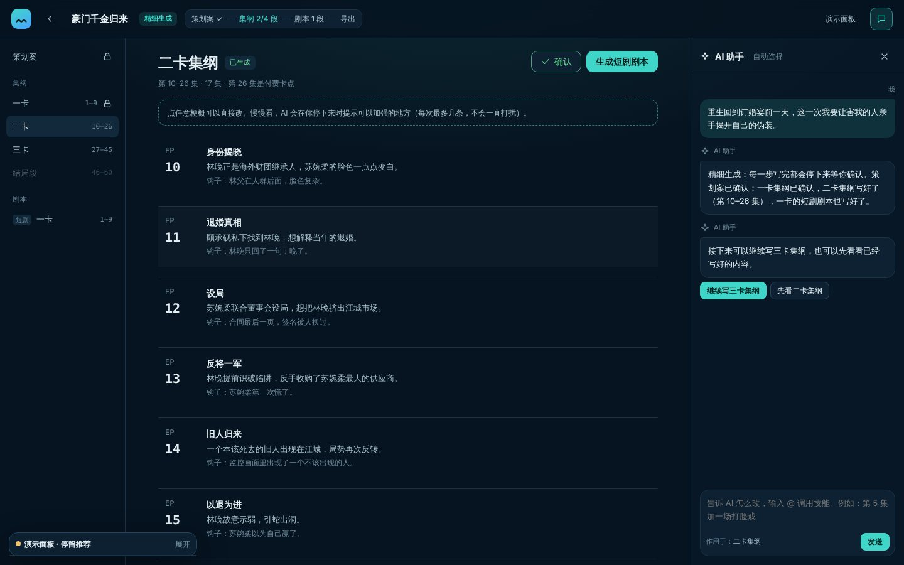

### 2.1 页面结构

| 区域 | 内容 |
|---|---|
| 顶栏 | Logo、返回、**剧名**（点击直接改）、「精细生成」标签、进度（策划案 ✓ — 集纲 2/4 段 — 剧本 1 段 — 导出）、AI 助手开关（对话图标） |
| 左：目录 | 策划案；集纲（一卡 / 二卡 / 三卡 / 结局段，带集数区间）；剧本（短剧 · 一卡）。状态：已确认 = 锁、生成中 = 转圈、等待前置 = 置灰 |
| 中：文档 | 当前页内容。标题行：页名 + 状态（已生成 / 已编辑 / 已确认）+「确认」+ 下一步主按钮（生成短剧剧本 / 续写下一段） |
| 右：AI 助手 | 消息流（每一步写完，AI 在这里给「下一步」按钮）+ **推荐卡片位**（输入框上方）+ 输入框 |

### 2.2 精细生成的节奏（与推荐的关系）

| 阶段 | 页面表现 | 推荐 |
|---|---|---|
| 某一段生成中 | 文档区显示进度（「正在写第 35 集…」），右侧注明「生成中不推荐，避免打扰」 | **静默** |
| 一段写完 | AI 助手：「三卡集纲写好了（第 27–45 集）……」+「继续写结局段」「我先看看」 | 开始检测停留 |
| 用户阅读、修改 | 可直接点梗概修改；满意后点「确认」 | 可推荐（编辑中静默） |
| 已确认（定稿） | 页面只读，标题旁「已确认」 | **不推荐**（已定稿不改） |

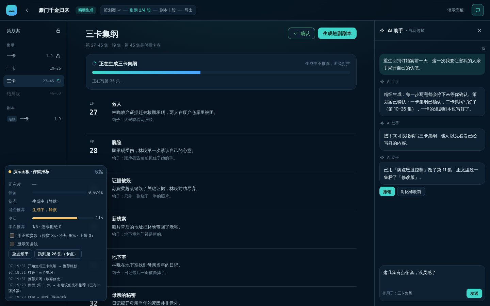

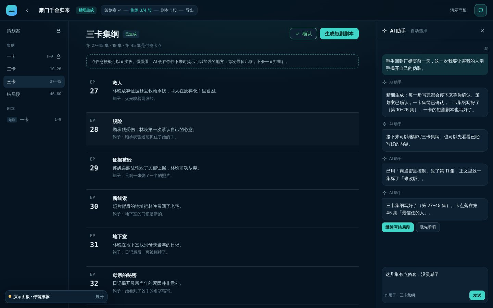

---

## 3. 停留推荐：总流程

```
采集信号 ──→ 能不能推荐？──否──→ 记录原因（冷却 / 静默 / 上限），不打扰
（停留 / 反复阅读 /     │是
 选中文字 / 打字）       ↓
                  这一集有没有可说的？──没有──→ 不推荐（不为了推荐而推荐）
                        │有
                        ↓
                  弹出推荐卡片（AI 助手）＋ 正文这一集高亮「✦ AI 建议」
                        │
          ┌─────────────┼──────────────┬──────────────┐
      不用了 / ×     先看看改成什么样      不理会 / 离开        不再提示
          │             ↓                    ↓                 │
   本次不再推荐     修改前 / 修改后预览      收起成小条          全部关闭
   这个技能          │                   （可再展开）
              ┌─────┼──────┐
          采用到正文  换一版   放弃
              ↓
     正文这一集标「修改版」＋ AI 消息「撤销 / 对比修改前」
```

---

## 4. 信号采集

### 4.1 四种触发信号

| 信号 | 定义 | 触发条件（正式参数） |
|---|---|---|
| **停留阅读**（主要） | 文档区高度 40% 处有一条看不见的「阅读线」，阅读线落在哪一集，就认为用户在读哪一集 | 同一集累计停留 **8 秒**；只在「活跃」时累计（见 4.2） |
| **反复阅读** | 用户读过某一集、离开，又回到这一集 | **60 秒内回看同一集 2 次** |
| **选中文字** | 用户在正文里用鼠标选中一段文字 | 选中 ≥ 4 个字，并停住 **1.5 秒** |
| **对话框打字** | 用户在 AI 助手输入框里打字 | 停止输入 0.8 秒后，命中关键词（见 5.2） |

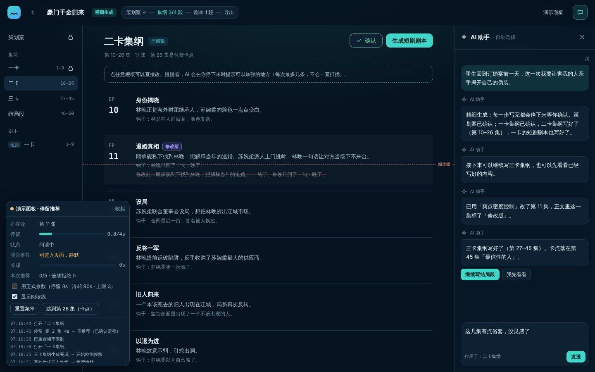

### 4.2 「活跃」判定（停留计时什么时候算、什么时候停）

| 情况 | 停留计时 |
|---|---|
| 页面在前台，最近 30 秒内有鼠标移动 / 滚动 / 键盘 / 触摸 | 累计 |
| 30 秒没有任何操作（人可能走开了） | 暂停 |
| 浏览器切到后台 | 暂停 |
| 正在编辑正文（光标在可编辑文字里） | 暂停 |
| 阅读线换到另一集 | 清零，重新计时 |
| 正在生成 | 不计时 |

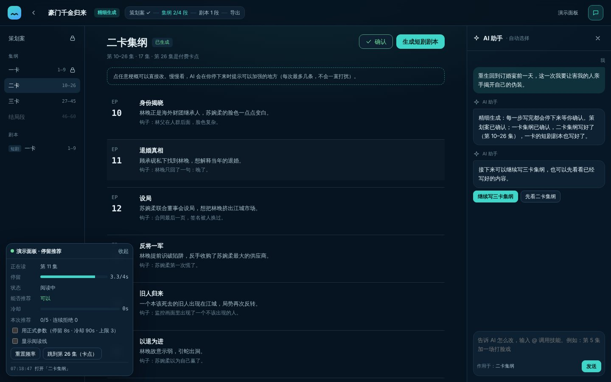

---

## 5. 内容检测：推荐什么

**原则：只有检测到具体问题才推荐；推荐必须说清楚依据。** 一次只出一张卡片。

### 5.1 检测规则（停留 / 反复阅读 / 选中文字）

| 检测项 | 适用页面 | 条件 | 推荐技能 | 卡片依据（示例） | 预览改什么 |
|---|---|---|---|---|---|
| 卡点钩子偏弱 | 集纲 | 这一集是付费卡点，且钩子强度 < 75 | 付费卡点钩子 | 第 26 集是二卡付费卡点 · 钩子强度 53/100 · 结尾「林晚挂断电话，转身走进了雨里。」悬念偏弱 | 这一集的结尾钩子 |
| 开场冲突慢 | 集纲 | 第 1 集，梗概前两句没有冲突动作 | 黄金三秒开篇 | 第 1 集开场冲突来得慢 · 开场冲突 40/100 · 冲突在第 4 句才出现 | 第 1 集梗概（冲突提前） |
| 连续没有爽点 | 集纲 | 这一集和相邻一集都没有爽点动作（打脸、拆穿、反击、曝光、揭开、摊牌、识破、倒戈……），且都不是卡点集 | 爽点密度控制 | 第 10–11 集连续两集没有爽点 · 爽点 0 个 | 这一集梗概（加一场小爽点） |
| 台词偏长 | 剧本 | 这一集有超过 24 字的台词 | 台词口语化 | 第 1 集有 3 句台词偏长 · 最长一句 47 字 | 最长那句台词 |
| 反复阅读 | 集纲 / 剧本 | 60 秒内回看同一集 2 次 | 脑洞创意 | 第 7 集你来回看了几遍，是不是觉得这里不够出彩？ | 给 3 个方向，选一个 |
| 选中台词 | 剧本 | 选中的文字在对白里 | 台词口语化 | 选中了「姐姐，我都是为了你好呀…」 | 选中的那句 |
| 选中梗概 / 动作 | 集纲 / 剧本 | 选中的文字不在对白里 | 脑洞创意 | 选中了「……」 | 选中的那段 |
| 没检测到问题 | — | 以上都不满足 | **不推荐** | — | — |

**钩子强度**（0–100，正式版由模型打分，Demo 规则）：基础 38；含强悬念要素（枪、血、死、倒下、只有、最后、竟、DNA、亲生、名字、倒计时、消失……）+34；按长度最多 +16。≥ 75 视为合格。

**多个检测项同时满足时的优先级**：选中文字 > 反复阅读 > 卡点钩子 > 开场冲突 > 连续没有爽点 > 台词偏长。

### 5.2 对话框打字关键词

| 关键词 | 推荐技能 | 卡片标题 |
|---|---|---|
| 没灵感、卡住、想不出、俗套、套路、新意 | 脑洞创意 | 检测到 · 你在对话框里提到「俗套」 |
| 拖、节奏、太慢、无聊 | 爽点密度控制 | 检测到 · 你提到「节奏」 |
| 台词、对白、口语 | 台词口语化 | 检测到 · 你提到「台词」 |
| 钩子、卡点、悬念、付费 | 付费卡点钩子 | 检测到 · 你提到「卡点」 |

打字触发的卡片作用于当前正在读的那一集；用户已经 @ 了对应技能则不推荐。

---

## 6. 推荐卡片

### 6.1 位置与关联

| 项 | 规则 |
|---|---|
| 卡片位置 | AI 助手输入框正上方，带轻微上浮动效；消息区相应变矮，不遮挡消息 |
| 正文关联 | 推荐针对的那一集：外框高亮（青色描边 + 浅底），右上角「✦ AI 建议」小标签；点小标签 = 展开卡片 |
| 目录 | 无变化（推荐只属于当前页，切换页面即关闭） |
| AI 助手收起时 | 不弹卡片；顶栏 AI 助手图标出现跳动的小红点，右上角浮出「💡 AI 有一条写作建议」；点浮条 → 打开 AI 助手并展开卡片 |

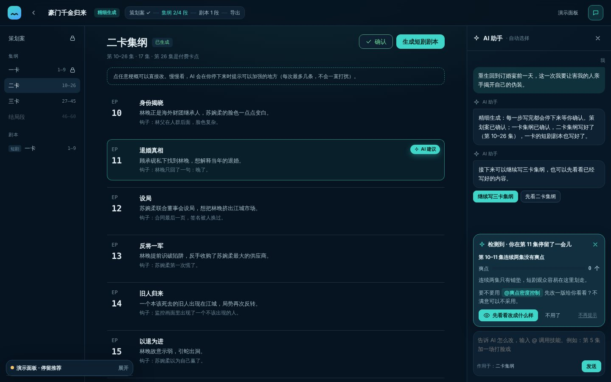

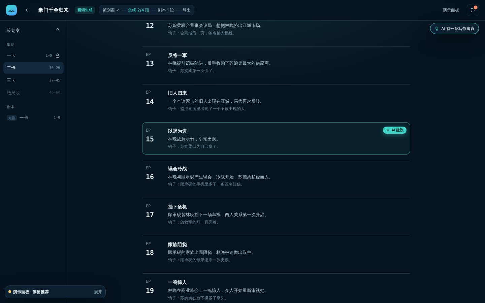

### 6.2 卡片结构

| 部分 | 内容 | 示例 |
|---|---|---|
| 标题 | 「✦ 检测到 · 」+ 触发描述；右侧 × | 检测到 · 你在第 26 集停留了一会儿 / 你来回看了第 7 集 / 你选中了一段文字 / 你在对话框里提到「俗套」 |
| 依据（结论） | 一句话，加粗 | 第 26 集是二卡付费卡点 |
| 依据（指标） | 指标名 + 进度条 + 数值（不合格琥珀色，合格绿色） | 钩子强度 ▓▓▓▓▓░░░ 53/100 |
| 说明 | 为什么是问题，引用原文 | 结尾「林晚挂断电话，转身走进了雨里。」悬念偏弱，观众不一定愿意付费看下一集。 |
| 技能 | 「要不要用 @付费卡点钩子 先改一版给你看看？不满意可以不采用。」 | 技能名为可识别的 @ 标签 |
| 按钮 | 主按钮「👁 先看看改成什么样」（脑洞创意为「给我 3 个方向」）、「不用了」、右侧小字「不再提示」 | |

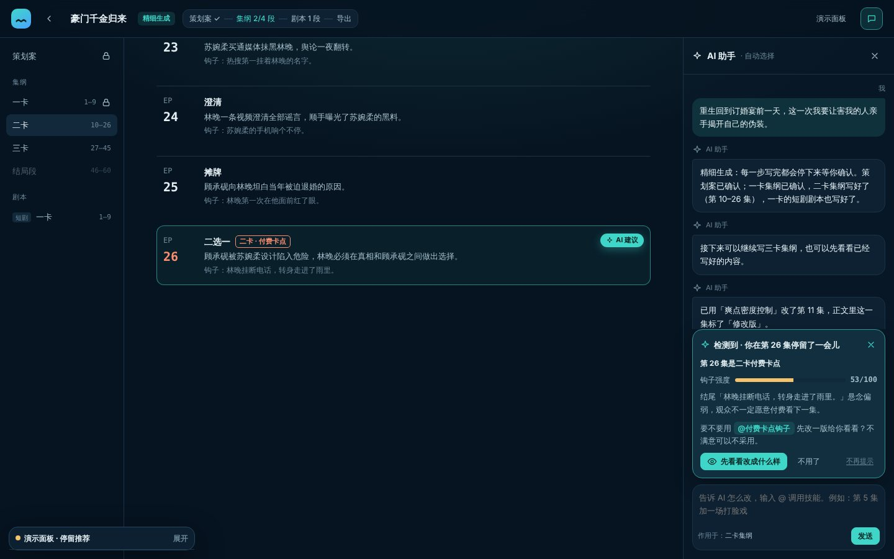

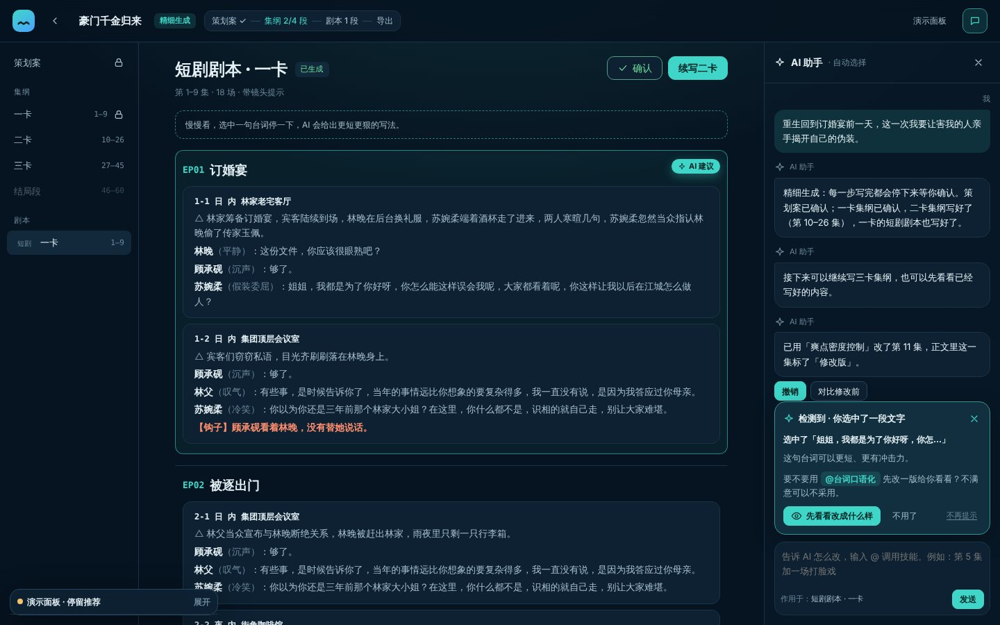

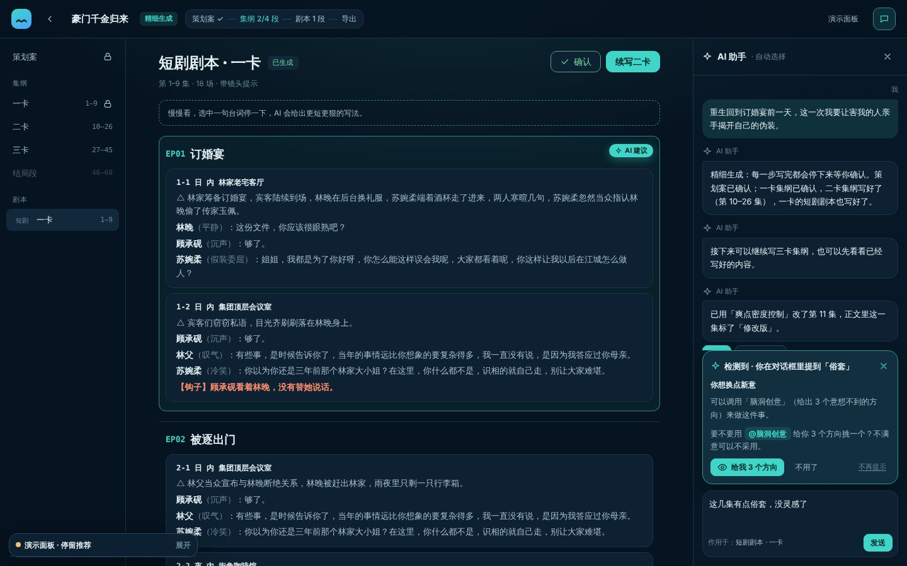

### 6.3 预览与采用

| 步骤 | 表现 |
|---|---|
| 点「先看看改成什么样」 | 卡片内显示「⟳ 正在用「付费卡点钩子」改第 26 集…」（约 1 秒） |
| 预览 | 「结尾钩子 · 修改前」（删除线）/「修改后」（紫色底）；只改检测到问题的那一处，不动其他内容 |
| 采用到正文 | 写入正文：这一集标题旁「修改版」标签、闪烁定位；页面状态变「已编辑」；卡片关闭；AI 助手消息「已用「付费卡点钩子」改了第 26 集，正文里这一集标了「修改版」。」+「撤销」「对比修改前」 |
| 换一版 | 重新生成一版修改（同一技能），仍是预览 |
| 放弃 | 关闭卡片，正文不变（不计为「拒绝」） |
| 撤销 | 这一集恢复到修改前，去掉「修改版」 |
| 对比修改前 | 这一集下方显示修改前的梗概和钩子（删除线），再点收起 |
| 脑洞创意 | 预览为 3 个方向（①②③），选中一个后「采用到正文」才可点；采用 = 把这个方向写进这一集梗概 |

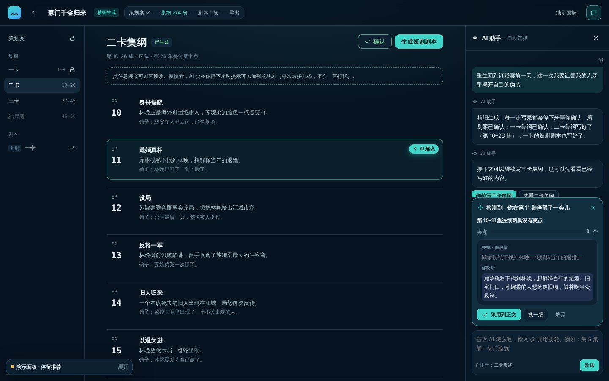

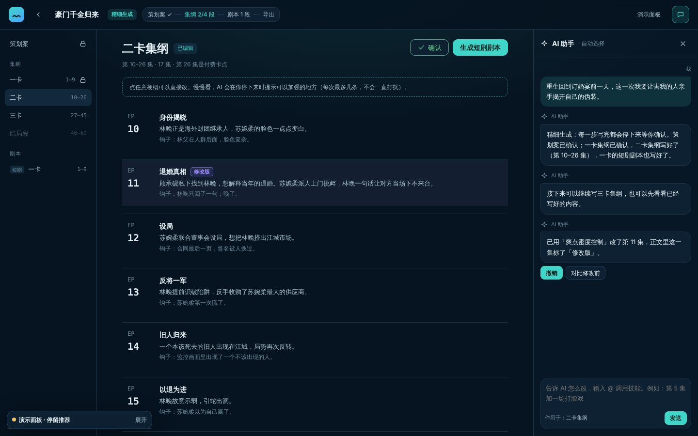

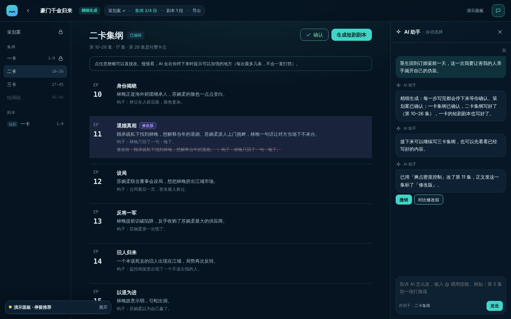

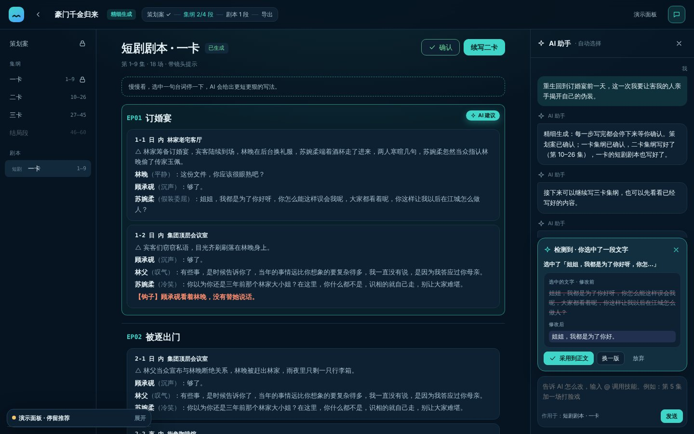

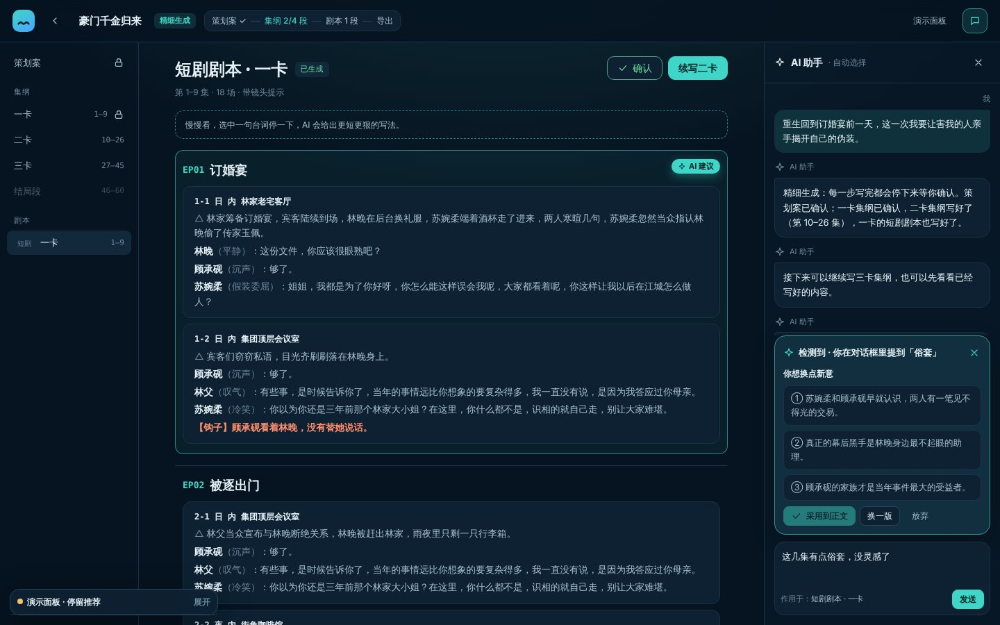


计费：「先看看」按一次 AI 修改计（2 积分 × 模型倍率），「换一版」再计一次；采用、放弃、撤销不计费。卡片上不显示积分，避免干扰；积分不足时「先看看」提示「积分不足」。

### 6.4 卡片生命周期

| 情况 | 结果 |
|---|---|
| 用户不理会卡片 **45 秒** | 收起成一条小条：「💡 第 15 集有一条建议：第 14–15 集连续两集没有爽点　展开」 |
| 阅读线离开推荐那一集 **≥ 3 集** | 同上，收起成小条 |
| 点小条 / 点正文里的「✦ AI 建议」 | 重新展开卡片，并把那一集滚到阅读线位置 |
| 切换到别的页面（目录 / 下一步按钮） | 卡片关闭（不计为拒绝） |
| 这一页被确认定稿 | 卡片关闭 |
| 开始生成（会切到正在生成的那一页） | 卡片关闭；生成中不出新卡片 |

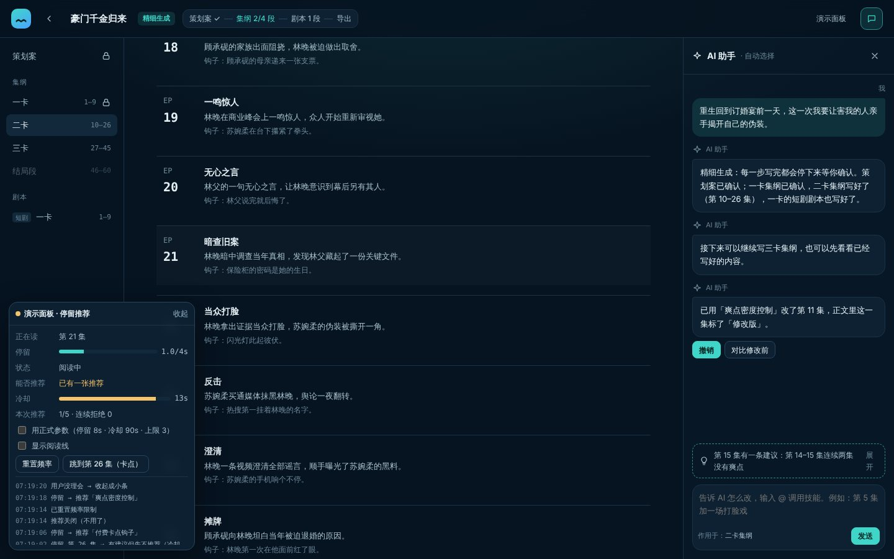

---

## 7. 频率控制（防打扰）

| 规则 | 正式参数 | Demo 演示参数 |
|---|---|---|
| 停留多久触发 | 8 秒 | 4 秒 |
| 两张卡片之间的冷却 | 90 秒 | 15 秒 |
| 每个项目每次打开最多 | 3 张 | 5 张 |
| 同一集 | 只推荐一次（展示过或检测过「没问题」就不再检测） | 同左 |
| 进入页面后的安静期 | 10 秒 | 2 秒 |
| 打字后的安静期 | 10 秒 | 5 秒 |
| 不理会多久收起 | 45 秒 | 25 秒 |
| 用户点「不用了」或 × | 这个技能本次不再推荐；连续拒绝计数 +1 | 同左 |
| 连续拒绝 2 次 | 冷却时间加倍 | 同左 |
| 连续拒绝 3 次 | 本次打开不再推荐任何卡片 | 同左 |
| 用户采用 | 连续拒绝计数清零 | 同左 |
| 勾「不再提示」 | 永久关闭（账号级设置，可在设置里重新打开）；Toast「之后不再主动推荐，需要时在 AI 助手里输入 @ 调用技能」 | 同左 |
| 被冷却 / 上限挡住时 | 不把这一集记为「推荐过」；冷却结束后用户还停在这一集，会再推荐 | 同左 |

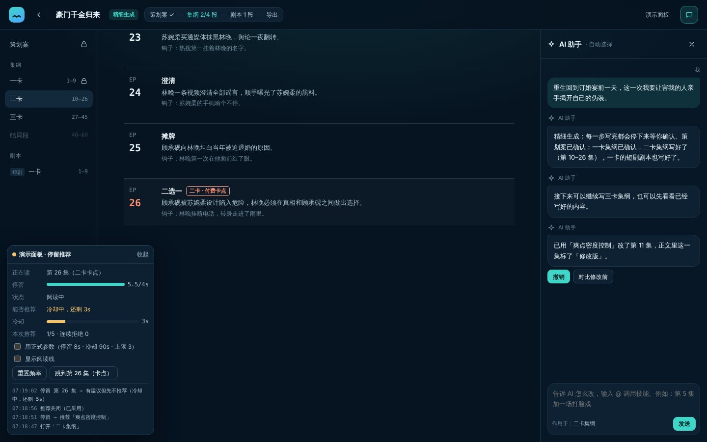

## 8. 静默条件（这些时候绝不弹）

| 条件 | 说明 |
|---|---|
| 正在生成 | 任何一段在生成中 |
| 正在编辑正文 | 光标在可编辑文字里 |
| 刚进入页面 | 安静期内 |
| 刚在对话框打字 | 安静期内（打字触发本身除外） |
| 页面已确认定稿 | 只读页面不推荐修改 |
| 已经有一张卡片 | 展开或收起成小条都算 |
| 页面在后台 / 用户离开 | 停留不计时 |
| 用户关闭了推荐 | 「不再提示」或连续拒绝 3 次 |

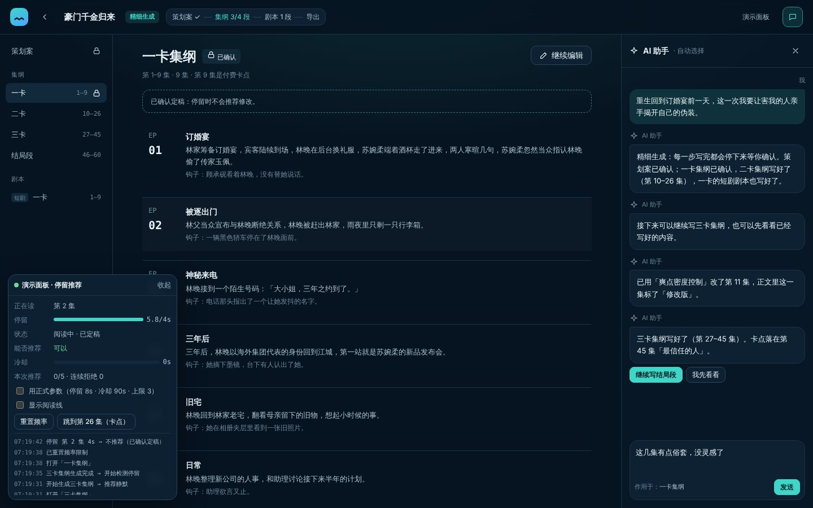

---

## 9. 推荐卡片状态机

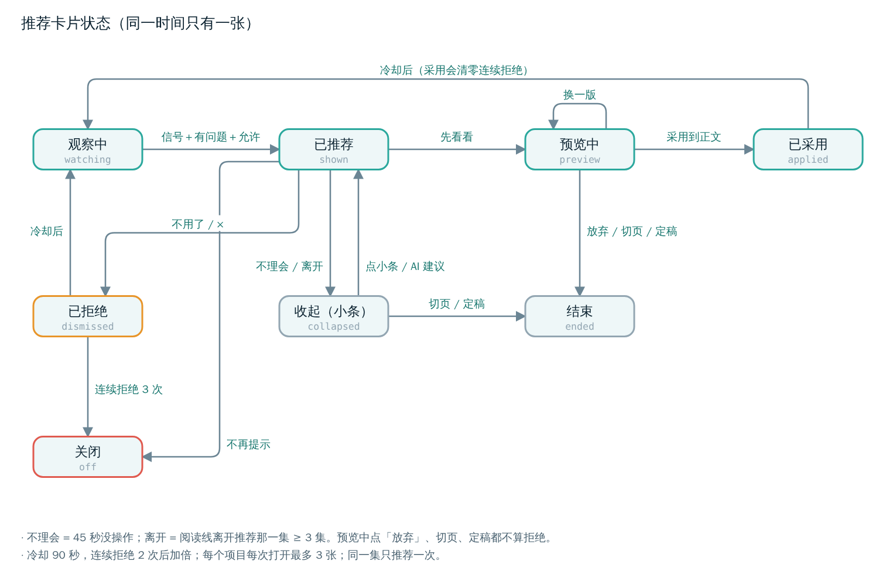

| 状态 | 表现 | 进入 | 退出 |
|---|---|---|---|
| 观察中 | 无 | 页面打开、上一张卡片结束 | 信号满足且检测到问题且频率允许 → 已推荐 |
| 已推荐 | 卡片展开 + 正文高亮 | 触发 | 先看看 → 预览中；不用了 → 已拒绝；不理会 45s / 离开 ≥ 3 集 → 收起；切页 / 定稿 → 结束；不再提示 → 关闭 |
| 收起 | 小条 | 不理会、离开 | 点小条 / 点「✦ AI 建议」→ 已推荐；切页 → 结束 |
| 预览中 | 修改前 / 后（或 3 个方向） | 先看看、换一版 | 采用 → 已采用；换一版 → 预览中；放弃 → 结束 |
| 已采用 | 正文修改版 + AI 消息 | 采用到正文 | 撤销 → 正文还原；进入冷却 → 观察中 |
| 已拒绝 | 卡片消失 | 不用了 / × | 进入冷却（连续拒绝 2 次加倍）→ 观察中；连续 3 次 → 关闭 |
| 关闭 | 不再推荐 | 不再提示、连续拒绝 3 次 | 重新打开项目（连续拒绝的情况）/ 设置里打开（不再提示的情况） |

---

## 10. 文案

| 场景 | 文案 |
|---|---|
| 标题 · 停留 | 检测到 · 你在第 {N} 集停留了一会儿 |
| 标题 · 反复阅读 | 检测到 · 你来回看了第 {N} 集 |
| 标题 · 选中 | 检测到 · 你选中了一段文字 |
| 标题 · 打字 | 检测到 · 你在对话框里提到「{词}」 |
| 提问 | 要不要用 @{技能} 先改一版给你看看？不满意可以不采用。 |
| 提问 · 脑洞创意 | 要不要用 @脑洞创意 给你 3 个方向挑一个？不满意可以不采用。 |
| 主按钮 | 先看看改成什么样 / 给我 3 个方向 |
| 加载 | 正在用「{技能}」改第 {N} 集… |
| 预览按钮 | 采用到正文 / 换一版 / 放弃 |
| 采用后 | 已用「{技能}」改了第 {N} 集，正文里这一集标了「修改版」。 |
| 小条 | 第 {N} 集有一条建议：{依据} |
| 浮条 | AI 有一条写作建议 |
| 不再提示 | 之后不再主动推荐，需要时在 AI 助手里输入 @ 调用技能 |
| 页面提示条 | 慢慢看，AI 会在你停下来时提示可以加强的地方（每次最多几条，不会一直打扰）。 |

文案规范：说「检测到」要有具体依据（集数、指标、原文引用）；不用「建议你」「你应该」；按钮写动作结果（「先看看改成什么样」），不写「确定」。

---

## 11. 埋点与指标

| 事件 | 触发 | 关键属性 |
|---|---|---|
| tip_signal | 任一信号满足 | signal（dwell / reread / select / typing）、page、ep |
| tip_blocked | 有建议但没弹 | reason（cooldown / limit / quiet / editing / generating / locked / muted） |
| tip_no_issue | 停留满足但没检测到问题 | page、ep |
| tip_show | 卡片展示 | skill、signal、ep、metric、asst_open |
| tip_preview / tip_regen | 先看看 / 换一版 | skill、latency |
| tip_apply | 采用到正文 | skill、ep、time_to_apply |
| tip_discard | 预览后放弃 | skill |
| tip_dismiss | 不用了 / × | skill、seconds_shown、dismiss_streak |
| tip_collapse / tip_expand | 收起 / 再展开 | reason（idle / away） |
| tip_off | 不再提示 | shown_count |
| tip_undo | 采用后撤销 | skill、seconds_after_apply |

核心指标：预览率 = preview / show；采用率 = apply / show；净采用率 = (apply − undo) / show；打扰率 = 5 秒内 dismiss / show；关闭率 = off / 打开项目数；各技能、各检测项的采用率（用于调整阈值和下线低效检测项）。

---

## 12. 异常与边界

| 场景 | 处理 |
|---|---|
| 预览生成失败 | 卡片内「没改好，可以再试一次」+「重试」；不扣积分 |
| 积分不足 | 「先看看」按钮置灰，提示「积分不足」 |
| 预览期间用户手动改了这一集 | 「采用到正文」前比对，内容变了则提示「这一集刚被你改过，要基于新内容重新生成吗？」 |
| 采用时页面已被确认 | 不写入，提示先「继续编辑」 |
| 同一集多次采用 | 「修改版」保留第一次修改前的内容作为对比基准 |
| 很短的页面（不足一屏） | 阅读线可能落在空白处：按最接近阅读线的一集计算 |
| 手机端 | 阅读线在屏幕 40% 处；卡片在 AI 助手全屏面板里；收起时顶栏红点 |

---

## 13. 验收标准

1. 在可编辑的集纲页停在第 26 集（卡点）8 秒，出现「第 26 集是二卡付费卡点 · 钩子强度 xx/100」卡片，正文第 26 集高亮。
2. 在没有问题的集上停留，不出现卡片。
3. 卡片出现后 90 秒内，停在另一个有问题的集，不出现新卡片；90 秒后若仍停在那一集，出现卡片。
4. 「先看看」显示修改前 / 后；「采用」后正文对应位置被修改并标「修改版」，「撤销」可还原。
5. 「不用了」后，同一技能本次不再推荐；连续拒绝 3 次后本次不再推荐任何卡片。
6. 生成中、编辑中、已确认页面不出现卡片。
7. AI 助手收起时，触发后顶栏图标出现红点和「AI 有一条写作建议」浮条，点击后展开卡片。
8. 卡片 45 秒无操作或阅读线离开 ≥ 3 集，收起成小条；点小条展开并滚回那一集。
9. 选中台词 ≥ 4 字停 1.5 秒，出现「台词口语化」卡片，预览只改选中的那句。
10. 勾「不再提示」后，重新打开项目也不再出现卡片。

---

## 附录：Demo 使用说明（`demo/fine.html`）

- 双击打开，默认在「二卡集纲」（可编辑）。慢慢滚动正文，停在某一集即可看到推荐。
- 左下角「演示面板」（顶栏「演示面板」可开关）实时显示：正在读哪一集、停留计时、当前状态（阅读中 / 离开 / 编辑中 / 生成中）、能否推荐及原因、冷却剩余、本次已推荐次数、连续拒绝次数，以及信号日志。
- 默认是**演示参数**（停留 4 秒、冷却 15 秒），勾「用正式参数」切到 PRD 的正式值。
- 「重置频率」清空冷却和计数；「跳到第 26 集（卡点）」快速看卡点钩子推荐；「显示阅读线」显示阅读线位置。
- 其他可试：「短剧剧本 · 一卡」里选中一句长台词；在 AI 助手里输入「这几集有点俗套」；点「三卡」生成三卡集纲看生成中静默；在「一卡」（已确认）停留看不推荐；点 AI 助手 × 收起后看红点。
- Demo 里的检测和改写是规则模拟，正式版由模型完成，交互和频率规则不变。


