# 澜幕 · 首页上传与技能栏 / 剧本医生（可视化）PRD

| 项目 | 内容 |
|---|---|
| 文档版本 | v1.0（评审稿） |
| 更新日期 | 2026-10-16 |
| 范围 | ① 首页：上传小说**或剧本**（自动识别）＋ 技能选项栏（@ 添加技能）；② 生成页：剧本医生入口放到右上角，报告改为可视化 |
| 对应 Demo | `demo/home.html`（首页）、`demo/doctor.html`（生成页 · 剧本医生），都可双击打开 |
| 关联文档 | 全站 PRD `docs/PRD.md`。本文档与之冲突时以本文档为准：首页上传框（全站 3.4）、剧本医生（全站第 8 章）按本文档实现 |

---

## 1. 首页：上传小说或剧本

### 1.1 上传框

| 项 | 规则 |
|---|---|
| 位置 | 输入框左侧，大号虚线框（200×156） |
| 文案 | 「＋ 上传小说 / 剧本」「拖进来，或点击选择文件」「格式要求」（悬停看说明） |
| 格式要求 | 支持 .txt / .md / .docx，单文件不超过 20MB；上传后自动识别是小说还是剧本（有「第 N 章」→ 小说；有「第 N 集」或「人名：台词」→ 剧本），识别错了可以手动切换；上传即表示拥有改编权 |
| 拖拽 | 文件拖到框上，框变为青色描边 + 浅底，松手即上传 |
| 点击 | 弹出菜单：上传文件 / 粘贴文本 / 示例小说《重生之千金归来》/ 示例剧本《心动合租屋》 |
| 两个创作类型 | 「短剧剧本」「互动影游」下都可以上传小说或剧本（不再区分「上传小说」「上传剧本」两种框） |
| 超限 | 超过 20MB：Toast「文件超过 20MB」 |

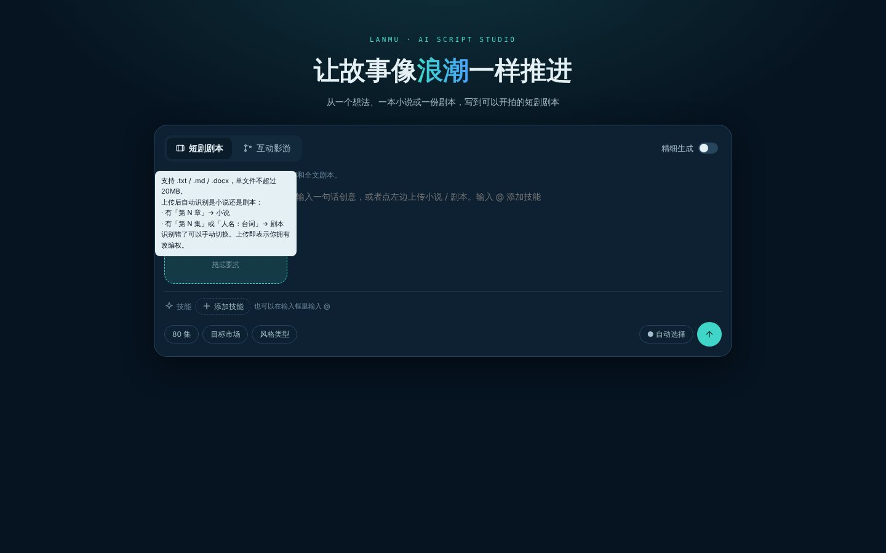

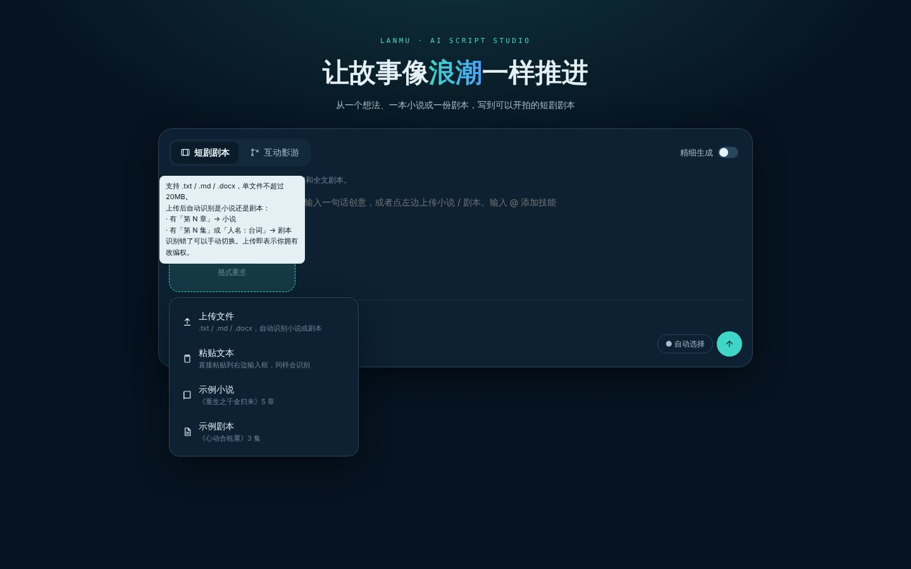

### 1.2 自动识别

| 识别为 | 条件（任一） | 识别说明（显示在文件卡片上） |
|---|---|---|
| 剧本 | 「第 N 集」标题 ≥ 2 个；或「人名：（动作）台词」格式的对白 ≥ 3 句 | 检测到 3 个「第 N 集」标题和 3 句对白，识别为剧本 |
| 小说 | 其他情况 | 按「第 N 章」识别出 5 章，识别为小说 |

- 识别结果用文件卡片上的「小说 | 剧本」切换按钮显示，**点另一个即可手动更正**，说明变为「已手动切换为剧本」。
- 粘贴超过 200 字的文本到输入框，也会按同样规则识别并变成文件卡片（名为「粘贴的小说 / 粘贴的剧本」）。
- 识别后 Toast「已识别为剧本，识别错了可以手动切换」。

### 1.3 文件卡片

| 字段 | 内容 |
|---|---|
| 图标 | 小说 = 书（青色），剧本 = 文档（紫色） |
| 名称 | 文件名（去掉扩展名） |
| 识别切换 | 小说 / 剧本 |
| 统计 | 字数（≥1 万显示「1.2 万字」）· 章数或集数 · 主要人物（最多 4 个） |
| 识别说明 | 见 1.2 |
| 移除 | 右侧 × |

### 1.4 用途

文件卡片下方一行「用来」，单选，决定后面的流程：

| 来源 | 用途（第一个为默认） | 说明文案 | 流程 |
|---|---|---|---|
| 小说 | 改编成短剧剧本 | 小说改编：先解析章节、人物和主线，再写策划案、集纲和剧本。 | 小说解析 → 策划案 → 集纲 → 剧本 |
| 小说 | 改编成互动影游 | 解析小说后写成带选项和多结局的互动剧本。 | 小说解析 → … → 互动影游剧本 |
| 剧本 | 精修成短剧节奏 | 剧本精修：保留剧情，按短剧节奏重写分场、台词和钩子。 | 剧本解析 → 逐集精修 |
| 剧本 | 续写后面的集 | 读懂已有剧情和人物，接着写后面的集。 | 剧本解析 → 续写集纲 → 续写剧本 |
| 剧本 | 转互动影游 | 解析分集后加入选项、数值和多结局。 | 剧本解析 → 互动影游剧本 |
| 剧本 | 先让剧本医生体检 | 先给这份剧本打分、标出问题，再决定怎么改。 | 剧本解析 → 剧本医生报告（见第 3 章） |

- 在「互动影游」类型下上传小说，默认用途为「改编成互动影游」。
- 上传剧本时，参数栏的集数显示「N 集（按剧本）」，不可改。
- 手动切换小说 / 剧本后，用途重置为该类型的默认用途。

### 1.5 输入框

| 状态 | 占位文案 |
|---|---|
| 未上传 | 输入一句话创意，或者点左边上传小说 / 剧本。输入 @ 添加技能 |
| 已上传小说 | 补充改编要求（选填）：比如「保留退婚和重逢两场名场面，男主戏份加重」。输入 @ 添加技能 |
| 已上传剧本 | 补充要求（选填）：比如「节奏再快一点，第 3 集加强卡点」。输入 @ 添加技能 |

发送条件：已上传文件，或创意 ≥ 15 字。

### 1.6 发送前确认

点发送弹出「准备开始」：来源（小说 / 剧本《名称》· 字数）、用途、技能（已添加的 @ 标签，未添加时提示「可以生成后再 @」）、生成方式（一句话 / 精细）、流程（按 1.4）。按钮「返回修改」「开始」。

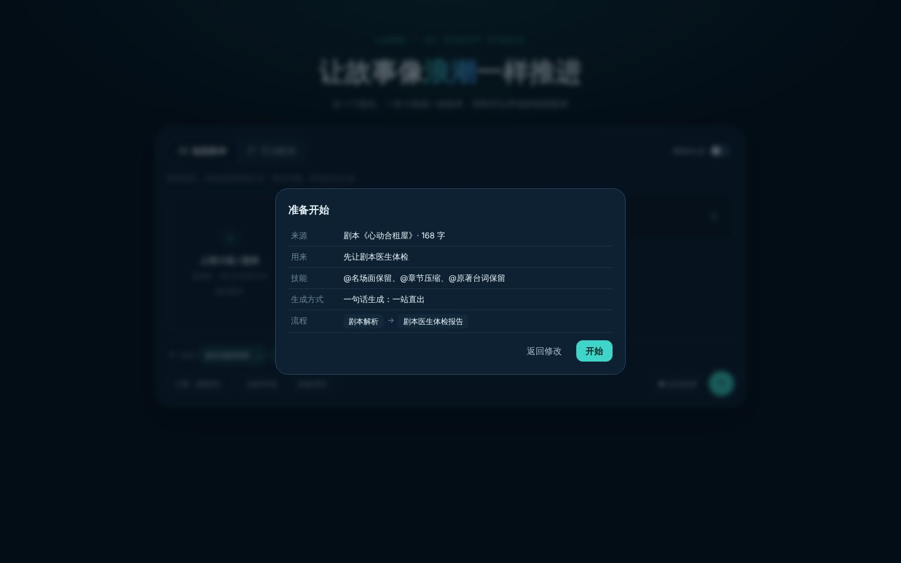

---

## 2. 首页：技能选项栏

### 2.1 位置与组成

在输入区下方、参数栏上方，一整行：

| 元素 | 规则 |
|---|---|
| 标签 | 「✦ 技能」 |
| 已选技能 | 「@技能名 ×」标签，悬停显示技能说明；点 × 移除 |
| 添加技能 | 虚线按钮「＋ 添加技能」，打开技能面板 |
| 提示 | 「已选 2/5 · 也可以在输入框里输入 @」 |
| 上限 | 一次最多 5 个，超出 Toast「一次最多 5 个技能」 |
| 作用 | 生成全程（策划案、集纲、剧本）和之后的修改都按这些技能来写；进入工作台后挂到项目上，AI 助手里也能继续 @ |

不做「推荐技能」（与全站 v1.2 一致），只在用户主动添加时出现。

### 2.2 技能面板

| 元素 | 规则 |
|---|---|
| 搜索 | 按技能名和说明过滤，如「台词」「卡点」 |
| 分类 | 全部 / 改编（本期新增，带「新」）/ 结构节奏 / 台词 / 人物 / 创意 / 本土化 / 我的 |
| 技能卡 | 两列：@技能名、分类、一句说明；已选的高亮并显示「✓ 已选」，再点取消 |
| 底部 | 「已选 2/5 · 生成和修改时都会按这些技能来写」「上传我的 Skill」「完成」 |
| 关闭 | 完成、×、点面板外 |

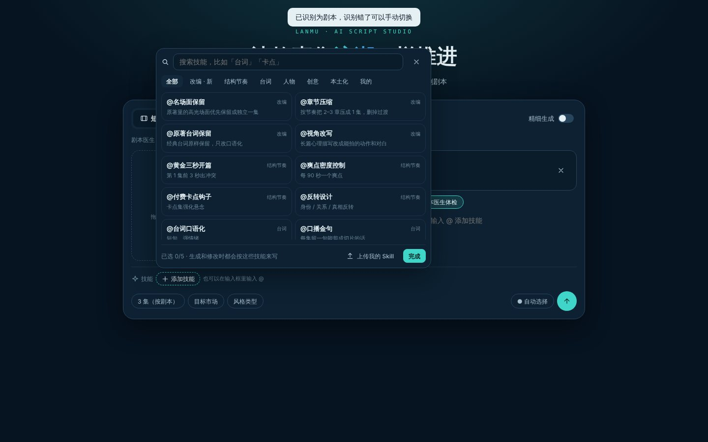

### 2.3 @ 添加

| 项 | 规则 |
|---|---|
| 触发 | 输入框里输入 @（行首或空格后） |
| 列表 | 输入框下方弹出，最多 8 条：@技能名 + 说明，已选的打 ✓；@ 后继续输入即过滤（匹配名称和分类） |
| 选择 | 点击，或 ↑↓ + Enter / Tab；Esc 关闭 |
| 结果 | 输入框里的「@xx」文字被移除，技能加到技能栏；用户写的其他文字保留 |

### 2.4 技能清单（首页可选）

| 分类 | 技能 | 说明 |
|---|---|---|
| 改编（新增） | 名场面保留 | 原著里的高光场面优先保留成独立一集 |
| 改编（新增） | 章节压缩 | 按节奏把 2–3 章压成 1 集，删掉过渡 |
| 改编（新增） | 原著台词保留 | 经典台词原样保留，只改口语化 |
| 改编（新增） | 视角改写 | 长篇心理描写改成能拍的动作和对白 |
| 结构节奏 | 黄金三秒开篇、爽点密度控制、付费卡点钩子、反转设计 | 同全站 |
| 台词 | 台词口语化、口播金句 | 口播金句：每集留一句能剪成切片的话 |
| 人物 | 人物弧光、反派立体化 | 反派立体化：给反派一个说得通的动机 |
| 创意 | 脑洞创意、互动分支设计 | 同全站 |
| 本土化 | 海外本土化 | 同全站 |
| 我的 | 用户上传的 Skill | 素材库里状态为「可用」的 |

---

## 3. 剧本医生（生成页，可视化）

### 3.1 入口：右上角

| 项 | 规则 |
|---|---|
| 位置 | 生成页顶栏右侧、AI 助手图标左边，固定可见 |
| 样式 | 青色描边按钮「🩺 剧本医生」+ 右侧分数徽标 |
| 徽标状态 | 未体检：「未体检」；已体检：状态圆点 + 分数（如「● 75」，圆点颜色 = 评级）；体检后正文被改过：「75 · 已改动」（琥珀色） |
| 打开 | 右侧栏切换为剧本医生，并加宽到 560px（文档仍可见，便于对照）；按钮变为实心高亮 |
| 关闭 | 再点按钮，或剧本医生栏右上角 ×，回到 AI 助手 |
| 第一次打开 | 自动开始体检（体检免费，不改动剧本） |
| 其他入口 | 保留：AI 助手里提示「点右上角剧本医生」；每页「⋯」菜单「剧本医生体检」 |

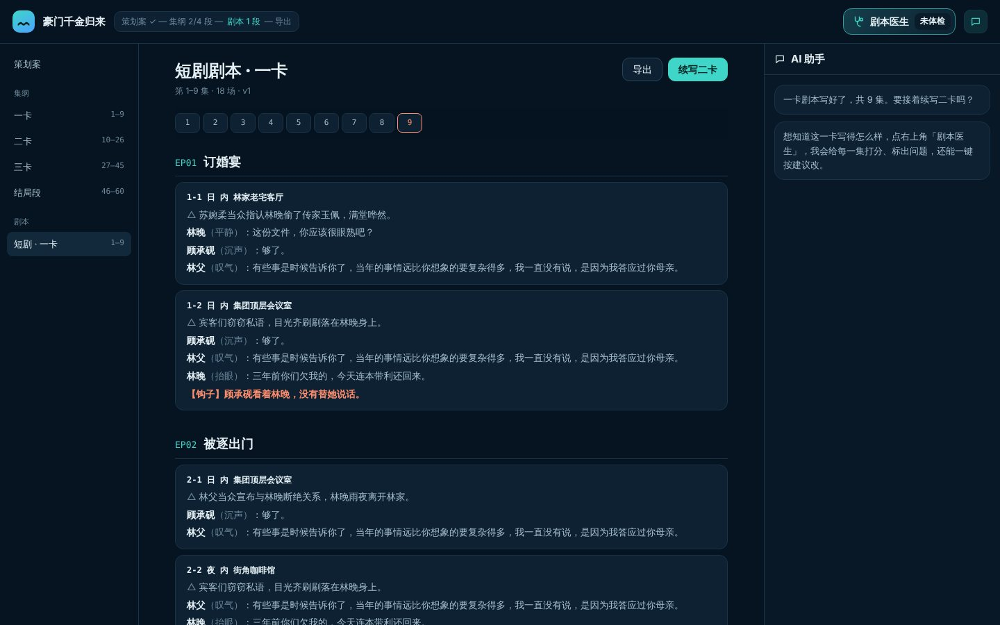

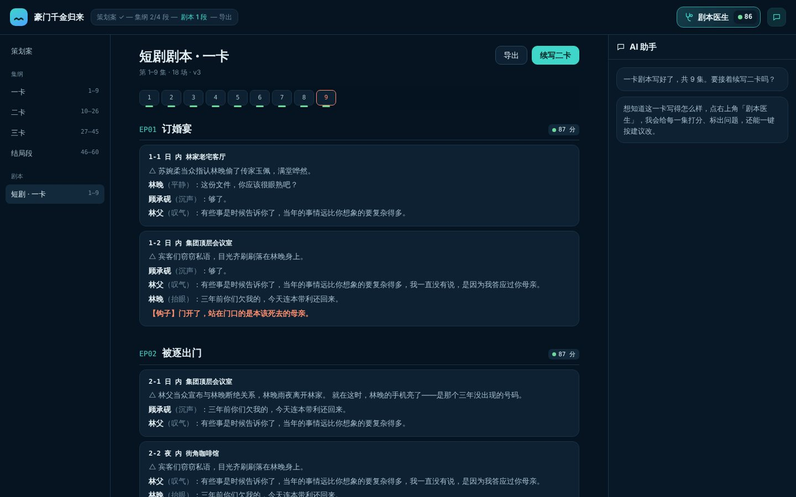

### 3.2 体检范围与过程

- 栏顶「体检范围」：当前页（默认）/ 全部集纲 / 策划案。切换后重新体检。（Demo 只演示当前页。）
- 体检过程：中间是脉动的剧本医生图标、「正在体检第 3 / 9 集 · 结尾钩子 · 神秘来电」、进度条、「体检免费 · 约 5 秒 · 体检不会改动你的剧本」；**正文同步滚动到正在检查的那一集并高亮**，让用户看到「它在逐集看」。
- 完成后 Toast「体检完成：75 分」，进入「总览」。

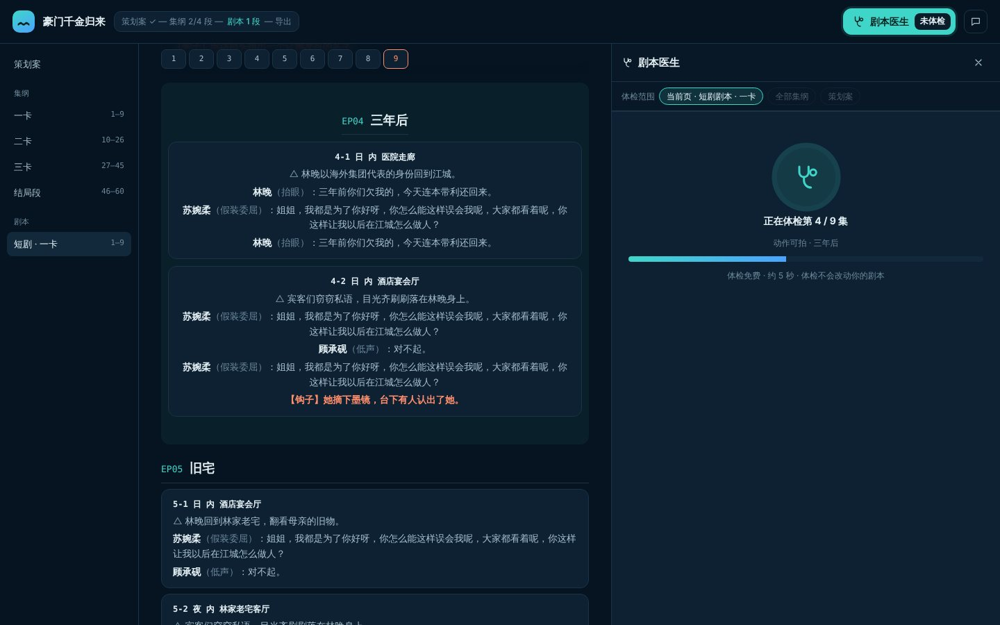

### 3.3 报告结构

栏内三个标签：**总览 / 逐集 / 问题 · N**，右侧开关「在正文标出问题」（默认开）。底部操作条随标签变化。

#### 总览

| 区块 | 内容 | 可视化规则 |
|---|---|---|
| 总分 | 环形分数（0–100）+ 评级（✓ 良好 / ! 及格 / ✕ 待加强，带符号）+ 和上次的变化（↑ 11（上次 75）） | 环的颜色 = 评级状态色 |
| 一句话结论 | 检查了 9 集 × 6 项。最弱的是「台词口语化」（62 分），最弱的一集是第 4 集（68 分）。x 处待加强 · y 处一般 · 分数只做参考 | — |
| 各项得分 | 6 个维度横向条形 + 分数 + 状态标签 | 单一颜色（一个系列只用一个颜色）；状态只用标签表达；悬停显示维度说明 |
| 逐集得分曲线 | 每集总分折线；虚线「合格 70」；卡点集竖虚线标「一卡」 | 单一 y 轴 40–100；悬停十字线 + 提示「第 3 集「神秘来电」82 分」；点任一点跳到那一集 |

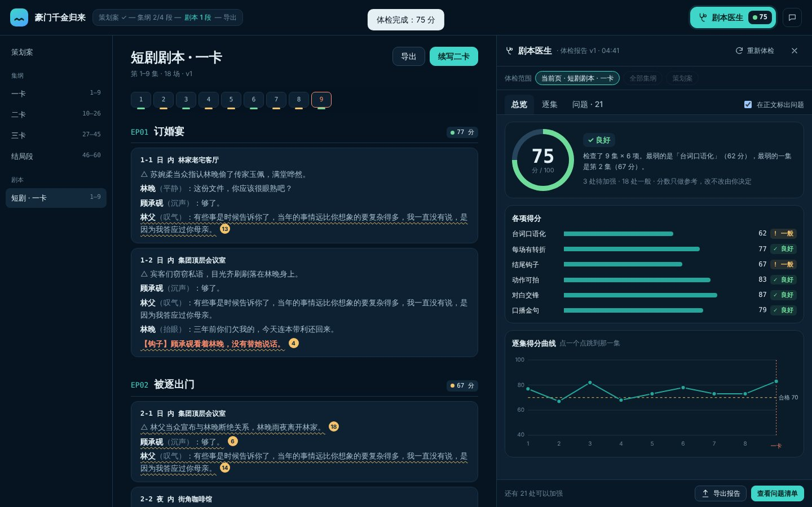

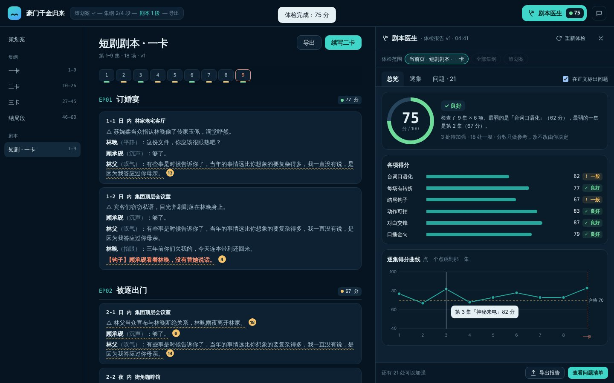

#### 逐集

| 区块 | 内容 | 交互 |
|---|---|---|
| 热力图 | 行 = 6 个维度，列 = 每一集（卡点集列头标「卡」）；格子写分数，颜色 = 状态（良好 / 一般 / 待加强）；最后一行是每集总分 | 悬停提示「第 4 集 · 台词口语化：46 分（待加强）」；点格子 → 打开对应问题并在正文定位；该格没问题时 Toast「第 N 集这一项没有问题」 |
| 图例 | ✓ 良好 ≥75 · ! 一般 60–74 · ✕ 待加强 <60 | 颜色 + 符号 + 文字，不只靠颜色 |
| 每集结论 | EP01 订婚宴 · 最弱：结尾钩子 60 ……　77 ✓ 良好 | 点一行跳到那一集 |

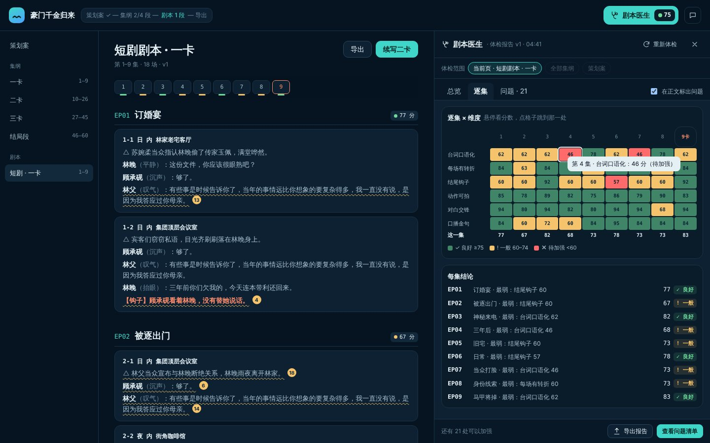

#### 问题

| 项 | 规则 |
|---|---|
| 分组 | ✕ 待加强（<60）、! 一般（60–74），组内按分数从低到高；每条有编号，和正文里的标注编号一致 |
| 条目 | 勾选框、编号、维度 · 分数 · 状态、位置（第 4 集 · 4-1）、原文摘录、问题、建议 |
| 默认勾选 | 低于 70 分的 |
| 定位 | 正文滚到那一行（阅读线附近）并高亮；条目高亮 |
| 按建议改 | 条目内显示修改前（删除线）/ 修改后；「采用」写入正文、条目标「✓ 已改」；「放弃」收起 |
| 批量 | 底部「按勾选的意见改（约 4 积分）」：一次改完所有勾选项，然后自动重新体检 |
| 导出报告 | 复制文本报告（正式版导出 PDF） |

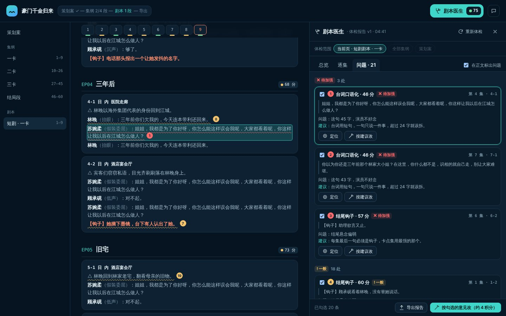

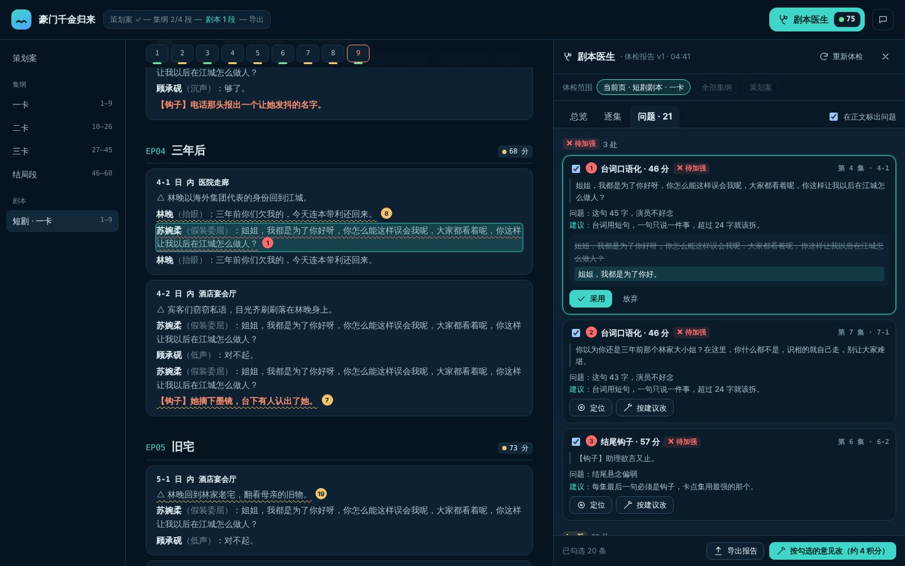

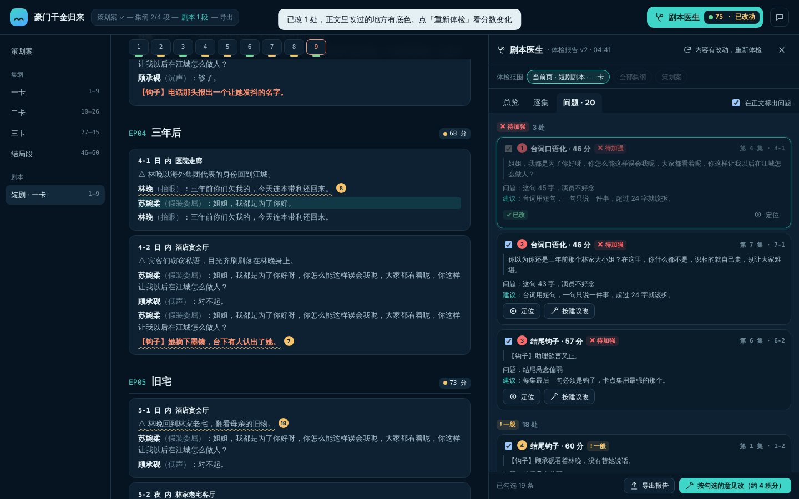

### 3.4 正文标注（与报告联动）

| 标注 | 规则 |
|---|---|
| 问题行 | 波浪下划线（待加强红 / 一般琥珀）+ 末尾编号圆点；悬停显示「维度：问题」；点击 → 打开该问题 |
| 每集分数 | 集标题右侧「● 77 分」 |
| 集数跳转条 | 每个集号下方一条短色条 = 这一集的评级 |
| 已改的行 | 浅青底色 |
| 开关 | 报告栏「在正文标出问题」，关掉后正文恢复干净 |

### 3.5 重新体检与前后对比

- 正文有改动（采用建议、手动编辑、AI 修改）后，右上角徽标显示「· 已改动」，报告栏按钮变为「内容有改动，重新体检」。
- 重新体检后，「各项得分」和「逐集得分曲线」同时显示**修改前 / 修改后**两个系列（带图例和末端标签），总分显示变化（↑ 11）。

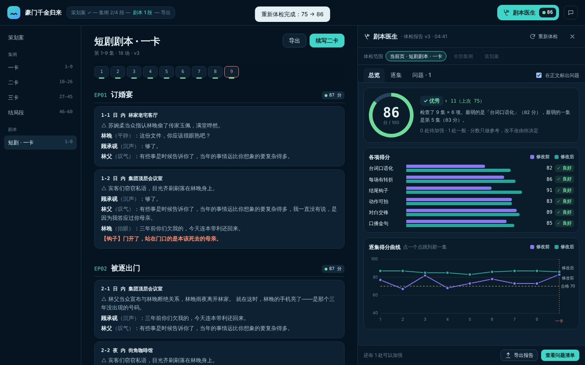

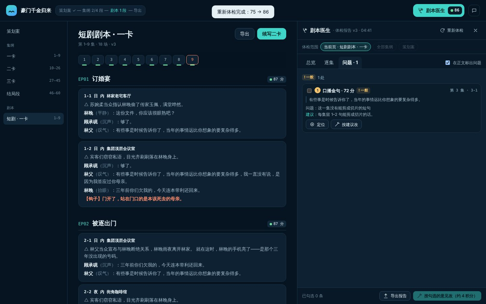

### 3.6 维度与评分（短剧剧本页）

| 维度 | 权重 | 标准 |
|---|---|---|
| 台词口语化 | 1.2 | 台词用短句，一句只说一件事，超过 24 字就该拆 |
| 每场有转折 | 1.0 | 每场戏至少一个情绪或信息反转 |
| 结尾钩子 | 1.1 | 每集最后一句必须是钩子，卡点集用最强的那个 |
| 动作可拍 | 0.9 | 动作只写镜头拍得到的 |
| 对白交锋 | 1.0 | 冲突戏要有来有回 |
| 口播金句 | 0.8 | 每集留 1–2 句能剪成切片的话 |

每集每个维度 0–100 分；每集总分、全页总分 = 各维度加权平均。状态：≥75 良好、60–74 一般、<60 待加强（策划案、集纲页的维度沿用全站 PRD 8.3）。分数只做参考，**不按分数弹窗或催促重写**（与全站 v1.0 的调整一致）。

### 3.7 可视化规范

- 一个系列只用一个颜色；修改前 / 修改后两种颜色（紫 / 青）已通过色盲安全校验，并始终配图例和末端文字标签。
- 状态色（良好 / 一般 / 待加强）只用来表示状态，且总是带符号（✓ ! ✕）和文字，不单靠颜色。
- 只用一个 y 轴；网格和坐标轴弱化；每个图都有悬停提示；点击图上的元素都能跳到正文对应位置。
- 曲线和热力图在深色、浅色主题分别取色（正式版按主题适配）。

### 3.8 状态

| 状态 | 右上角徽标 | 报告栏 |
|---|---|---|
| 未体检 | 未体检 | 「开始体检（免费）」 |
| 体检中 | 未体检 / 旧分数 | 进度 + 正文逐集高亮 |
| 已体检 | ● 分数 | 总览 / 逐集 / 问题 |
| 已改动 | 分数 · 已改动 | 「内容有改动，重新体检」 |
| 重新体检后 | ● 新分数 | 显示修改前 / 修改后对比 |

### 3.9 埋点

doctor_open（入口：topbar / menu / assistant）、doctor_check（范围、耗时、总分）、doctor_tab、doctor_chart_click（曲线点 / 热力格）、doctor_locate、doctor_preview、doctor_apply、doctor_bulk（条数）、doctor_recheck（分数变化）、doctor_export、doctor_mark_toggle。核心指标：体检后 24 小时内有采用的比例、重新体检的分数提升、右上角入口的点击率（对比旧入口）。

### 3.10 验收标准

1. 生成页右上角始终可见「剧本医生」，未体检显示「未体检」，体检后显示带状态色的分数。
2. 点击后右侧栏加宽为剧本医生，自动体检；体检中正文逐集高亮。
3. 总览显示总分、6 维度条形、逐集曲线；曲线悬停有十字线和提示，点击跳到对应集。
4. 热力图格子有分数和符号图例，点击定位到正文对应行。
5. 问题条目可定位、可预览修改、可采用；采用后正文有底色、徽标显示「已改动」。
6. 批量改后自动重新体检，图表显示修改前 / 修改后两个系列。
7. 关闭「在正文标出问题」后，正文没有任何标注。

---

## 附录：Demo 使用说明

**`demo/home.html`（首页）**
- 点上传框 → 示例小说 / 示例剧本，或把 .txt / .md 文件拖进上传框；在文件卡片上点「小说 | 剧本」可手动切换。
- 点「＋ 添加技能」打开技能面板；或在输入框输入「@台」等，用 ↑↓ + Enter 选择。
- 点发送看「准备开始」确认。

**`demo/doctor.html`（生成页 · 剧本医生）**
- 点右上角「剧本医生」开始体检；在「总览 / 逐集 / 问题」间切换；悬停曲线和热力图看提示，点击定位。
- 在「问题」里点「按建议改」→「采用」，或直接点底部「按勾选的意见改」，看重新体检后的修改前 / 修改后对比。
- Demo 的评分和修改是规则模拟，正式版由模型完成。
