# 0. 本文范围

只覆盖两件事：

1. **每个创作区块右上角的两枚交互图标**：评估 / 重写（取代原先放在页面右上角的「剧本医生」大按钮，AI 助手输入框里的「剧本医生」同步删除）。
2. **重写的联动提醒**：改上游内容可能影响下游，重写前弹窗询问是否全部重写。
3. **AI 助手**：非全屏时自动收起，用「小机器人图标」呼出，悬停提示「AI助手」；侧栏宽度可拖动调整。

> 演示：`demo/workspace-doctor.html`（单文件，双击即开）。示例数据为《她的第二张脸》。

# 1. 区块右上角两图标

## 1.1 位置与形态

每个“可评估 / 可重写”的内容区块，在**区块标题行的右侧**（即页面截图中红框的位置）放一个小工具条，从左到右两枚图标，纯图标 + 悬停文字：

| 顺序 | 图标 | 悬停文字 | 作用 |
|---|---|---|---|
| 1 | 清单打勾 | 评估 / 评估本集 | 对**当前区块**输出评估报告（见第 2 章） |
| 2 | 循环箭头 | 重写 / 重写本集 | 只重写**当前区块**（见第 3 章） |

> 「总节点」入口已取消，只保留评估与重写。

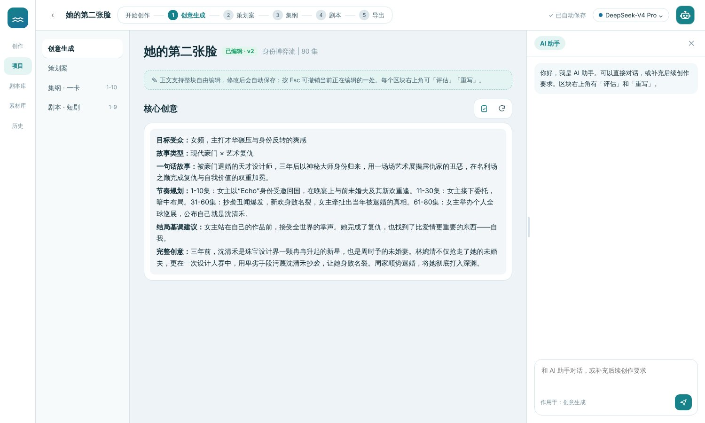

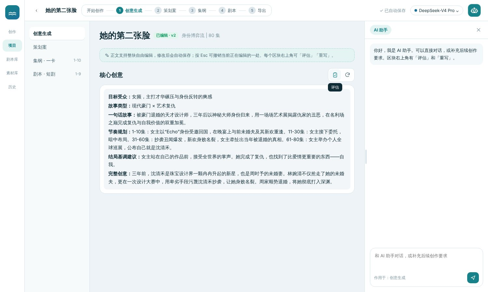

## 1.2 各阶段的“区块”粒度

| 阶段 | 区块 | 评估 / 重写的对象 |
|---|---|---|
| 创意生成 | 「核心创意」一个区块 | 整个核心创意 |
| 策划案 | **「人物小传」「策划案」两个区块**（各自有图标） | 对应区块 |
| 集纲 | **每一集一个区块**（标题行为「第 N 集 + 集名」） | 仅当前这一集 |
| 剧本 | **每一集一个区块**（标题行为「EP0N + 集名」） | 仅当前这一集 |

集纲、剧本阶段的悬停文字带“本集”（评估本集 / 重写本集），避免用户误以为作用于整卡。

## 1.3 与其它入口的关系

- 原「页面右上角剧本医生」按钮：**取消**。
- AI 助手输入框里的「剧本医生」：**删除**。输入框只保留「作用于：当前阶段」与发送。

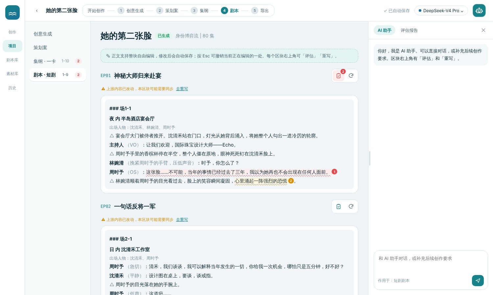

# 2. 评估（只出报告，不改原文）

**原则：评估只输出报告和意见，不帮写、不重写、不修改任何原文。**

## 2.1 流程

1. 点击区块的「评估」→ 右侧栏切到「评估报告」页签，显示扫描进度（约 2 秒）。
2. 出报告：
   - 总分环 + 状态（✓ 良好 ≥75 / ! 一般 60–74 / ✕ 待加强 <60，**状态一律“图标 + 文字”，不只靠颜色**）；
   - 分项条形（每个阶段 4 个维度，见 2.3）；
   - 修改意见列表，编号 1、2、3……；
3. **同步在原文里标注**：有问题的原句加波浪下划线与底色（红 = 需修改、黄 = 建议），句尾带同编号的小圆标。
4. 点击报告里的某条意见 → 原文滚动到该句并高亮；反向，点原文里的圆标 → 右侧对应意见高亮。
5. 区块的「评估」图标右上角出现红色数字角标（意见数）；左侧树对应节点同步显示总数。
6. 报告底部固定提示：「评估只给意见，不改动、不重写原文。需要修改请点该区块右上角的『重写』」。**报告里没有任何修改类按钮。**

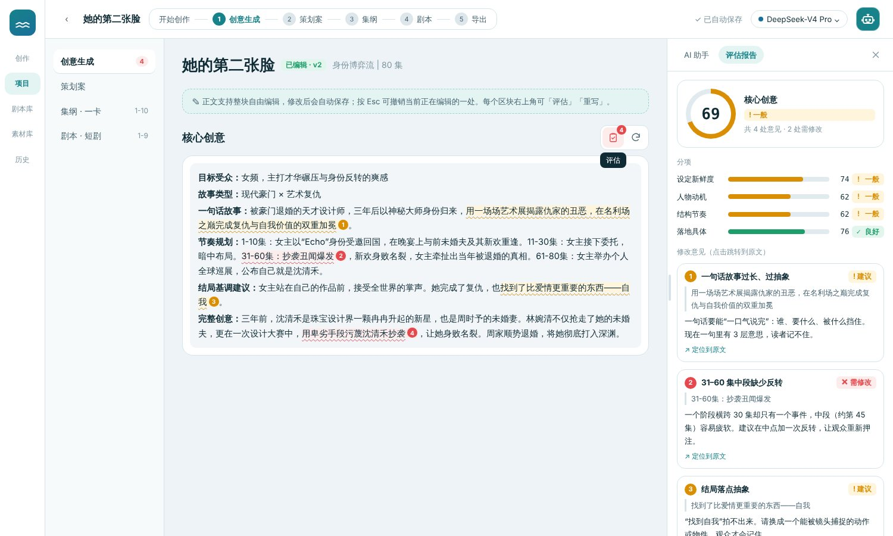

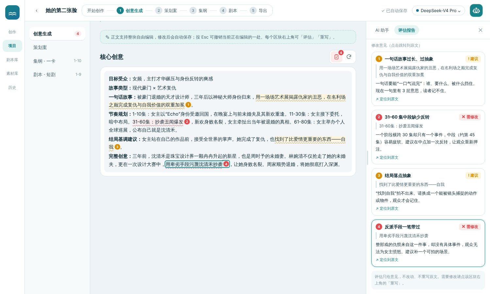

## 2.2 意见条目字段

| 字段 | 说明 |
|---|---|
| 编号 | 按原文出现顺序 1、2、3… |
| 严重度 | ✕ 需修改（红）/ ! 建议（黄） |
| 标题 | 一句话概括问题 |
| 原文引用 | 命中的原句（过长截断） |
| 评估意见 | 为什么是问题、往哪个方向改（**不给改好的文本**） |
| 定位 | 「↗ 定位到原文」 |

## 2.3 各阶段评估维度

| 阶段 | 维度 |
|---|---|
| 创意 | 设定新鲜度 / 人物动机 / 结构节奏 / 落地具体 |
| 策划案 | 人物立体 / 关系张力 / 主线推进 / 风险把控 |
| 集纲（单集） | 冲突强度 / 期待点 / 转折 / 结尾钩子 |
| 剧本（单集） | 台词口语 / 动作可拍 / 对白交锋 / 结尾钩子 |

示例：集纲第 2 集、剧本 EP01 的评估：

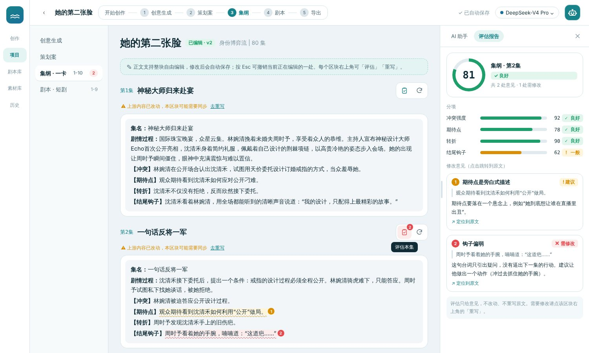

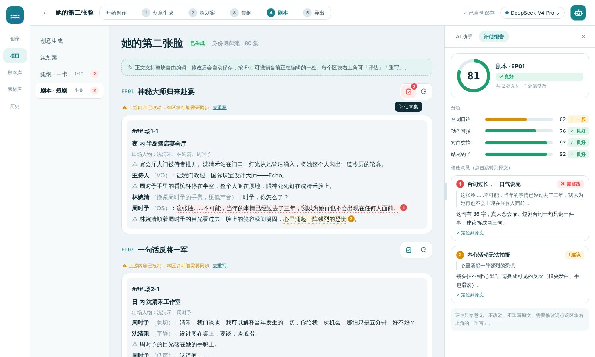

## 2.4 状态规则

- 已有报告且原文未变：再次点「评估」直接打开已有报告；
- 区块被重写后：该区块的报告与原文标注**全部清除**（报告已过期），需重新评估；
- 区块之间互不影响：评估集纲第 2 集不会触碰其它集。
- Demo 说明：评估为规则 / 模板演示，正式版由模型按上表维度评分；意见条数与分数随原文变化。

# 3. 重写

1. 点「重写」→（有下游时先见 3.1 的提示）居中弹窗：标题「重写 · 区块名」，可选补充要求（输入框 + 快捷词：台词更口语 / 结尾钩子更狠 / 冲突再强一点），按钮「取消 / 开始重写」。
2. 点「开始重写」→ toast「正在重写…」→ 区块文字被替换，并在区块标题下出现绿色提示条：**「✓ 已重写 · 红标已清除，可再点『评估』复查　[撤销重写]」**。
3. 「撤销重写」恢复重写前的原文。
4. 重写后再评估，可看到分数提升、意见减少，形成「评估 → 重写 → 复评」的闭环。

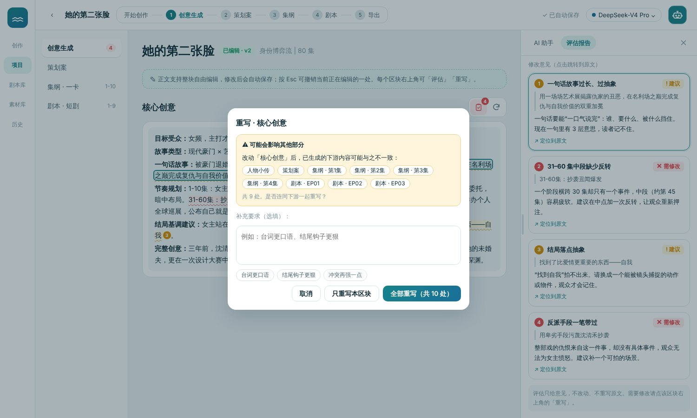

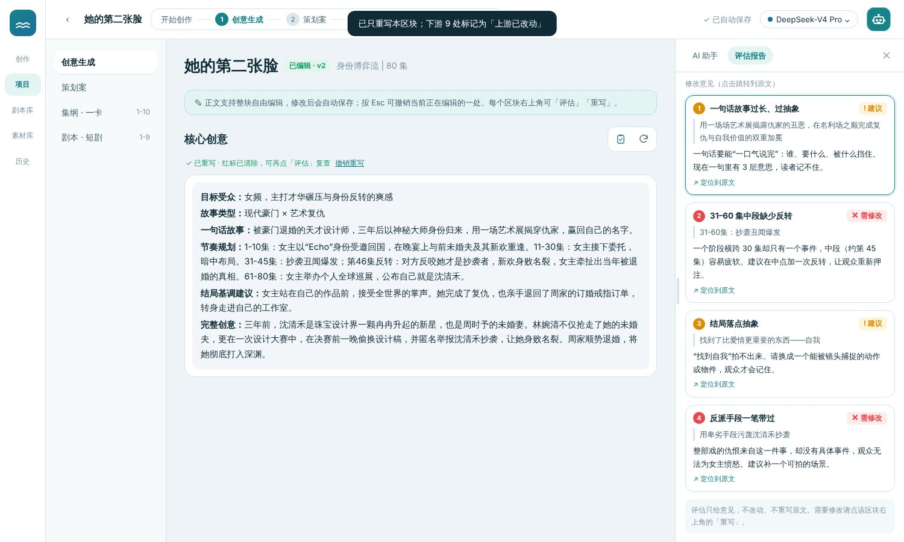

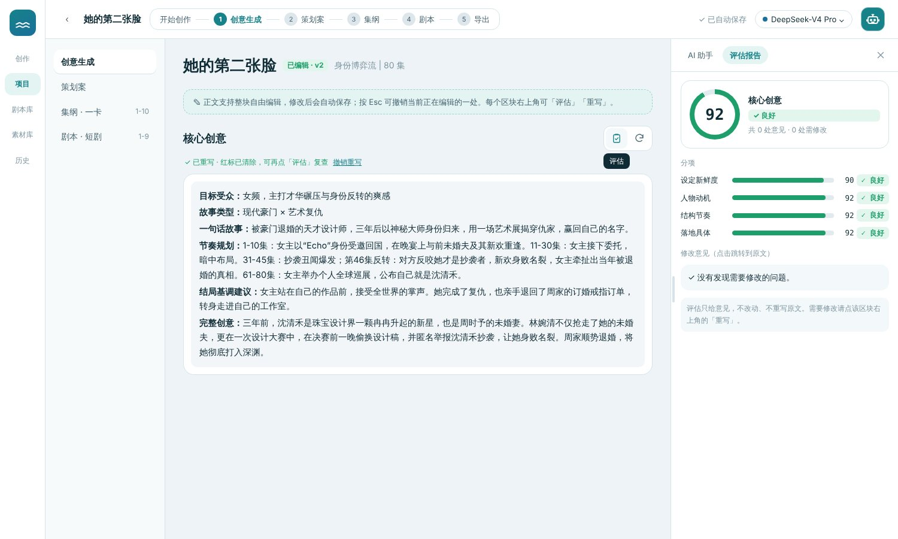

> 评估与重写**相互独立**：评估不会自动触发重写；重写也不依赖先评估。重写时若已存在评估意见，建议模型把意见作为参考（正式版实现）。

## 3.1 上游重写的联动提醒（新增）

内容有上下游依赖：

| 重写的区块 | 可能受影响的下游 |
|---|---|
| 核心创意 | 人物小传、策划案、全部集纲、全部剧本 |
| 人物小传 / 策划案 | 全部集纲、全部剧本 |
| 集纲第 N 集 | 对应的剧本第 N 集 |
| 剧本第 N 集 | 无，直接重写 |

**规则**：点击有下游的区块的「重写」，弹窗顶部出现黄色提示 **「⚠ 可能会影响其他部分」**，列出受影响的下游区块（标签）与数量，并询问是否连同下游一起重写。三个按钮：

- **取消**：不做任何事；
- **只重写本区块**：仅重写当前区块；受影响的下游区块标题下出现黄色提示 **「⚠ 上游内容已改动，本区块可能需要同步　[去重写]」**，左侧不强制处理；
- **全部重写（共 N 处）**：依次重写当前区块 + 全部下游（进度 toast「正在同步重写 k/N…」），完成后 toast「已全部重写，共 N 处」；下游旧报告与标红一并清除。

没有下游的区块（如剧本单集）弹窗里不出现提示，按钮为「取消 / 开始重写」。「补充要求」输入框对所有被重写的区块生效。

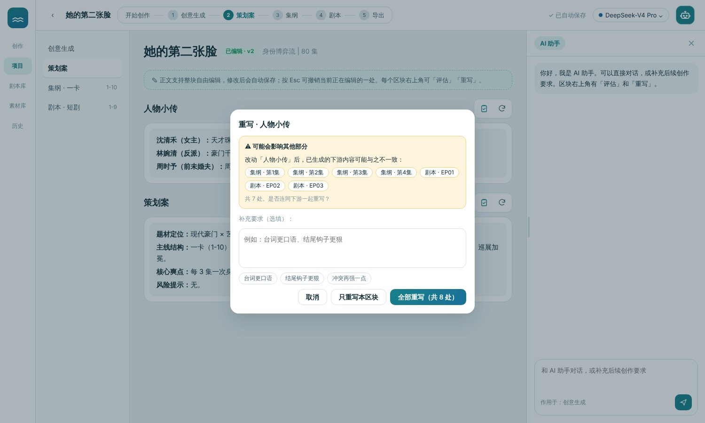

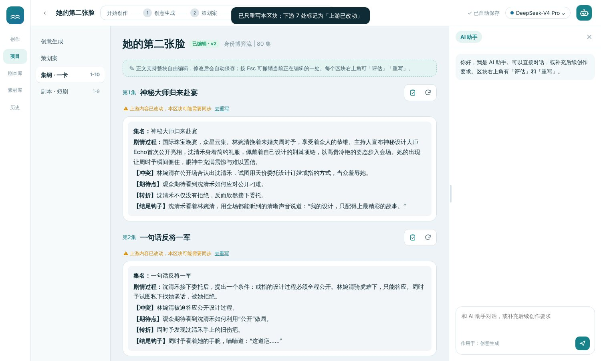

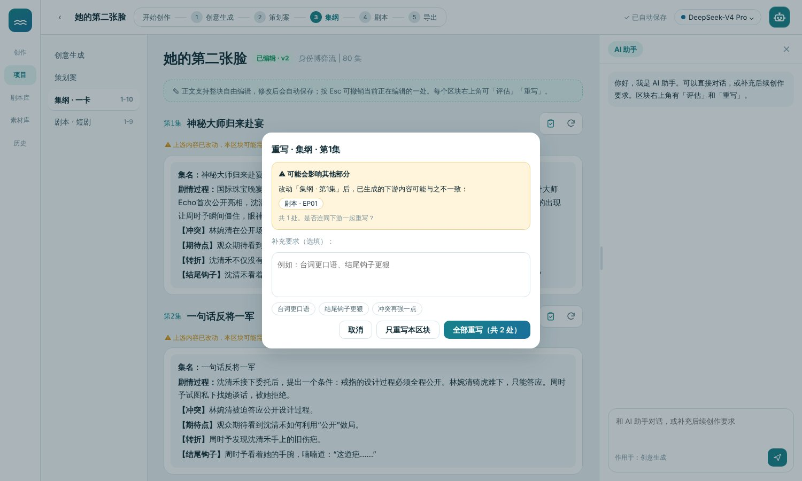

# 4. AI 助手：非全屏自动收起 + 机器人图标

## 4.1 响应规则

| 条件 | 行为 |
|---|---|
| 窗口宽度 ≥ 1280px（全屏 / 宽屏） | AI 助手停靠在右侧，默认展开 |
| 窗口宽度 < 1280px（非全屏） | AI 助手**自动隐藏**；点机器人图标，从右侧以浮层形式滑出（盖在正文上，不挤压正文），再点图标或关闭按钮收起 |
| 窗口跨越 1280px 断点 | 按新宽度重置默认状态（宽屏展开、窄屏收起） |

窄屏浮层顶部对齐在顶栏下方，保证顶栏的机器人图标始终可点。

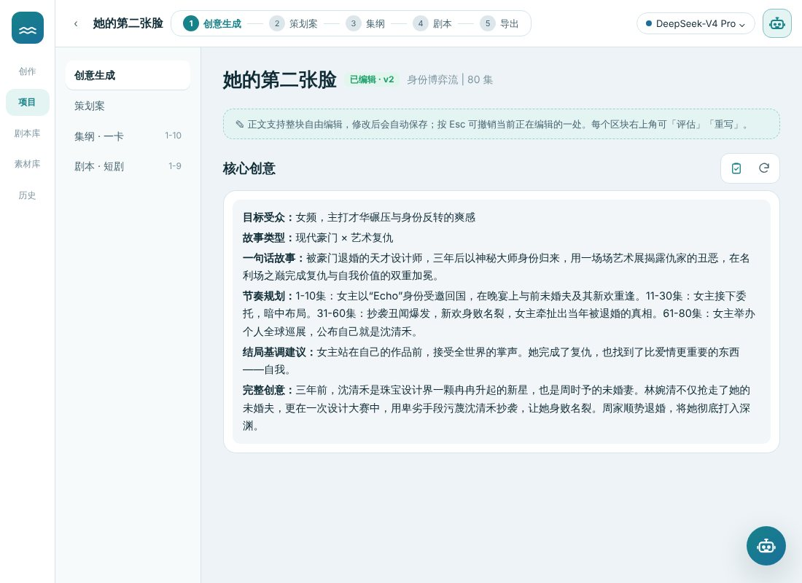

## 4.2 机器人图标

- 顶栏最右侧，**用小机器人图标替换原来的小评论图标**；青绿底色，比评论图标更醒目。
- 窄屏下右下角另有一个圆形浮动机器人按钮（与顶栏图标同功能）。
- **悬停提示（tooltip）：「AI助手」**；顶栏图标提示在下方，浮动按钮提示在上方。
- 点击：展开 / 收起 AI 助手；展开时顶栏图标呈实心高亮态。

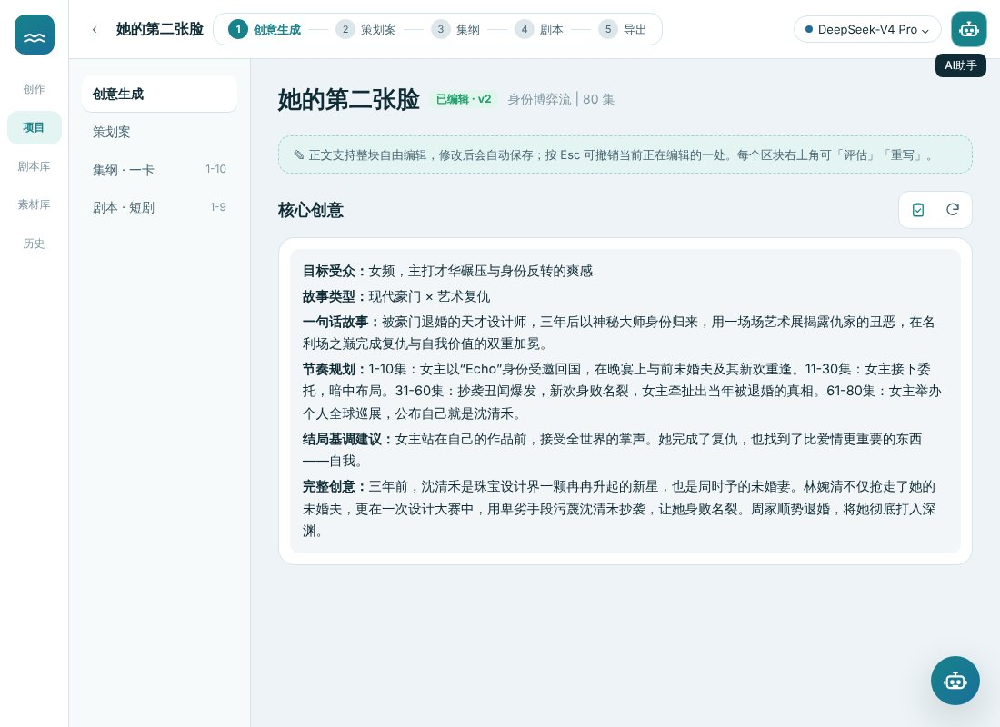

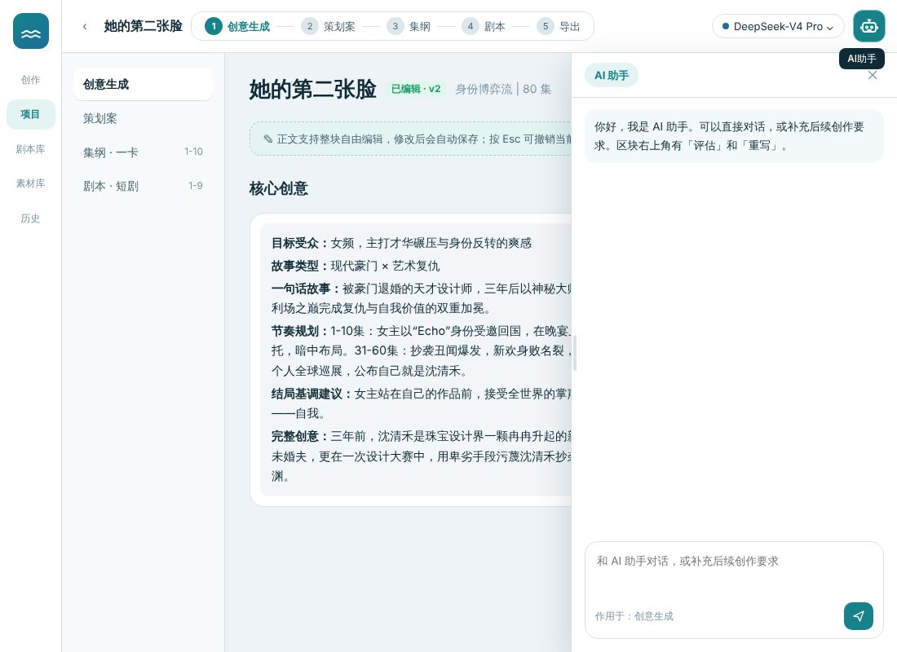

## 4.3 评估报告与 AI 助手共用右侧栏

- 右侧栏有两个页签：「AI 助手 | 评估报告」，报告页签仅在评估过后出现；
- 点「评估」时，即使 AI 助手处于收起状态，也会自动展开右侧栏并切到报告页签（窄屏为浮层）；
- 报告与对话互不覆盖，可随时切换。

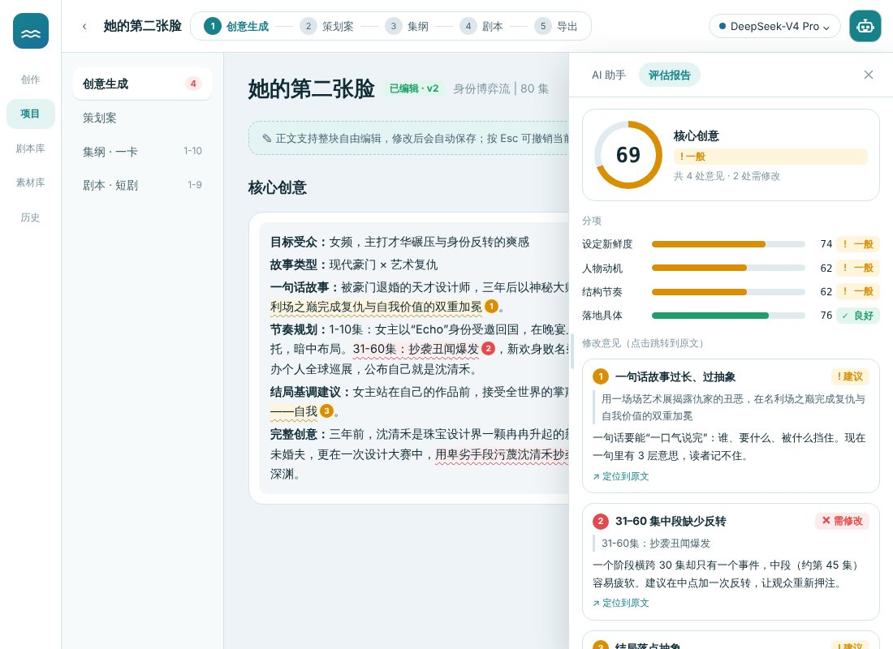

## 4.4 侧栏宽度可调整（新增）

- 侧栏左边缘有一条竖向拖动条（悬停变青色，光标为左右箭头）；
- 向左拖变宽、向右拖变窄，范围 **300–680px**，默认 380px；
- **双击拖动条恢复默认宽度**；
- 宽度会被记住（浏览器本地），下次打开沿用；窄屏浮层同样可拖，最宽不超过屏幕 92%；
- 拖动过程中正文区域实时让位（宽屏停靠模式）。

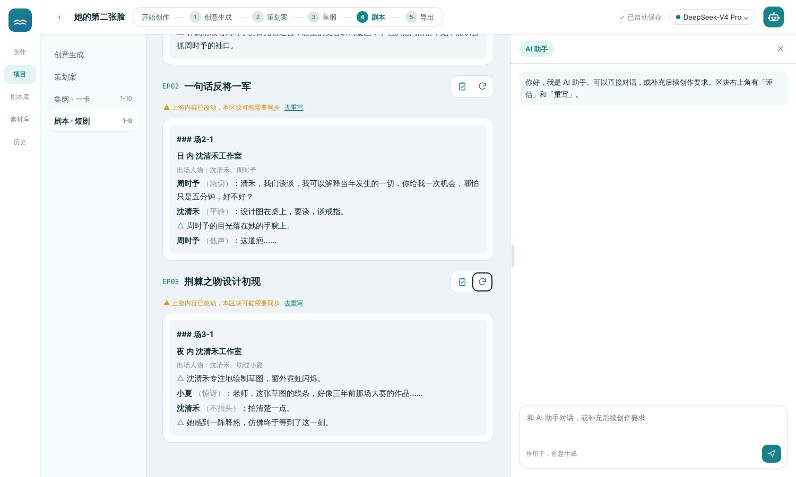

# 5. 验收要点

1. 创意 1 组、策划案 2 组（人物小传 / 策划案）、集纲每集、剧本每集各 1 组两图标；集纲每集、剧本每集各 1 组。
2. 评估只出报告，报告里无任何「修改」类按钮；原文被标红并带编号，双向跳转可用。
3. 重写默认只影响当前区块，可撤销，重写后旧报告清除；有下游的区块重写前弹出「可能会影响其他部分」，可选只重写本区块或全部重写。
4. AI 助手输入框内无「剧本医生」；侧栏可拖动调宽（300–680px），双击恢复。
5. 宽 < 1280px 时 AI 助手默认隐藏；机器人图标可呼出；悬停显示「AI助手」。
6. 状态表达不只靠颜色（有 ✓ ! ✕ 与文字）。

# 附录：Demo 使用

1. 打开 `demo/workspace-doctor.html`，左侧可切换 创意 / 策划案 / 集纲 / 剧本。
2. 在任一区块右上角点第 1 枚图标评估；点意见或原文圆标互相跳转。
3. 点第 2 枚图标重写，再评估对比。
4. 把浏览器窗口缩到 1280px 以下，观察 AI 助手自动收起，点机器人图标呼出。
