# 澜幕 LANMU · AI 短剧剧本工作台 PRD

| 项目 | 内容 |
|---|---|
| 文档版本 | v1.3（评审稿） |
| 更新日期 | 2026-10-14 |
| 对应 Demo | `demo/index.html`（基于 V21，加上 1.6 列出的改动） |
| 适用范围 | 产品、设计、前端、后端、算法、测试 |
| 阅读方式 | 第 1–2 章看全貌；第 3–10 章逐页看功能和交互；第 11 章是完整状态机；第 12–15 章是规则、异常和非功能需求 |

### 修订记录

| 版本 | 日期 | 说明 |
|---|---|---|
| v0.2 | 2026-10-12 | 初版草案：原创 / 小说改编、一句话 / 精细生成、卡点集纲、互动剧本、状态机 |
| v1.0 | 2026-10-14 | 按 V21 Demo 全量重写；补齐一站直出、自定义节点、爆款转换、互动影游剧本树、剧本医生、素材库、版本与历史等全部交互细节和状态；写入本版两项改动（见 1.6） |
| v1.1 | 2026-10-14 | AI 助手对话里展示生成的策划案和集纲（长内容折叠，可展开）；AI 改过的集在正文标「修改版」，可以和第一版对比、恢复第一版（见 1.6 第 3、4 条，7.4、7.5） |
| v1.2 | 2026-10-15 | AI 助手去掉快捷修改、推荐 Skill、写作建议；输入框支持 @ 调用技能；新增「技能引导」小卡片（看内容或打字时检测到场景才弹，有频率限制）；新增内置技能「脑洞创意」（见 1.6 第 5、6 条，7.6–7.8） |
| v1.3 | 2026-10-15 | 一句话生成和精细生成都能自定义剧名（首页「剧名」、工作台顶部 ✎、策划案「自己起名」）；技能引导更容易被看到：停留 8 秒、AI 助手收起时图标亮红点（见 1.6 第 7、8 条） |

---

## 1. 产品概述

### 1.1 一句话定位

澜幕是给短剧编剧和制片团队用的 AI 剧本工作台：从**一个想法、一本小说或一部爆款剧**出发，写出**可以开拍的短剧分场剧本**，也能转成**带选项、数值和多结局的互动影游剧本**。

### 1.2 要解决的问题

| 用户痛点 | 澜幕的解法 |
|---|---|
| 从想法到 80 集剧本耗时长，前期策划、分集、分场都靠人工 | 一句话生成：一站直出策划案 → 全部集纲 → 全文剧本，中间不用操作 |
| AI 一口气写完不可控，改起来比重写还累 | 精细生成：每一步写完停下来；按付费卡点分段写、逐段确认；所有文字可直接改 |
| 付费卡点、钩子、爽点密度这些短剧行规，通用 AI 不懂 | 卡点设置弹窗、Skill（方法论插件，@ 调用）、技能引导、剧本医生打分 |
| 小说改编、爆款跟拍、出海本土化是高频需求 | 小说改编（解析 → 改编）；爆款转换（国内题材迭代 / 海外本土化） |
| 互动影游剧本的分支容易写出死路、结局触发不了 | 剧本树可视化编辑 + 自动结构校验 + 手机预览试玩 |
| 改着改着不知道哪个版本好 | 每次生成 / AI 修改 / 恢复都留版本，可随时恢复；上游改动自动提示下游 |

### 1.3 目标用户

| 用户 | 典型场景 | 关注点 |
|---|---|---|
| 短剧编剧（核心） | 接到题材需求，3 天内交 80 集剧本 | 速度、节奏、能直接改 |
| 制片 / 内容策划 | 评估选题，快速出策划案和分集 | 卡点、成本、可拍性 |
| 小说版权方 / 网文作者 | 把自己的小说改成短剧 | 忠于原著程度、改编范围 |
| 出海团队 | 把国内爆款本土化到北美、东南亚等市场 | 文化替换、语言、禁忌 |
| 互动影游团队 | 做第一人称互动剧 | 分支结构、数值、结局、拍摄清单 |

### 1.4 竞品参考

泡漫、灵境、百度 hogee、昆仑、LibTV、万兴剧场、有戏 AI、麦芽、跳跃视界、小云雀。借鉴点：

- **小云雀**：右侧对话侧边栏 + 左侧文档的工作台布局；输入框左侧的大号上传框。本版 AI 助手侧边栏按这个形态做。
- **麦芽**：爆款对标 → 澜幕做成「爆款转换」（国内迭代 / 海外本土化）。
- **有戏 AI、万兴剧场**：互动剧本的节点画布 → 澜幕做成竖向「剧本树」，并加了结构校验和试玩。
- 通用：参数用嵌入式下拉（chip）而不是大表单；状态尽量少、文案尽量直白。

### 1.5 名词表

| 名词 | 含义 |
|---|---|
| 策划案 | 剧名（3 个备选）、一句话梗概、故事梗概、世界观、人物小传、核心冲突与爽点、节奏与付费卡点、结局方向 |
| 集纲 | 每一集的标题、梗概和结尾钩子 |
| 付费卡点 / 一卡 · 二卡 · 三卡 | 短剧付费墙所在的集。默认在总集数的 15% / 44% / 75% 处 |
| 段 / 结局段 | 按卡点把全剧切成「一卡段（第 1 集到一卡）、二卡段、三卡段、结局段（三卡之后到最后一集）」 |
| 范围 | 生成剧本时选的集数区间：全文 / 某一段 / 自定义第 a–b 集 |
| 短剧剧本 | 分场剧本：场次头（集-场 日/夜 内/外 地点）、人物、动作△、对白、镜头提示、钩子 |
| 互动影游剧本 | 由剧情、选择、判定、付费、结局五类节点组成的分支剧本，可试玩、可导出 JSON |
| 剧本树 | 互动影游剧本的可视化：主线自上而下，同层分支左右并排 |
| 一句话生成 | 一站直出，中间不用操作 |
| 精细生成 | 人机协同，每一步写完停下来等确认 |
| 自定义节点 | 精细生成下，只执行勾选的步骤（例如只要策划案、只要集纲） |
| 下一步卡片 | 每一步写完，在页面底部弹出的卡片，给出「接下来做什么」的按钮 |
| 确认 / 定稿 | 把一页内容锁住，上游改动不会再自动影响它 |
| Skill / 技能 | 写作方法论插件（如「黄金三秒开篇」），生成或修改时挂载使用；在 AI 助手里输入 @ 调用；内置 9 个，用户可上传 |
| PE 题材 | 平台当前支持的题材范围，按目标市场（国内 / 海外）和受众（男频 / 女频）区分 |
| 剧本医生 | 给当前页打分、指出问题、给修改意见的体检工具，可按意见重写 |
| 续写 / 加更 | 续写：把下一段剧本写出来；加更：在最后一集之后再加几集 |
| 积分 | 生成消耗的点数。Demo 初始 300 |

### 1.6 本版改动（相对 V21）

| # | 改动 | 说明 | 对应章节 |
|---|---|---|---|
| 1 | **AI 助手改成右侧侧边栏** | 去掉右下角悬浮的「AI 助手」按钮和悬浮面板。顶栏最右侧加一个对话图标，点一下打开 / 收起 AI 助手。打开时 AI 助手停靠在页面右侧，和文档并排，文档区自动变窄，不再盖住内容（参考小云雀） | 第 7 章 |
| 2 | **剧本医生改成「打分报告 + 可选重写」** | 每次体检都出同一份报告：总分、分项得分、问题、修改意见、建议 Skill、和上一版对比。**去掉「低于 60 分弹窗提示重写、高于 60 分不提示」的逻辑**，分数只做参考，不按分数提示重写。用户自己决定「我自己改」还是「按勾选意见重写」 | 第 8 章 |
| 3 | **AI 助手也输出策划案和集纲** | 策划案、每段集纲生成完，AI 助手对话里出现一张内容卡片，标题写明范围（如「集纲 · 第 1–12 集」）。内容长时只显示一部分，点开卡片展开全部。短剧剧本和互动影游剧本的正文**不进对话框** | 7.4 |
| 4 | **AI 修改的集显示「修改版」，可对比第一版** | 用户让 AI 改了某一集（比如最后一集），正文里这一集标「修改版」，并自动打开和第一版的左右对比，改动处高亮；可以恢复第一版、撤销 | 7.5 |
| 5 | **AI 助手精简 + @ 调用技能** | 去掉侧边栏里常驻的「快捷修改」「推荐 Skill」「写作建议」和编辑时弹出的写作提醒。用户在输入框输入 @（或点输入框左下角 @ 按钮）弹出技能列表，搜索、选择后以「@技能名」标签挂在输入框上方 | 7.6 |
| 6 | **技能引导小卡片** | 用户在看生成内容（同一页停留 15 秒）或给 AI 助手打字（检测到「没灵感」「节奏拖」「台词」等意图）时，AI 助手里弹一张小卡片：「检测到…，需要我们的「脑洞创意」…吗？」一键加上技能。频率受限：两次至少隔 2 分钟、每个项目每次打开最多 3 次、同一页只按停留提示一次、拒绝过的技能本次不再提示、可勾「不再提示」。新增内置技能「脑洞创意」：先给 3 个方向，挑一个再改 | 7.7、7.8 |
| 7 | **剧名可编辑（一句话 / 精细都支持）** | 首页参数栏第一个是「剧名：AI 起名」，可以生成前就自己起名，生成的策划案以它为准（排在备选第一个）；工作台顶部剧名旁有 ✎，点剧名或 ✎ 直接改；策划案「剧名」区块多一个「✎ 自己起名」。三处同步，并记为用户起的名字，之后重新生成策划案也保留 | 3.5、5.1、5.3 |
| 8 | **技能引导更容易被看到** | 看内容的停留时间从 15 秒降到 8 秒；生成完成后停留同样会触发；AI 助手收起时也会检测，此时顶栏 AI 助手图标出现跳动的小红点，打开就能看到引导卡片 | 7.7 |
| 9 | 小修 | 剧本医生加进每页「更多」菜单（侧边栏收起时也能用）；所有弹窗的底部按钮固定可见（内容多时中间滚动）；修复报告里分数环中间数字看不见、独立打开 HTML 时页面有白边、手机上目录列错位 | — |

### 1.7 本期范围

| 本期做 | 本期不做（后续） |
|---|---|
| 短剧剧本：原创、小说改编、爆款转换（国内迭代 / 海外本土化） | 多人协作、评论、权限 |
| 互动影游剧本：一句话创作、上传剧本转换 | 分镜、视频生成、配音 |
| 一句话生成 / 精细生成 / 自定义节点 | 投流素材、多语种字幕成片 |
| 卡点设置、分段生成、续写、加更 | 付费购买积分、会员体系 |
| AI 助手对话改稿、@ 调用技能、技能引导 | 账号体系（Demo 无登录） |
| 剧本医生 | 导出 Word / PDF 文件（Demo 只能复制文本） |
| 剧本库、素材库（小说原文、Skill）、历史记录、版本恢复 | |
| 深海 / 晴空 / 护眼三套主题，桌面和手机适配 | |

---

## 2. 信息架构与全局框架

### 2.1 站点地图

```
澜幕
├─ 创作（首页）
│   ├─ 短剧剧本 ── 原创（默认）/ 小说改编（上传小说）/ 爆款转换
│   └─ 互动影游 ── 一句话创作 / 上传剧本转换
│        └─ 发送 → 项目工作台
├─ 项目工作台
│   ├─ 顶栏：返回 · 剧名 · 步骤条 · 自动保存 · 模型 · AI 助手开关
│   ├─ 左：目录（解析页 / 策划案 / 集纲 / 剧本）
│   ├─ 中：文档（当前页）
│   └─ 右：AI 助手侧边栏（可收起）
├─ 剧本库：全部项目，按类型筛选、搜索
├─ 素材库：小说原文 / Skill
└─ 历史：每次生成和 AI 修改的记录，可打开、可恢复版本
```

### 2.2 全局布局

| 区域 | 说明 |
|---|---|
| 左侧导航栏（76px） | Logo；创作、剧本库、素材库、历史；底部是主题切换（深海 / 晴空 / 护眼）和剩余积分。项目工作台属于「创作」，导航高亮在「创作」 |
| 内容区 | 随导航切换。首页底部有海浪和气泡动效，其他页面没有 |
| 弹层 | 下拉面板（chip 弹出）、弹窗（遮罩居中）、下一步卡片（底部居中）、Toast（顶部居中，2.4 秒自动消失） |


### 2.3 项目工作台三栏布局


| 屏幕宽度 | 目录 | 文档 | AI 助手（打开时） | AI 助手（收起时） |
|---|---|---|---|---|
| > 1240px | 210px | 自适应 | 330px，停靠右侧 | 文档占满剩余宽度 |
| 1001–1240px | 180px | 自适应 | 310px，停靠右侧 | 同上 |
| 761–1000px | 150px | 自适应 | 290px，停靠右侧；顶栏隐藏步骤条 | 同上 |
| ≤ 760px（手机） | 横向滚动标签条，放在文档上方 | 全宽 | 全屏面板盖在页面上，右上角 × 关闭；底部导航保留 | — |

窄屏效果（1100px 宽）：


### 2.4 通用交互规范

| 组件 | 规则 |
|---|---|
| 参数 chip | 点一下弹出下拉面板，再点一下或点空白处、按 Esc 关闭。单选项选完即关闭；多选项（题材、Skill、游戏系统、自定义节点）选完不关闭，点「完成」或点空白关闭。已设置的 chip 高亮（带 ✦），多选显示数量角标 |
| 弹窗 | 遮罩 + 居中卡片；标题和底部按钮固定，中间内容超出时单独滚动（按钮始终可见）；右上角 ×、底部「取消」、Esc 都能关闭 |
| 「更多」菜单（⋯） | 每页标题右侧，放低频操作：剧本医生体检、确认定稿 / 继续编辑、版本记录、重新生成等 |
| 下一步卡片 | 每一步写完弹出（见 4.3）。同一时间只有一张；切换页面不消失，点 × 或点任一按钮后消失；只在当前项目页显示 |
| Toast | 操作反馈，例如「已确认」「已复制」「积分不足：需要 10，剩余 6」 |
| 自动保存 | 所有改动 200ms 内自动存到本地；顶栏显示「✓ 已自动保存」 |
| 快捷键 | 首页输入框 ⌘/Ctrl+Enter 发送；AI 助手输入框 Enter 发送、Shift+Enter 换行；直接编辑时 ⌘/Ctrl+Enter 确认修改、Esc 撤销；剧名 Enter 保存；Esc 关闭弹层；⌘/Ctrl+Shift+D 打开内部调试面板（仅内部） |
| 用户可见的状态 | 只展示简洁状态（已生成、已编辑、待更新、已确认、生成失败、生成中）。状态机、任务日志不展示给用户（见第 11 章） |

---

## 3. 创作入口（首页）

### 3.1 页面结构

自上而下：标语区 → 创作输入框（composer）→「从爆款题材开始」灵感题材（仅原创）→「最近的剧本」（最多 3 个项目卡）。

| 区域 | 内容 |
|---|---|
| 标语 | LANMU · AI SCRIPT STUDIO；「让故事像浪潮一样推进」；副标题两行 |
| 创作类型切换 | 左上两个并列按钮：**短剧剧本**（默认）/ **互动影游** |
| 精细生成开关 | 右上角开关，默认关（= 一句话生成） |
| 模式说明 | 开关下方一行灰字，随类型和开关变化（见 3.3） |
| 输入区 | 左边大号上传框，右边文本输入框 |
| 参数栏 | 一排 chip（见 3.5），右侧是模型选择和发送按钮 |
| 提示 | 发送按钮下方，例如「还差 6 字」 |


### 3.2 创作类型与创作模式

首页只有两个类型按钮，内部对应四种创作模式：

| 类型按钮 | 内部模式 | 怎么进入 | 怎么退出 |
|---|---|---|---|
| 短剧剧本 | **原创**（默认） | 点「短剧剧本」 | — |
| 短剧剧本 | **小说改编** | 点左侧上传框 →「上传小说 / 粘贴小说正文 / 载入示例小说」；或在素材库点「用它改编」 | 点文件卡片上的 × |
| 短剧剧本 | **爆款转换** | 点参数栏「爆款转换」chip → 选方向，或「上传剧本 / 示例爆款」 | 爆款转换面板里点「关闭爆款转换」，或点文件卡片 × |
| 互动影游 | **互动影游**（一句话创作 / 上传剧本转换） | 点「互动影游」；上传框里上传或粘贴剧本即切到「上传剧本转换」 | 点文件卡片 × 回到一句话创作 |

### 3.3 一句话生成与精细生成

| 模式 | 定义 | 首页说明文案（原创） |
|---|---|---|
| 一句话生成（默认） | 一站直出，中间不用用户操作 | 一句话生成：一站直出策划案、全部集纲和全文短剧剧本，中间不用操作。想改编小说，点左边「上传小说」。 |
| 精细生成 | 每一步写完停下来，用户可以选卡点、选范围、挂 Skill、逐段确认 | 精细生成：策划案、集纲、剧本每一步写完都会停下来，你可以选卡点、选范围、挂 Skill、逐段确认。 |

其他模式的说明文案：

| 模式 | 一句话生成 | 精细生成 |
|---|---|---|
| 小说改编 | 解析小说后，一站直出策划案、全部集纲和全文短剧剧本，中间不用操作。 | 点「解析小说」进入工作台，先解析小说，确认改编范围和力度，再一步步写策划案、集纲和剧本。 |
| 爆款转换 | 拆解爆款后，一站直出转换后的策划案、集纲和全文剧本。 | 先拆解爆款并给出转换方案，确认后再一步步写。 |
| 互动影游 · 一句话创作 | 一站直出策划案、集纲、短剧剧本和互动影游剧本，中间不用操作。 | 每一步都会停下来，可以调整互动形式、视角、结局数和生成范围，最后再转成互动影游剧本。 |
| 互动影游 · 上传剧本 | 上传剧本后直接转成互动影游剧本，中间不用操作。 | 同上 |

精细生成下如果自定义节点不是「全流程」，说明文案后面追加一行：「自定义节点：策划案 → 一卡集纲。勾选的步骤会依次自动执行，执行完停下。」

### 3.4 输入区

**上传框**（输入框左侧，184×150px，虚线框，参考小云雀）：

| 元素 | 规则 |
|---|---|
| 主体 | 「+」图标 + 「上传小说」（互动影游下为「上传剧本」） |
| 格式要求 ⓘ | 悬停显示：支持 .txt / .md，单文件不超过 20MB；小说按「第 N 章」识别章节，上传即表示拥有改编权；剧本需要有「第 N 集」分集标题 |
| 点击 | 弹出下拉面板，三个选项（见下图） |


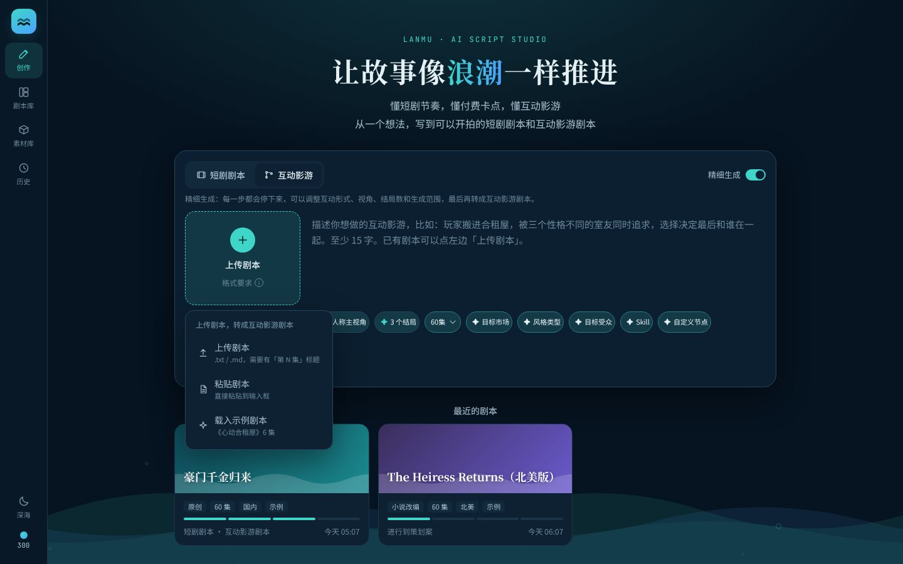

| 选项（短剧） | 选项（互动影游） | 行为 |
|---|---|---|
| 上传小说（.txt / .md） | 上传剧本 | 打开系统文件选择；读取成功后切到小说改编 / 上传剧本转换模式，文件名作为小说名 |
| 粘贴小说正文 | 粘贴剧本 | 切换模式，光标进入输入框 |
| 载入示例小说《重生之千金归来》5 章 | 载入示例剧本《心动合租屋》6 集 | 填入示例文本 |

上传或粘贴后，输入框上方出现**文件卡片**：图标 + 「小说改编 · 《书名》」+ 字数 + ×。小说改编时卡片右侧多一个「解析小说」按钮。


**文本输入框**：

| 模式 | 占位文案 | 发送条件 |
|---|---|---|
| 原创 | 在此输入想法，我们将为你定制创意，至少输入 15 字。 | ≥ 15 字，不够时提示「还差 N 字」 |
| 小说改编 | 小说正文会显示在这里，也可以直接粘贴。上传即表示你拥有该作品的改编权。 | ≥ 20 字 |
| 爆款转换 | 粘贴爆款短剧的剧本或集纲，也可以点下方「爆款转换」上传。 | ≥ 20 字 |
| 互动影游 · 一句话 | 描述你想做的互动影游……至少 15 字。已有剧本可以点左边「上传剧本」。 | ≥ 15 字 |
| 互动影游 · 上传剧本 | 粘贴剧本（需要有「第 N 集」标题），会把它转成互动影游剧本。 | ≥ 20 字 |

不满足条件时发送按钮置灰。⌘/Ctrl+Enter 发送。

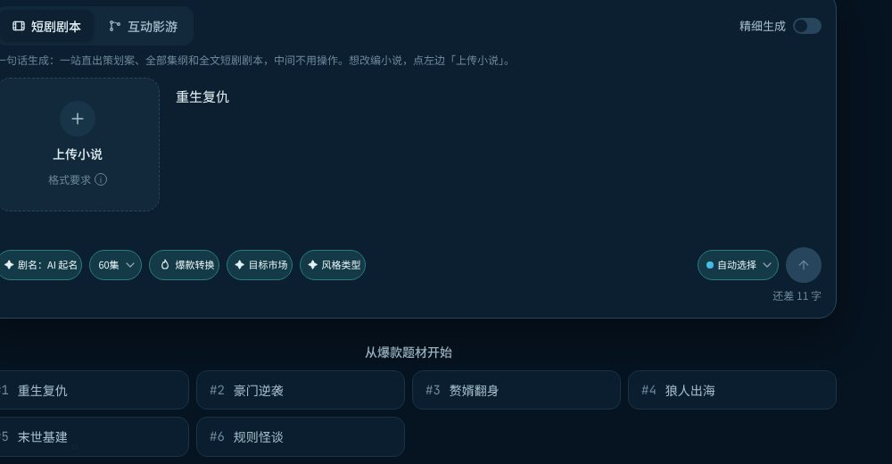

### 3.5 参数栏（chip）

**短剧剧本**：

| chip | 出现条件 | 选项 | 默认 | 规则 |
|---|---|---|---|---|
| 剧名 | 总是（参数栏第一个） | 输入框，最多 30 字；「交给 AI 起名」清空 | 空 =「剧名：AI 起名」 | 填了就以它为剧名，AI 另给 2 个备选；生成中顶栏就显示这个名字；改完显示「剧名 ·《xxx》」 |
| 集数 | 总是 | 20 / 30 / 40 / 60 / 80 / 100，或自定义 10–150 | 80 | 选了海外市场时自动改成该市场默认集数（北美、东南亚、日韩、拉美 60，中东 50） |
| 爆款转换 | 总是 | 国内爆款迭代 / 海外本土化；底部「上传剧本」「示例爆款」「关闭爆款转换」 | 关 | 选任一方向即进入爆款转换模式，chip 文字变成「爆款转换 · 国内迭代」 |
| 目标市场 | 原创、小说改编；爆款转换选「海外本土化」时 | 国内（抖音 / 红果 / 小程序）、北美、东南亚、日韩、中东、拉美 | 不选（按国内） | 再点一次已选项可取消；爆款转换下不出现「国内」 |
| 风格类型 / 目标题材 | 原创、小说改编；爆款转换选「国内迭代」时 | 按 PE 题材表（见下） | 不选（按创意自动推断） | 最多 3 个；不在当前 PE 范围的题材置灰、不可点 |
| 目标受众 | 精细生成 | 女频 / 男频 / 全年龄 | 不选（按创意推断） | 切换后自动清掉不再可选的题材 |
| Skill | 精细生成 | 9 个内置 + 用户上传 | 无 | 每次最多 5 个；面板底部可直接上传 |
| 自定义节点 | 精细生成 | 见 4.4 | 全流程 | 至少保留一个节点 |
| 模型 | 总是（右侧） | 见第 12 章 | 自动选择 | 影响文风和积分 |

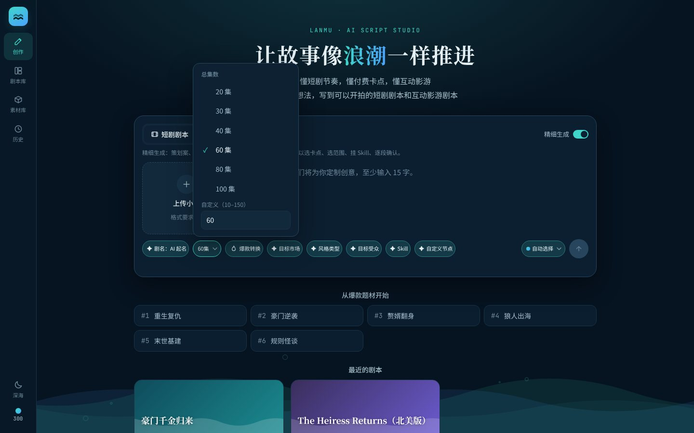


**PE 题材规则**（风格类型面板）：

| 目标市场 | 受众 | 可选题材 |
|---|---|---|
| 国内 | 男频 | 男频种田、男频复仇、男频逆袭 |
| 国内 | 女频 | 女频种田、女频复仇、女频逆袭、甜宠（女频） |
| 国内 | 不选 | 以上全部 |
| 海外（任一） | 不区分 | 男频机甲战神、女频 BL、女频 GL、女频狼人（情感向）、女频 BG（无奇幻世界观） |

面板分两组：上面是可选题材；下面灰字「非国内 PE 类型，暂不可选」（或「非出海 PE 类型」）列出其他题材，置灰，悬停提示「当前的 PE 类型里没有这一项」。


不选题材时按创意关键词推断：含「高武 / 武道 / 修仙 / 玄幻」→ 男频、玄幻 + 战神；「战神 / 兵王 / 龙王」→ 战神 + 复仇；「赘婿」→ 赘婿 + 复仇；「重生」→ 重生 + 复仇；「甜 / 恋爱 / 闪婚」→ 甜宠 + 霸总；「狼人 / Alpha」→ 狼人 + 甜宠；其他 → 豪门 + 复仇。推断结果再按 PE 规则过滤，过滤后为空时用默认（国内女频「复仇、逆袭」，国内男频「逆袭、复仇」，海外女频「狼人」，海外男频「战神」）。

其他下拉面板：


**互动影游**：

| chip | 出现条件 | 选项 | 默认 |
|---|---|---|---|
| 互动形式 | 总是 | 选项分支 / 数值养成 / 限时选择 / 混合 | 数值养成 |
| 视角 | 精细生成 | 第一人称主视角 / 第三人称 | 第一人称 |
| 结局 | 精细生成 | 单结局 / 3 个结局 / 5 个结局 | 3 个 |
| 集数、目标市场、风格类型 | 一句话创作时 | 同短剧 | 同短剧 |
| 目标受众、Skill、自定义节点 | 一句话创作 + 精细生成 | 同短剧 | 同短剧 |

上传剧本转换时不显示集数、市场、题材（以剧本为准）。

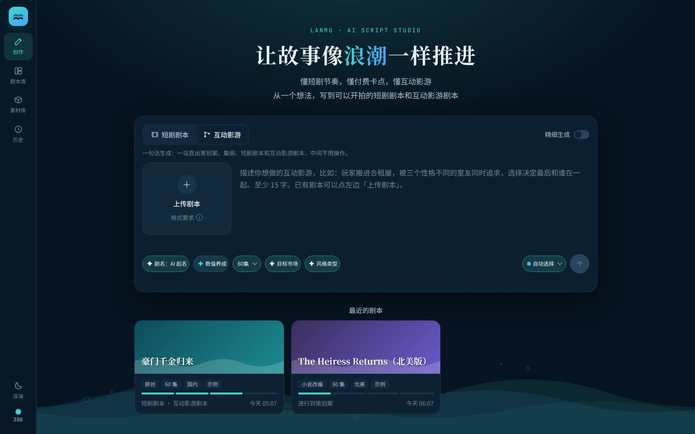

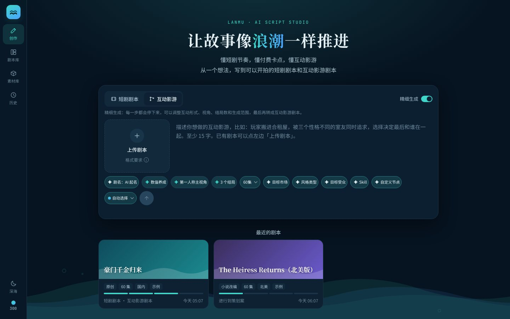


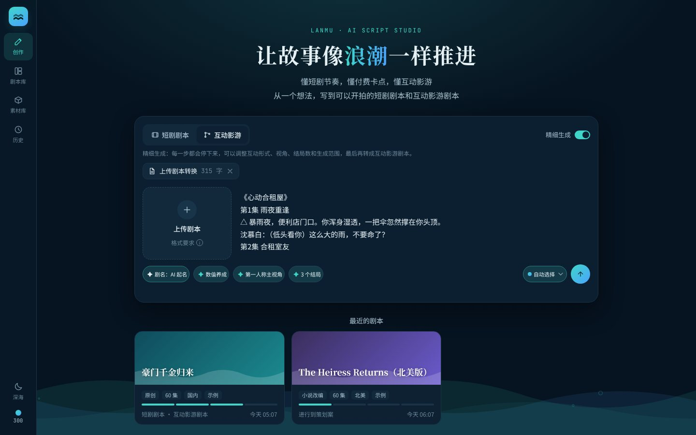

### 3.6 灵感题材与最近剧本

- **从爆款题材开始**（仅原创）：6 个题材按钮（重生复仇、豪门逆袭、赘婿翻身、狼人出海、末世基建、规则怪谈），点击把对应的一句话创意填进输入框，光标放到末尾。
- **最近的剧本**：最近更新的 3 个项目卡，点击进入项目。

### 3.7 发送之后

点发送 → 新建项目 → 进入项目工作台。AI 助手侧边栏默认打开（手机默认收起），第一条消息是用户的创意或「改编《书名》」等。

| 模式 | 发送后第一步 |
|---|---|
| 原创 / 互动影游一句话 | 直接写策划案（一句话生成：后面全自动；精细生成：写完停下） |
| 小说改编 | 进入「小说解析」页，解析约 1 秒 |
| 爆款转换 | 进入「爆款转换」页，拆解约 1 秒 |
| 互动影游 · 上传剧本 | 进入「剧本解析」页 |

---

## 4. 生成流程

### 4.1 总流程

```
原创想法 ──────────────────────────┐
小说 ── 小说解析（范围 / 力度）─────┤
爆款剧本 ── 拆解 + 转换方案 ────────┼─→ 策划案 ─→ 集纲（全部 / 按卡点分段）─→ 短剧剧本（全文 / 某段 / 自定义范围）
                                   │                                          │        └─→ 续写下一段 · 加更
互动影游想法 ──────────────────────┘                                          └─→ 互动影游剧本（可从集纲或剧本转）
上传剧本 ── 剧本解析（分集即集纲）──────────────────────────────────────────────→ 互动影游剧本
```

### 4.2 一句话生成（一站直出）

| 步骤 | 系统行为 |
|---|---|
| 1 | AI 助手回复「收到。一句话模式会一站直出：策划案 → 全部 80 集集纲 → 全文短剧剧本，中间不用你操作。」 |
| 2 | 写策划案（约 8 步进度）。卡点用默认值（一卡 = 总集数 × 15%，至少第 2 集；二卡 × 44%；三卡 × 75%） |
| 3 | 按卡点分段依次写一卡、二卡、三卡、结局段集纲，不弹卡点弹窗 |
| 4 | 写全文短剧剧本（第 1 集到最后一集） |
| 5 | 互动影游项目再接着转成互动影游剧本（全文范围，用首页选的互动形式、视角、结局数） |
| 6 | 完成后弹下一步卡片「剧本写好了」：查看剧本 / 转互动影游剧本 / 加更几集 / 导出 |

**一站直出进度条**：文档区顶部固定显示「✦ 一站直出中：✓ 策划案 — ◌ 集纲 2/4 段 — ○ 全文剧本」，右侧按钮「改为逐步确认」。点击后当前这一步写完就停下，之后按精细生成的方式继续。

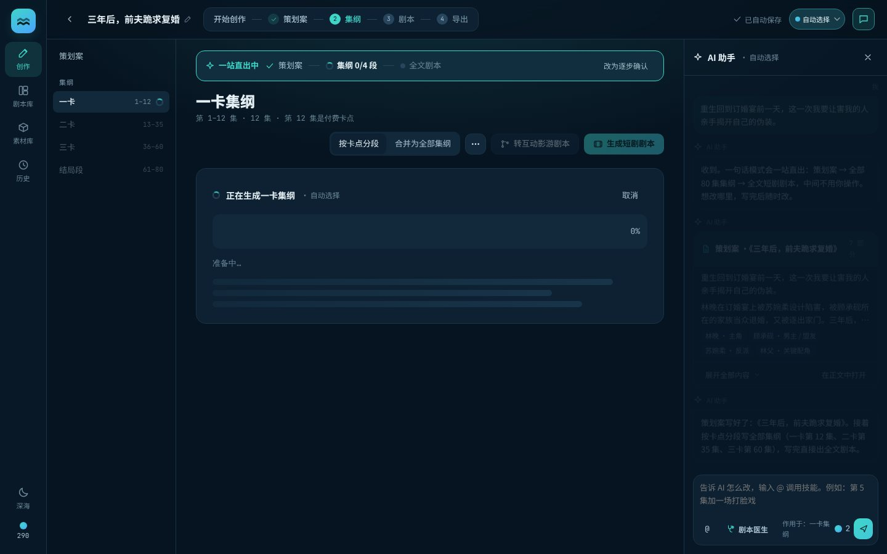

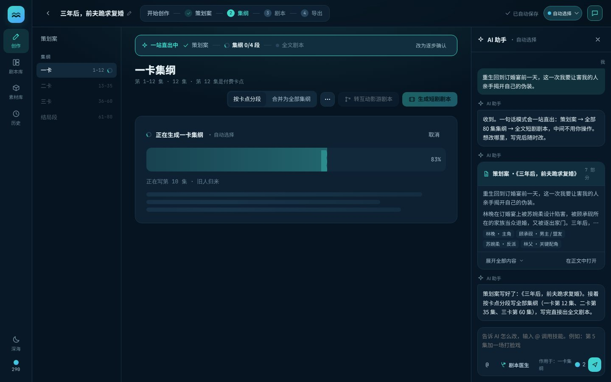

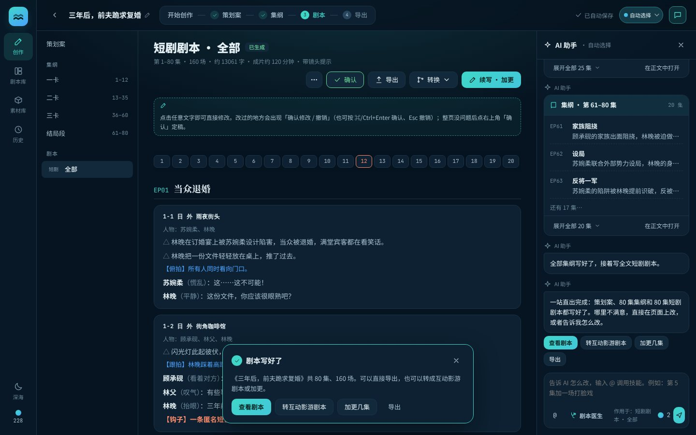


规则：

- 中途任一步失败：一站直出中止，AI 助手提示「「一卡集纲」没生成完（生成超时），积分没有扣。」并给「重试」按钮。
- 积分不够时在那一步停下，Toast 提示。
- 首页不显示总价；正式版建议发送前显示预估积分（Demo 有 `quickCost` 预估逻辑：策划案 10 + 集纲 ⌈N/4⌉+8 + 剧本 max(6, ⌈N/2⌉)，再乘模型倍率）。

### 4.3 精细生成（人机协同）

| 步骤 | 页面 / 弹层 | 用户可做 |
|---|---|---|
| 1 写策划案 | 策划案页显示生成进度 | 取消 |
| 2 策划案写好 | 自动弹出**卡点设置弹窗**（标题「策划案写好了，接下来生成集纲」） | 选「直接生成全部集纲」或「按卡点分段（推荐）」；拖卡点；设置每段写完后「停下来让我确认 / 自动接着写」；「稍后再说」关闭 |
| 3 写一卡集纲 | 集纲页显示进度；后面几段在目录里置灰（等待前置） | 取消 |
| 4 一卡写好 | 下一步卡片「一卡集纲写好了」：继续写二卡集纲 / 先写一卡剧本 / 我先看看；勾选框「后面自动连续写」 | 选择下一步 |
| 5 依次写完各段 | 最后一段写好后：生成全文短剧剧本 / 转互动影游剧本 / 我先看看 | |
| 6 写剧本 | 文档内展开**内嵌配置面板**（见 5.7），选范围和参数后开始 | |
| 7 剧本写好 | 下一步卡片：续写下一段剧本 / 我先看看；写到结尾时：加更几集 / 导出剧本 | |

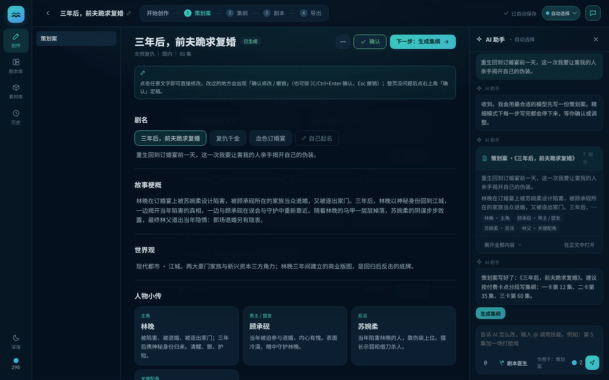

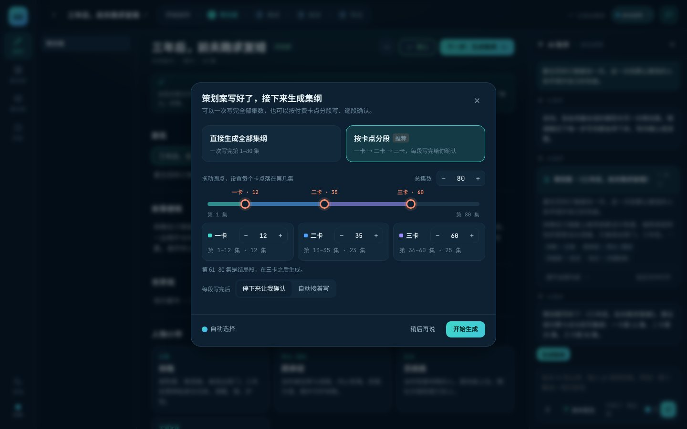


**「后面自动连续写」**：卡片上勾选后（或在卡点弹窗选「自动接着写」），之后每段写完自动写下一段，AI 助手提示「一卡集纲写好了，按你的设置自动接着写二卡。」这个设置是全局的，会记住。

### 4.4 自定义节点（精细生成）

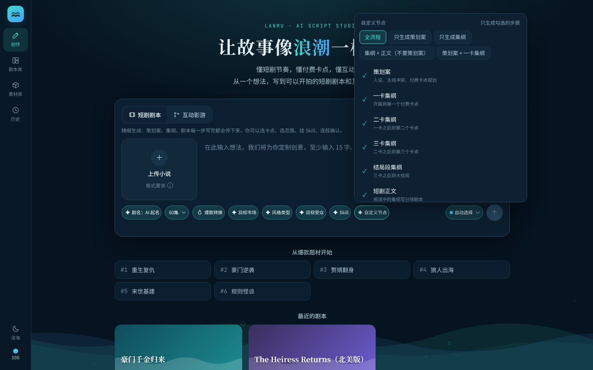

节点：策划案、一卡集纲、二卡集纲、三卡集纲、结局段集纲、短剧正文。

| 预设 | 勾选的节点 |
|---|---|
| 全流程（默认） | 全部 |
| 只生成策划案 | 策划案 |
| 只生成集纲 | 四段集纲 |
| 集纲 + 正文（不要策划案） | 四段集纲 + 短剧正文 |
| 策划案 + 一卡集纲 | 策划案 + 一卡集纲 |

执行规则：

1. 「全流程」= 普通精细生成（每一步停下）。其他组合 = 勾选的步骤依次**自动**执行，全部完成后停下。
2. 没勾策划案：系统按创意自动搭一份「基础设定（自动）」（人设和卡点），**不扣积分**，版本记录里标「基础设定（自动）」；AI 助手说明「你没勾选策划案，我先按创意自动搭了一份基础人设和卡点……」。
3. 勾了短剧正文：如果也勾了全部集纲段或一段都没勾 → 写全文剧本；只勾了部分段 → 只写这些段的剧本。缺的集纲会先自动补写。
4. 某段不存在（三卡就是最后一集，没有结局段）→ 跳过并提示。
5. 执行中文档顶部显示进度条「✦ 按自定义节点生成中：✓ 策划案 — ◌ 一卡集纲」。
6. 全部完成：AI 助手和下一步卡片提示「自定义节点都完成了：策划案、一卡集纲。没勾选的步骤没有执行……」，按钮按已生成的内容给（查看剧本 / 续写 / 导出，或查看集纲 / 接着写剧本，或查看策划案 / 接着生成集纲）。

面板底部说明文案随勾选变化，例如「正文需要集纲：缺少的集纲会先自动补写。」

### 4.5 小说改编

1. 首页上传或粘贴小说 → 点「解析小说」或发送。
2. 进入「小说解析」页，显示解析进度（识别章节 · 抽取人物 · 梳理主线 · 定位名场面）。
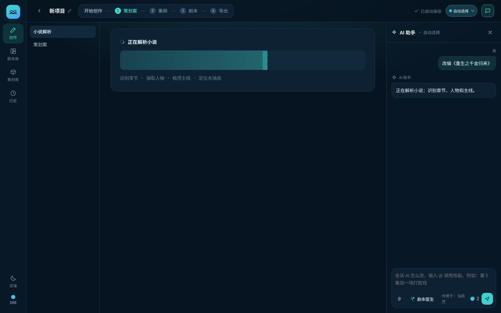

3. 解析完成：

| 区块 | 内容 | 可操作 |
|---|---|---|
| 标题 | 小说解析 ·《书名》· N 字 · N 章 | 「确认，生成策划案 →」 |
| 主线 | 一句话主线 | — |
| 主要人物 | 人名标签 | — |
| 改编范围 | 第 a 章到第 b 章 + 章节列表 | 数字输入 |
| 改编力度 | 忠于原著 / 适度改编（默认）/ 大幅重构 | 分段按钮 |

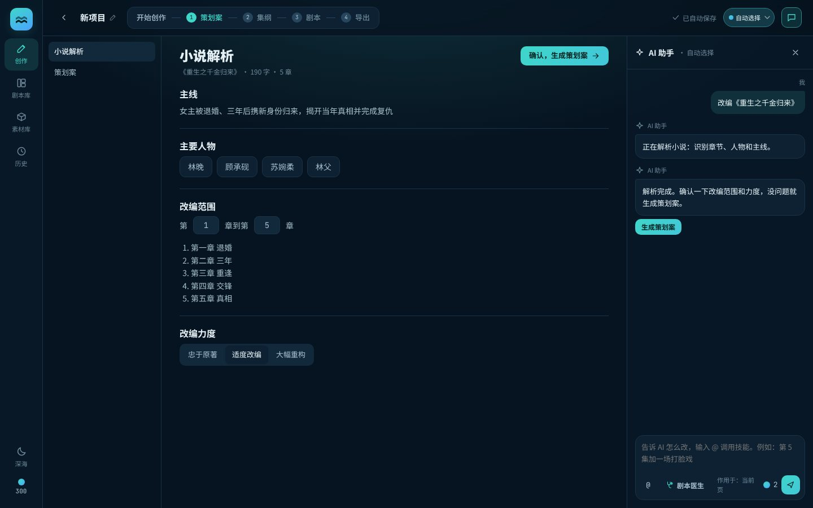

4. 一句话生成：解析完直接一站直出；精细生成：停在解析页，等用户点「确认，生成策划案」（或自定义节点时「按自定义节点生成」）。
5. 章节识别规则：按「第 N 章 / 回 / 节」识别，识别不到时整篇作为一章。文本少于 20 字 → 解析失败。
6. 改编后的策划案一句话梗概写「改编自《书名》：主线」。

### 4.6 爆款转换

两个方向：

| 方向 | 做什么 | 默认 |
|---|---|---|
| 国内爆款迭代 | 保留原剧的节奏骨架和卡点位置，换成另一个国内爆款题材，重写人设、金手指和名场面 | 题材默认「重生、复仇」，集数同原设置 |
| 海外本土化 | 保留原剧的故事和节奏，把人名、城市、文化细节和台词语言换成目标市场版本 | 市场默认北美，60 集 |

入口：

- 首页「爆款转换」chip → 选方向 → 上传 / 粘贴 / 示例爆款 → 发送。
- 短剧剧本页「转换 ▾」菜单 →「爆款转换：换个国内题材」/「爆款转换：本土化成海外版」：用当前剧本**新建一个爆款转换项目**（剧名加「（题材迭代）」或「（海外版）」），原项目不变。


「爆款转换」页（拆解完成后）：

| 区块 | 内容 |
|---|---|
| 标题 | 原剧约 N 集 · 识别出 3 个付费卡点（第 8 / 30 / 55 集）· 4 种钩子手法；按钮「生成转换后的策划案 →」 |
| 转换方向 | 国内爆款迭代 / 海外本土化（生成策划案之前可改，之后置灰） |
| 目标题材 / 目标市场 | 国内：PE 题材标签，最多 3 个，至少保留 1 个；海外：市场分段按钮 |
| 转换方案 | 对照表：项目 / 原剧 / 转换后。国内：主角人设、金手指、名场面、主要反派、节奏与卡点；海外：人名、城市、文化细节（5 条）、台词语言、节奏与卡点 |
| 本土化注意事项 | 海外时显示，例如北美「避免族裔刻板印象；台词口语化，节奏比国内再快 20%。」 |
| 相似度（预估） | 结构相似度、情节相似度两个进度条。国内 72% / 18%（情节相似度控制在 30% 以内）；海外 86% / 42%（需要持有原剧版权或改编授权）。情节相似度 > 30% 显示琥珀色 |
| 原剧拆解 | 爽点强度柱状图（20 柱，卡点区间珊瑚色）+ 钩子手法 |

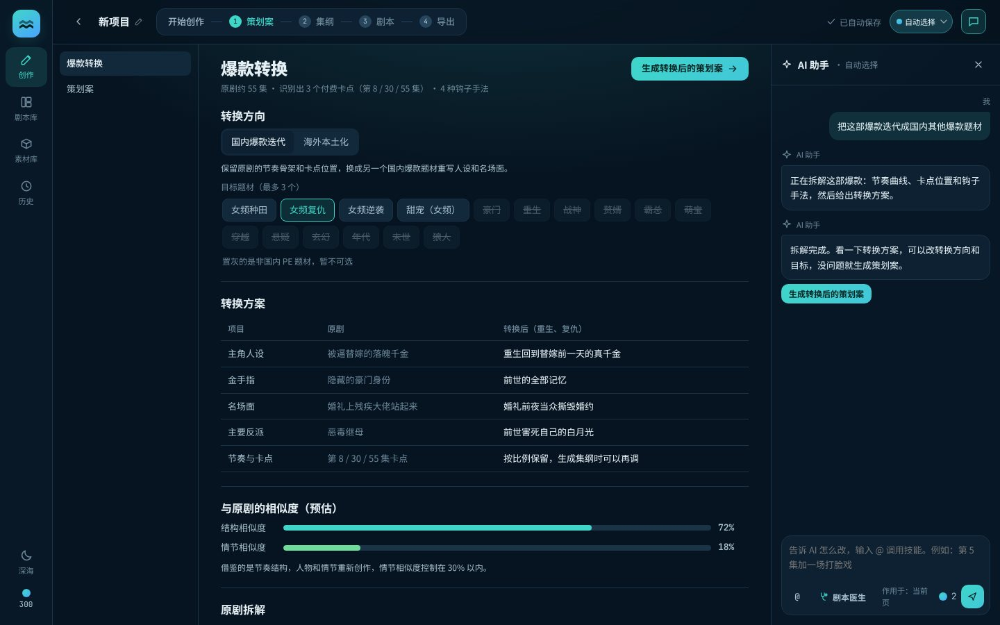

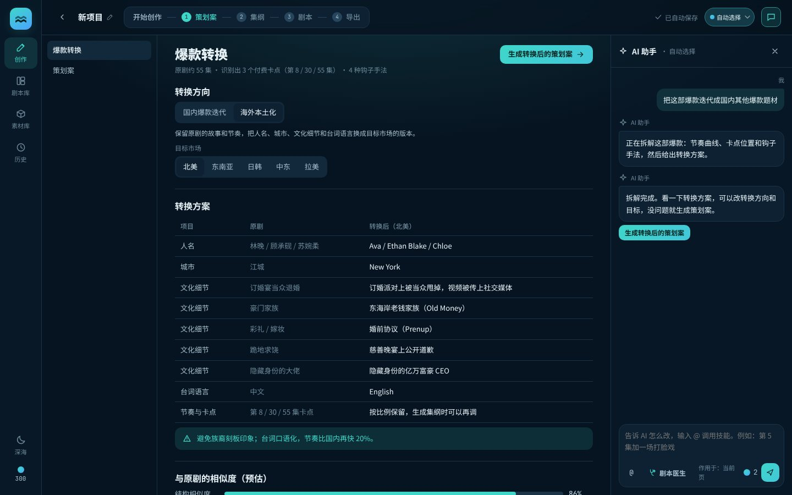

卡点识别：原文里有「第 N 集【一卡】」这类标记时取标记，否则默认第 8 / 30 / 55 集。

### 4.7 互动影游

**一句话创作**：和原创一样先写策划案 → 集纲 → 短剧剧本，再转成互动影游剧本。一句话生成时全自动；精细生成时每步停下，最后在剧本页点「转互动影游剧本」，配置面板预填首页选的形式、视角、结局数。

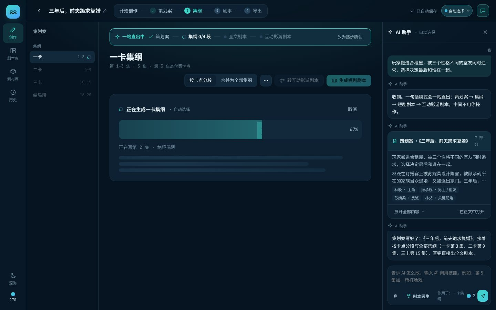

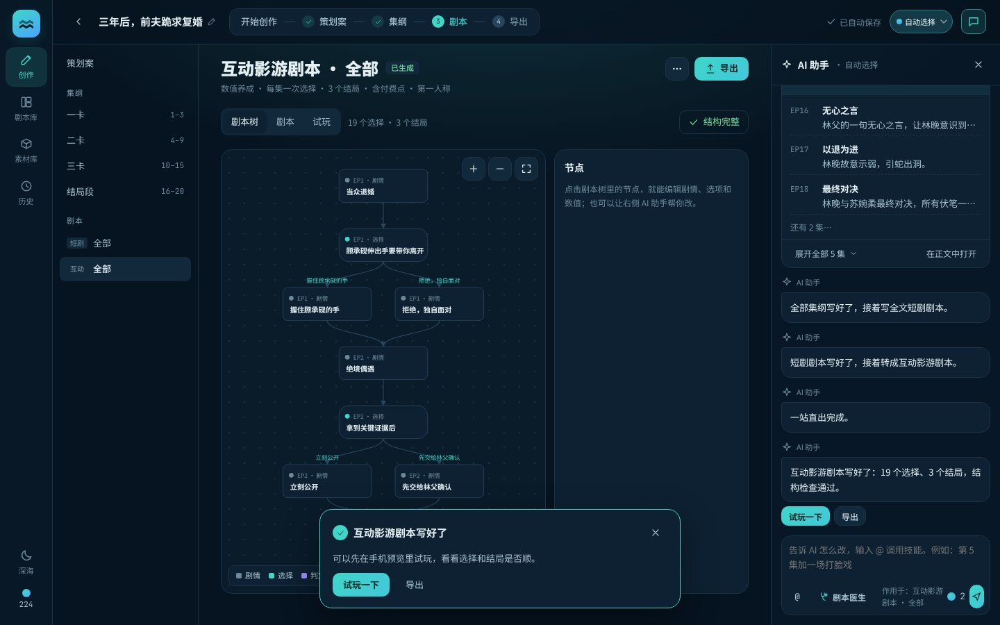

**上传剧本转换**：

1. 首页互动影游 → 上传框上传 / 粘贴 / 示例剧本 → 发送。
2. 解析规则：
   - 按「第 N 集 标题」分集，没有分集标题 → 解析失败「没有识别到「第 N 集」这样的分集标题」。
   - 标题里的【一卡】【二卡】【三卡】作为卡点；没有标记时按 30% / 60% / 最后一集。
   - 「人名：（动作）台词」识别为对白，「△」开头识别为动作；台词最多的人作为主要角色。
   - 每集的第一句动作作为集纲梗概，最后一行作为钩子；原文分场直接作为剧本内容使用。
   - 自动生成一份策划案（剧名取《》内的名字）和「全部集纲」。
3. 一句话生成：直接转成互动影游剧本。精细生成：停在「剧本解析」页，页面顶部展开「转成互动影游剧本」配置面板，确认后点「开始转换」。

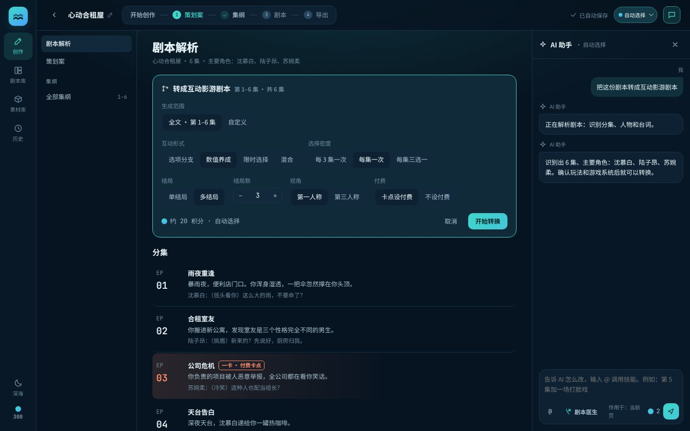

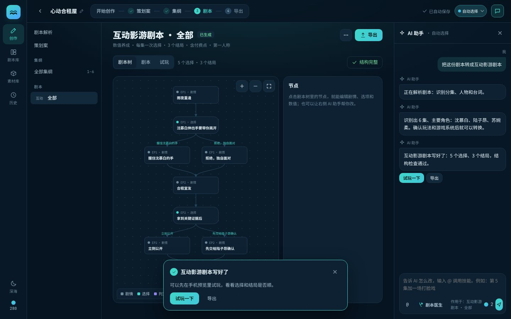

### 4.8 解析失败

触发：文本少于 20 字、文件编码无法识别、剧本没有分集标题、页面在解析中被刷新。

表现：解析页显示红色提示「解析失败：原因」，按钮「重新解析」「返回修改」。项目状态 = 解析失败。

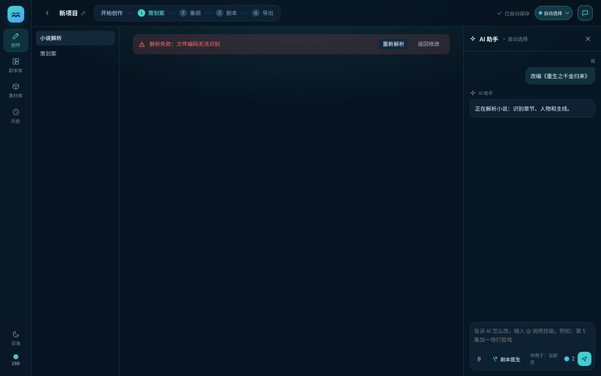

---

## 5. 项目工作台

### 5.1 顶栏


| 元素 | 规则 |
|---|---|
| ← 返回 | 回到剧本库 |
| 剧名 | 点剧名或旁边的 ✎ 直接编辑（✎ 会全选剧名），Enter 或失焦保存，最多 30 字；为空恢复原名。保存后同步到策划案（设为当前剧名并加入备选）和剧本库，Toast「剧名已改为《xxx》」。首页起了名时生成中就显示这个名字，否则策划案写好前显示「新项目」 |
| 步骤条 | 开始创作 — ① 策划案 — ② 集纲 — ③ 剧本 — ④ 导出。当前所在步骤高亮，已完成的步骤显示 ✓。可点击跳转（见下表） |
| ✓ 已自动保存 | 每次保存刷新 |
| 模型 chip | 和首页同一个设置，切换后 Toast「已切换到 GLM-5.2」，影响之后的生成 |
| **AI 助手开关（本版新增）** | 对话图标。打开时图标高亮，再点收起。见第 7 章 |

步骤条点击：

| 点击 | 行为 |
|---|---|
| 策划案 | 去策划案页；改编 / 转换项目在策划案还没生成时去解析页 |
| 集纲 | 有集纲 → 去第一段；没有集纲但策划案已生成 → 打开卡点设置弹窗；策划案也没有 → Toast「先完成策划案」 |
| 剧本 | 有剧本 → 去第一份剧本；没有 → Toast「在集纲页点「生成短剧剧本」或「转互动影游剧本」」 |
| 导出 | 有剧本 → 去剧本页并打开导出弹窗；没有 → Toast「先生成剧本」 |

### 5.2 目录

| 分组 | 条目 | 右侧 |
|---|---|---|
| （顶部） | 小说解析 / 爆款转换 / 剧本解析（仅非原创项目） | — |
| — | 策划案 | 状态图标 |
| 集纲 | 按卡点分段：一卡、二卡、三卡、结局段；合并时：全部集纲 | 集数区间（如 1–12）+ 状态图标 |
| 剧本 | 「短剧」标签 + 范围名；「互动」标签 + 范围名 | 状态图标 |

状态图标：生成中 = 转圈；待更新 = 琥珀点；生成失败 = 红点；已确认 = 锁；等待前置 = 整行置灰。

### 5.3 策划案页


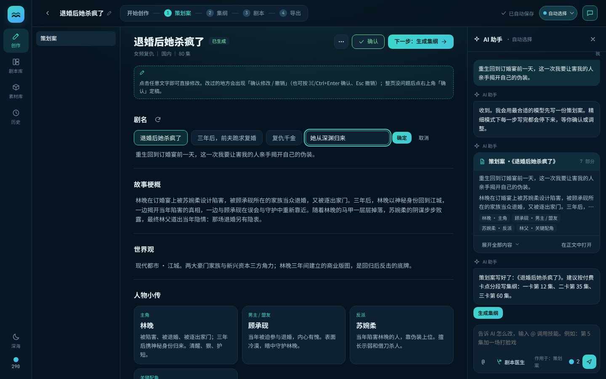

| 区块 | 内容 | 交互 |
|---|---|---|
| 标题行 | 剧名 + 状态标签（已生成 / 已编辑 · v3 …）；副标题：题材 ｜ 市场 ｜ 集数 ｜ Skill | 右侧：⋯ 更多、✓ 确认、「下一步：生成集纲 →」（已有集纲时变成「查看集纲 →」） |
| 剧名 | 3 个备选剧名按钮 +「✎ 自己起名」+ 一句话梗概 | 点备选剧名 = 设为剧名（同步顶栏）；点「自己起名」变成输入框 + 确定 / 取消（Enter / Esc），确定后设为剧名并排到备选第一个；梗概可直接改 |
| 故事梗概、世界观、核心冲突与爽点、节奏与付费卡点、结局方向 | 文本 | 可直接改 |
| 人物小传 | 4 张人物卡（主角、男主 / 盟友、反派、关键配角） | 描述可直接改 |
| 每个区块标题旁 ↻ | 鼠标悬停才出现 | 只重新生成这一块，2 积分，版本标「局部重新生成」；剧名区块重新生成 3 个备选 |

更多菜单：剧本医生体检、确认定稿、版本记录、全部重新生成（10 积分）。

男频创意（含高武 / 武道 / 修仙等，或受众选男频）使用男频模板：废脉逆袭、境界体系、武道会等，人物关系也对应调整。

### 5.4 集纲页


**标题行**：「一卡集纲」+ 状态标签；副标题「第 1–12 集 · 12 集 · 第 12 集是付费卡点」。

右侧操作：

| 按钮 | 规则 |
|---|---|
| 视图切换：按卡点分段 / 合并为全部集纲 | 一直显示在标题行（不藏进菜单）。分段 → 合并：各段合并成「全部集纲」，剧本不受影响；有段没写的用占位补齐并标「待更新」。合并 → 分段：打开卡点设置弹窗，选好后按卡点拆开 |
| ⋯ 更多 | 剧本医生体检、调整卡点位置（仅分段）、按其他范围写剧本 / 转互动影游剧本（已有剧本时）、确认定稿、版本记录、重新生成本页 |
| ✓ 确认 | 定稿 |
| 转互动影游剧本 / 查看互动影游剧本 | 没有覆盖这段的互动版本时打开配置面板，有则跳过去 |
| 生成短剧剧本 / 查看短剧剧本 | 同上 |

**页面状态**：

| 状态 | 表现 |
|---|---|
| 等待前置（blocked） | 锁图标 +「「一卡」写完后，这一段会接着往下写」+「去一卡」按钮 |
| 未生成（empty） | 「这一段还没有生成」+「生成二卡集纲」按钮 |
| 生成中 | 进度卡：转圈 + 「正在生成一卡集纲 · 模型名」+ 取消；进度条 + 「正在写第 10 集 · 旧人归来」+ 骨架屏 |
| 生成失败 | 红色提示 + 「重新生成」 |
| 已生成 / 已编辑 / 待更新 / 已确认 | 正常显示内容，配合提示条（见第 6 章） |


**集纲内容**：编辑提示条 → 集数跳转条（超过 8 集或有修改版时显示，吸顶；卡点集红框，修改版紫框带点，点击滚动到该集）→ 每集一行：EP 编号、标题（可改）、卡点标签「一卡 · 付费卡点」、AI 改过时的「修改版」标签和「对比第一版 / 恢复第一版」（见 7.5）、梗概（可改）、「钩子：…」。

### 5.5 卡点设置弹窗

两种用途：**生成集纲**（策划案写好后自动弹出，或步骤条 / 策划案页按钮打开）和**调整卡点**（集纲页更多菜单）。

| 元素 | 规则 |
|---|---|
| 生成方式（仅生成集纲时） | 「直接生成全部集纲：一次写完第 1–N 集」/「按卡点分段（推荐）：一卡 → 二卡 → 三卡，每段写完给你确认」 |
| 滑杆 | 三个圆点分别是一卡、二卡、三卡，标签「一卡 · 12」；拖动或聚焦后用 ← → 调整；三段用不同颜色填充 |
| 数字步进 | 每张卡点卡片有 − / 输入框 / +，下方显示「第 1–12 集 · 12 集」 |
| 总集数 | − / 输入 / +，步长 5，范围 10–150；改总集数时三个卡点按比例缩放。调整卡点时不能改 |
| 约束 | 一卡 ≥ 第 1 集；相邻卡点至少隔 3 集；三卡 ≤ 总集数。越界时圆点抖动，红字「二卡只能放在第 15–57 集（相邻卡点至少隔 3 集）」 |
| 结局段说明 | 「第 61–80 集是结局段，在三卡之后生成。」或「三卡就是最后一集。」 |
| 每段写完后 | 停下来让我确认 / 自动接着写（仅生成集纲时） |
| 底部 | 当前模型；稍后再说 / 取消；开始生成 / 应用 |

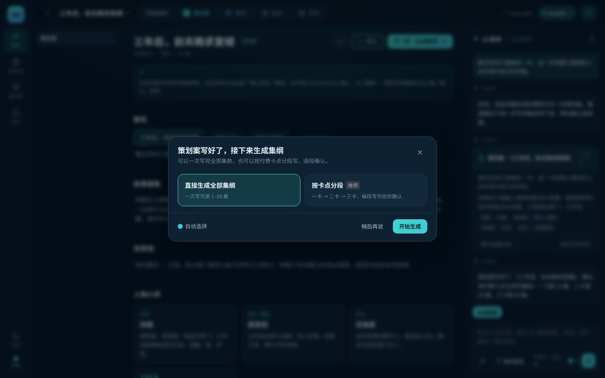

**调整卡点的影响**：

- 变化的段：已生成内容按新区间重新分配；新增进来的集用占位补齐（标「待补写」），该段变成「待更新」，提示「卡点调整后，这一段变成第 a–b 集，新增的集还需要补写」。
- 下游剧本按范围重叠关系标「待更新」。
- 有已定稿的段需要变化 → 不允许应用，红字「「一卡」已定稿，先解除定稿再调整」。
- 三卡调到最后一集 → 删除结局段。

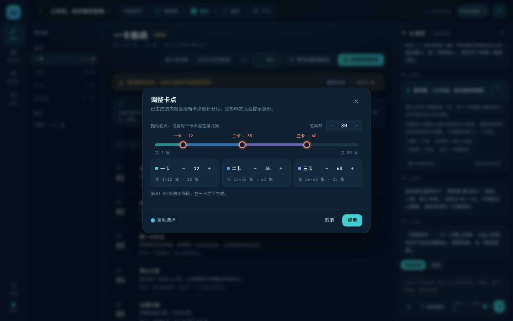

### 5.6 短剧剧本页


**标题行**：「短剧剧本 · 一卡」+ 状态；副标题「第 1–12 集 · 24 场 · 约 1988 字 · 成片约 18 分钟 · 带镜头提示」（成片时长：1–2 分钟版每集 1.5 分钟，2–3 分钟版每集 2.5 分钟）。

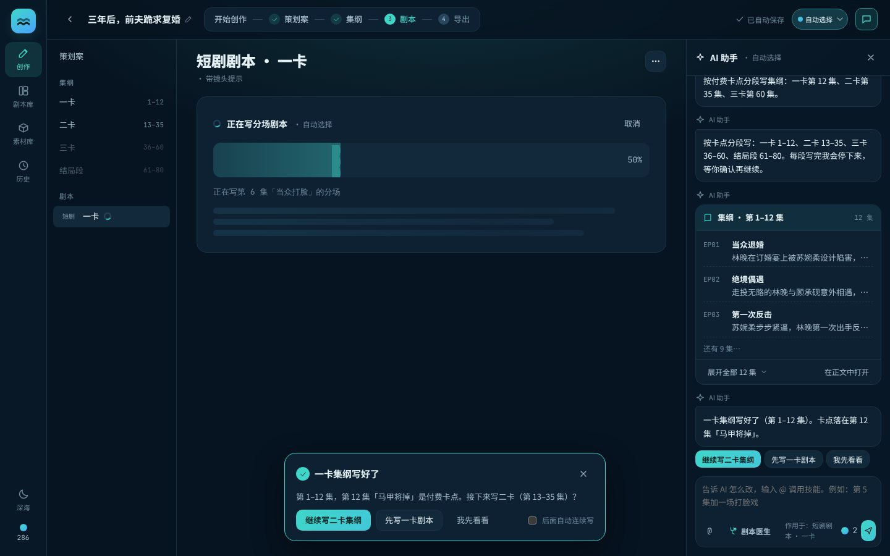


右侧操作：⋯ 更多（剧本医生体检、确认定稿、版本记录、重新生成、在结尾加更几集）、✓ 确认、导出、转换 ▾（转互动影游剧本 / 查看互动影游剧本；爆款转换：换个国内题材；爆款转换：本土化成海外版）、主按钮「续写二卡」（已到结尾时为「续写 · 加更」）。

**每集**：

- 集头：EP01 + 标题 + 卡点标签；右侧（未定稿时）「让 AI 改这一集」「重写本集」。
  - 让 AI 改这一集：打开 AI 助手（如果收起），输入框预填「第 1 集：」并聚焦。
  - 重写本集：1 积分，换场景和台词重写这一集，这一集变成「修改版」（见 7.5）；AI 助手提示「第 1 集重写好了，换了场景和台词。修改版已经替换到正文第 1 集，可以和第一版对比。」+「对比第一版」「撤销」；该集闪烁高亮。
  - AI 改过的集：集头显示「修改版」「对比第一版」「恢复第一版」，对比时这一集的分场变成左右两栏（见 7.5）。
- 每场：场次头「1-1 日 外 雨夜街头」、人物、内容行。内容行四类：动作（△）、镜头提示（【俯拍】，蓝色）、对白（人名 + （表演提示）+ 台词）、钩子（【钩子】或【一卡】，红色，每集最后一场的最后一行）。所有文字可直接改。
- 页面底部：「接下来是二卡（第 13–35 集）」+「续写二卡剧本」；写到结尾时「已经写到结尾」+「加更几集」。

### 5.7 内嵌配置面板（写剧本 / 转互动影游剧本）

不弹窗，直接在当前文档顶部展开（参考小云雀的嵌入式配置）。


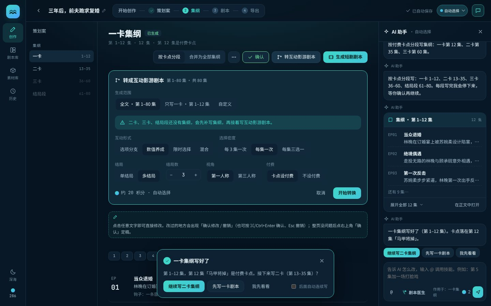

**公共：生成范围**

| 选项 | 规则 |
|---|---|
| 全文 · 第 1–N 集（默认） | 默认生成全文 |
| 只写一卡 · 第 1–12 集 | 当前页是某一段时出现 |
| 自定义 | 出现「从第几集到第几集」两个数字框；起始不能大于结束 |
| 缺集纲提示 | 范围内有段还没写集纲时：「二卡、三卡还没有集纲，会先补写集纲，再接着写剧本。」 |

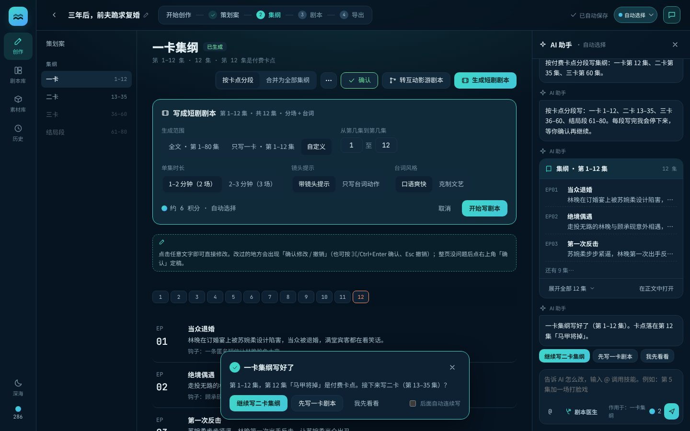

**写成短剧剧本**：单集时长（1–2 分钟 · 2 场 / 2–3 分钟 · 3 场）、镜头提示（带 / 只写台词动作）、台词风格（口语爽快 / 克制文艺）。底部：约 N 积分 · 模型；取消 / 开始写剧本。

**转成互动影游剧本**：互动形式（选项分支 / 数值养成 / 限时选择 / 混合）、选择密度（每 3 集一次 / 每集一次 / 每集三选一）、结局（单结局 / 多结局 + 结局数 2–5）、视角（第一人称 / 第三人称）、付费（卡点设付费 / 不设）。同范围已有互动版本时标题提示「会覆盖这个范围已有的互动版本」。底部：约 20 积分；取消 / 开始转换。

剧本的 key 由范围决定（全文 / 某段 / 第 a–b 集），**和集纲是分段还是合并无关**，所以切换集纲视图不会产生重复剧本。

### 5.8 续写与加更

| 操作 | 入口 | 规则 |
|---|---|---|
| 续写 | 剧本页主按钮、页面底部、下一步卡片、AI 助手按钮 | 写下一段的剧本，沿用当前剧本的参数；下一段没集纲时先补写集纲 |
| 加更 | 写到结尾后的「加更几集」；更多菜单「在结尾加更几集」 | 弹窗选 3 / 5 / 10 集 →「共 85 集（第 81–85 集）」；先续写集纲（开一条新的冲突线，不改已写内容），再写这几集剧本，接到已有剧本后面。积分约 max(4, 2n) + 2n |
| 互动影游续写 | 互动影游剧本页更多菜单「续写二卡」 | 把下一段并进同一个互动剧本，重新生成；标题变成「互动影游剧本 · 一卡–二卡」 |

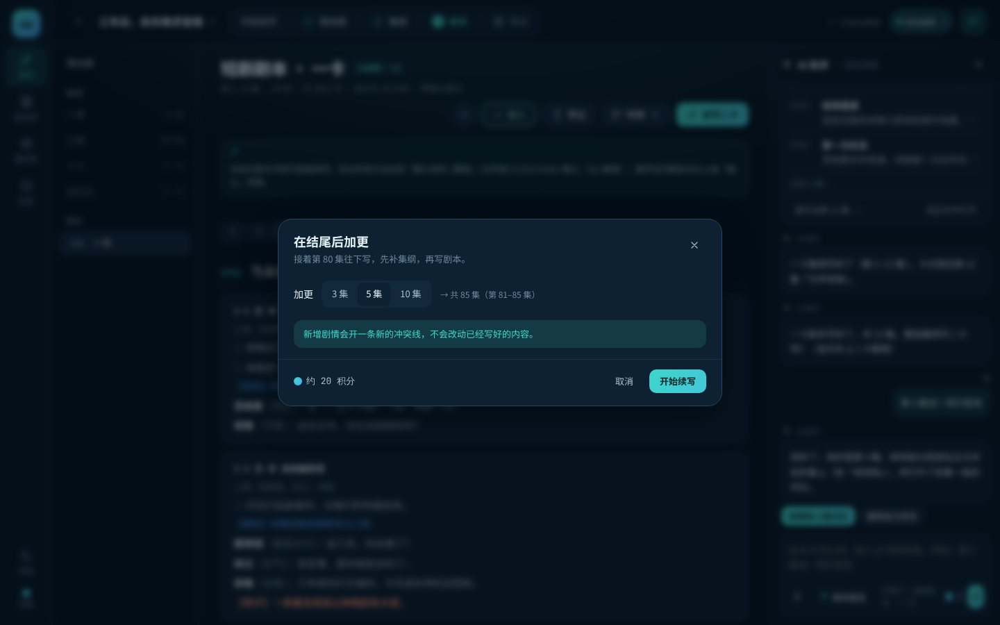

### 5.9 互动影游剧本页

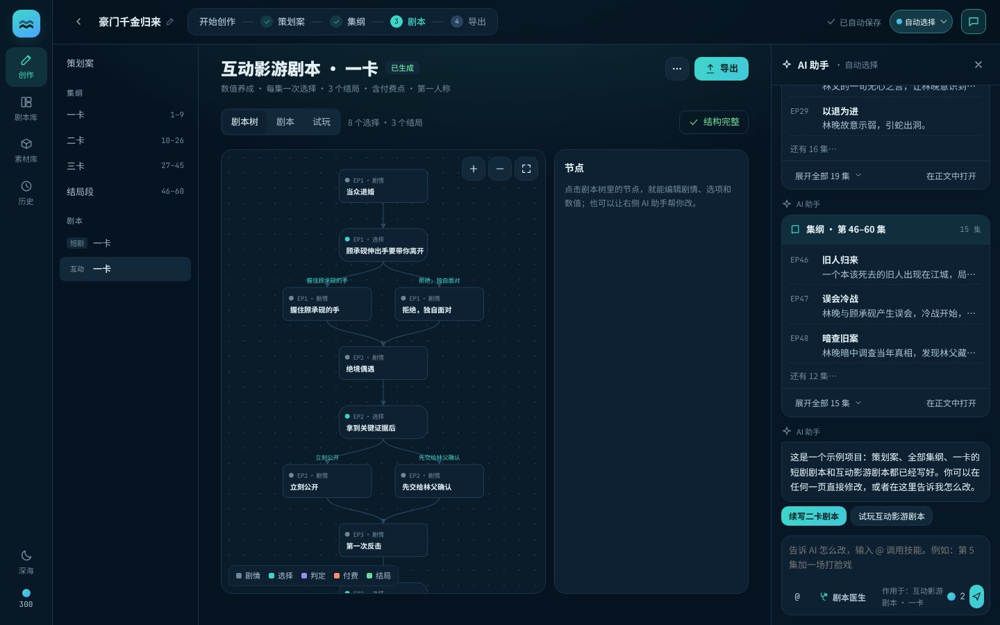

**标题行**：「互动影游剧本 · 一卡」+ 状态；副标题是配置（数值养成 · 每集一次选择 · 3 个结局 · 含付费点 · 第一人称）。右侧：⋯ 更多（剧本医生体检、确认定稿、修改设置并重新生成、续写下一段）、导出。

**工具条**：剧本树 / 剧本 / 试玩 三个标签；「8 个选择 · 3 个结局」；右侧结构检查结果：✓ 结构完整 / ⚠ N 条提醒 / ⚠ N 处需修复（后两者可点，回到剧本树并显示问题列表）。

**节点类型**：

| 类型 | 颜色 | 说明 | 出口 |
|---|---|---|---|
| 剧情 | 灰 | 一集的剧情或某个分支的剧情 | 1 个下一步 |
| 选择 | 青 | 选择题 + 2–4 个选项，每个选项可带数值变化（好感 / 实力）和隐藏标记；限时选择时带 8 秒倒计时 | 每个选项 1 个 |
| 判定 | 紫 | 按数值和标记分流到不同结局，从上往下匹配，其余走「否则」 | 每条规则 1 个 + 否则 |
| 付费 | 珊瑚 | 卡点集后的付费解锁 | 1 个下一步 |
| 结局 | 绿 | 好结局 / 坏结局 / 隐藏结局 / 事业结局 / 真结局 | 无 |

**剧本树交互**：主线自上而下，同层分支左右并排；连线上标选项文字；回跳的线从右侧绕。拖动画布平移、滚轮缩放（15%–250%）、右上角放大 / 缩小 / 适配画布；左下角图例。有问题的节点红框（错误）或琥珀框（提醒），走不到的节点虚线框；改过的节点标「已改」。

**节点编辑**（点节点后右侧面板）：

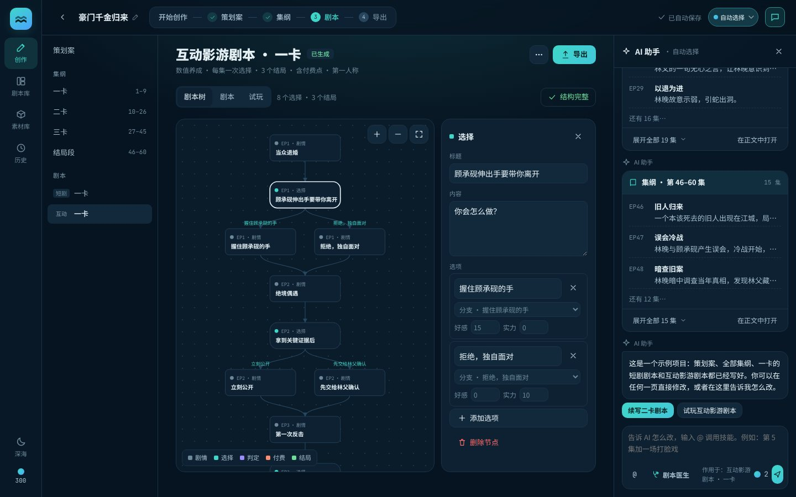

| 节点 | 可编辑 |
|---|---|
| 全部 | 标题、内容；删除节点（开始节点不能删） |
| 剧情 / 付费 | 下一步（下拉选任一节点） |
| 选择 | 每个选项：文字、指向、各数值变化；删除选项；添加选项（最多 4 个） |
| 判定 | 每条规则的门槛值；显示「其余 → 坏结局」 |

没选节点时右侧面板显示说明和「需要处理」问题列表，点问题定位到对应节点。每次编辑后自动重新校验。

**结构校验规则**（生成后、每次编辑后、导出前自动执行）：

| 级别 | 规则 | 提示文案 |
|---|---|---|
| 错误 | 从开头走不到的节点 | 「X」从开头走不到这里 |
| 错误 | 非结局节点没有出口，或出口没指定目标 | 「X」没有下一步 / 有出口没指定目标 |
| 错误 | 判定条件的数值门槛超过全剧最大可得值 | 「好结局」要求好感≥30，但全剧最多只能到 25 |
| 错误 | 判定需要的标记没有任何选项能触发 | 「隐藏结局」需要的条件没有任何选项能触发 |
| 错误 | 某节点之后怎么选都到不了结局 | 「X」之后怎么选都到不了结局 |
| 错误 | 没有结局节点 | 剧本没有结局 |
| 提醒 | 选择只有 1 个选项 | 「X」只有 1 个选项，算不上选择 |

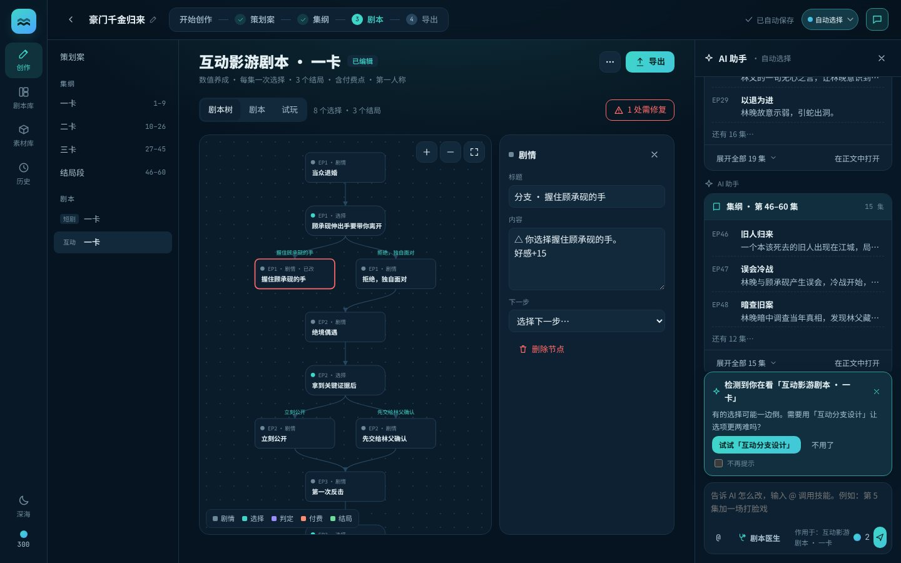

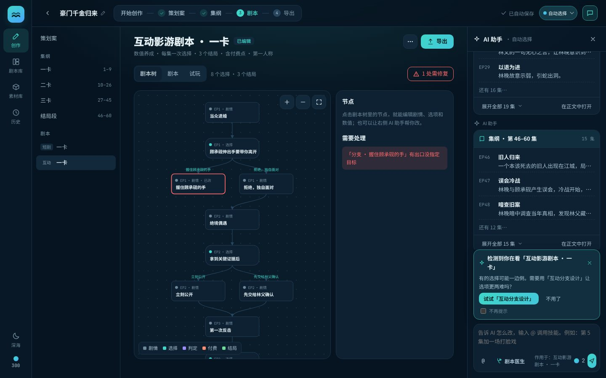

**剧本**标签：按节点顺序的文字版，选择节点列出每个选项 → 指向 + 数值变化，判定节点列出规则。


**试玩**标签：手机外框预览。顶部显示当前数值；剧情节点「继续 ▸」；选择节点列出选项（限时选择带倒计时条）；付费节点「解锁后续剧情（演示，不扣费）」；判定节点自动分流；结局显示结局名 +「↺ 再玩一次，试试别的选择」；剧情断了提示「剧情在这里断了，先去剧本树修一下。」

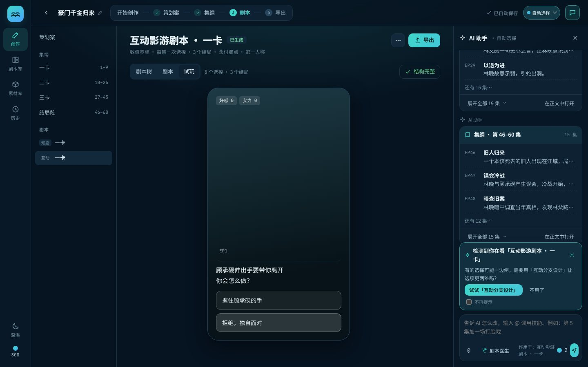

**生成规则**（模拟逻辑，正式版由模型生成，结构要求不变）：每集 1 个剧情节点（优先用该集已写好的剧本内容）；卡点集且开了付费 → 加付费节点；按选择密度在集后加选择节点（第一人称时主角名替换成「你」）；结尾单结局直接接结局，多结局先接判定再分到 2–5 个结局；变量：选项分支只有「好感」，其他形式「好感、实力」。

### 5.10 导出

| 内容 | 格式 | 规则 |
|---|---|---|
| 短剧剧本 | 标准分场文本：《剧名》范围 → 第 N 集 标题（卡点）→ 场次头、人物、对白「人名：（提示）台词」、动作「△」 | 弹窗内只读文本框 +「复制全部」；复制后项目进入「已导出」 |
| 互动影游剧本 | JSON（给播放器 / 引擎）或分支表 CSV（节点 ID、类型、集、标题、下一步） | 有结构错误 → 不能导出，提示「还有 N 处结构问题，修好后才能导出」+「去修复」；只有提醒 → 「有 N 条提醒，不影响导出」+「仍然导出」 |

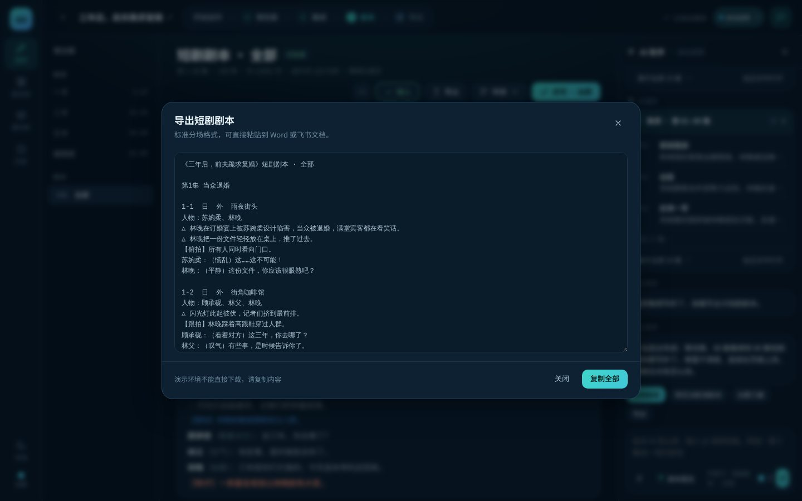

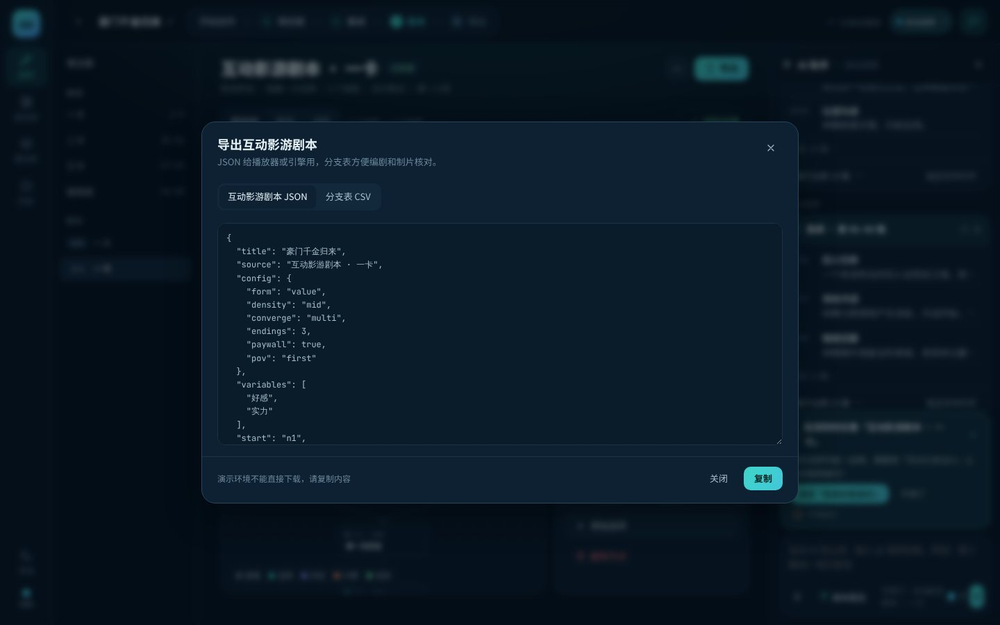

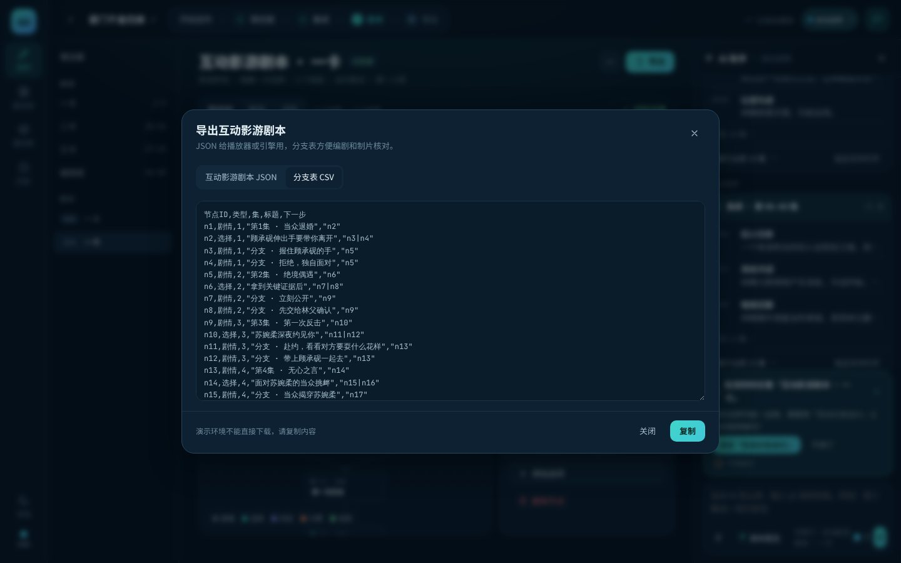

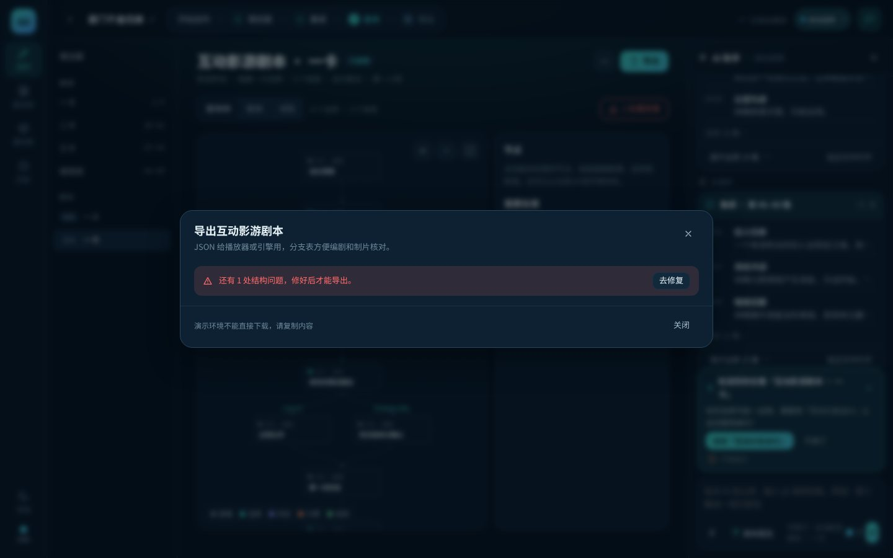

Demo 环境不能直接下载文件，只能复制；正式版需要支持下载 .docx / .txt / .json / .csv。

### 5.11 版本记录与撤销

- 每次生成、局部重新生成、AI 修改、剧本医生重写、恢复，都会存一版（v1、v2…），记录时间和模型。
- 入口：每页更多菜单「版本记录」；历史记录页「恢复此版本」。
- 恢复：内容回到该版，版本号 +1（记为「恢复到 v2」），页面变「已编辑」，下游按规则标「待更新」。已定稿不能恢复（Toast「已定稿，先解除定稿再恢复」），生成中不能恢复。
- 撤销：AI 修改、重写本集、剧本医生重写、恢复第一版之后，AI 助手消息带「撤销」按钮，恢复到修改前（同样存一版「撤销 AI 修改」，单集的修改版标记也一起回退）。只保留最近一次可撤销。
- 单集粒度的「修改版 / 第一版」对比见 7.5；页面级的版本记录管整页，两者互不冲突。

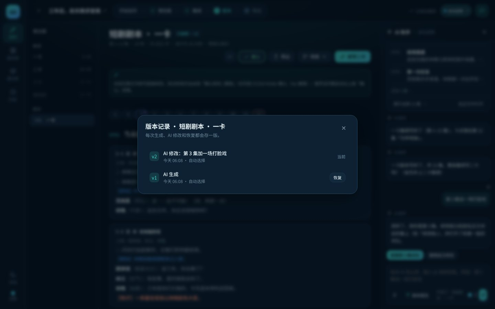

---

## 6. 编辑、定稿与改动传播

### 6.1 直接编辑

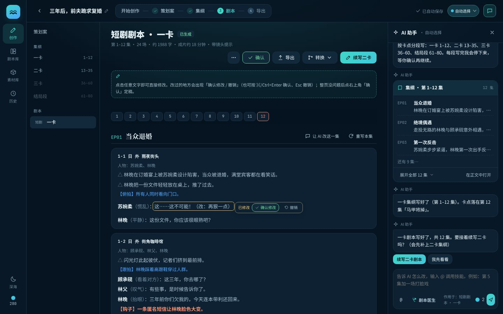

| 规则 | 说明 |
|---|---|
| 可编辑范围 | 策划案各区块和人物描述、集纲标题和梗概、剧本每一行、互动节点（在右侧面板） |
| 提示条 | 页面顶部虚线框：「点击任意文字即可直接修改。改过的地方会出现「确认修改 / 撤销」（也可按 ⌘/Ctrl+Enter 确认、Esc 撤销）；整页没问题后点右上角「确认」定稿。」 |
| 改动未确认 | 文字底色变琥珀色；后面出现浮条「已修改 ✓ 确认修改 ↺ 撤销」 |
| 确认修改 | 保存这一处，Toast「已确认修改」，页面状态变「已编辑」，按 6.3 传播 |
| 撤销 | 恢复原文，Toast「已撤销这处修改」 |
| 空内容 | 不能确认，Toast「内容不能为空，可以点「撤销」恢复」 |
| 未确认改动的保留 | 页面重绘（比如 AI 助手回复）时，未确认的改动保留 |
| 点「确认」定稿 | 先把这一页所有未确认的改动一起保存（Toast「已保存 3 处修改」），再定稿 |

### 6.2 确认定稿

| 操作 | 结果 |
|---|---|
| ✓ 确认 | 页面状态 → 已确认（锁）。所有文字不可编辑，「让 AI 改这一集」「重写本集」隐藏，提示条变成「已确认定稿，上游改动不会自动覆盖。需要再改，点右上角「继续编辑」。」AI 助手提示已定稿，并给下一步按钮（策划案 → 生成集纲；集纲 → 写成短剧剧本 / 继续写下一段集纲；剧本 → 导出剧本 / 续写） |
| 继续编辑 | 回到定稿前的状态（已生成或已编辑）；如果定稿期间上游有改动，回到「待更新」 |
| 已确认页面的限制 | AI 助手不改（回复「这一页已经确认定稿了……」）；剧本医生只能看报告，不能重写；不能恢复版本；有已定稿段时不能调整卡点 |

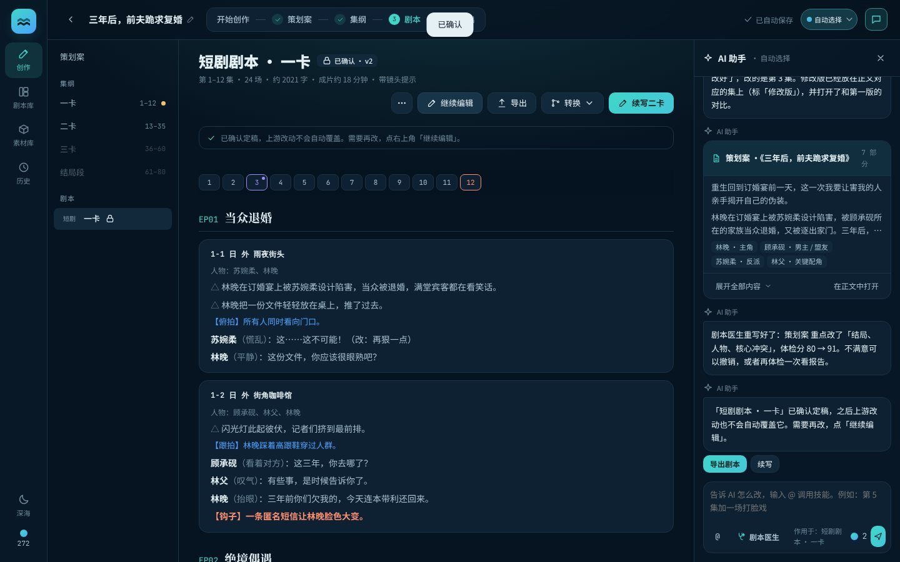

### 6.3 改动传播（待更新）

| 上游改动 | 受影响的下游 | 下游表现 |
|---|---|---|
| 策划案（编辑、局部重新生成、全部重新生成、AI 修改、恢复） | 所有集纲 | 已生成 / 已编辑 → 待更新，提示「策划案有改动，这部分集纲可能需要更新」 |
| 某段集纲 | 范围有重叠的短剧剧本、互动影游剧本 | 同上，提示「对应的集纲有改动，这部分剧本可能需要更新」 |
| 下游已确认 | — | 状态不变，只加一条说明「策划案有改动，这里已确认定稿，不会自动变动。」+「继续编辑」 |

「待更新」提示条：琥珀色，按钮「重新生成」「保持不变」（保持不变 → 变为已编辑，提示消失）。目录对应条目显示琥珀点。


---

## 7. AI 助手（右侧侧边栏）【本版改动】

### 7.1 打开与收起

| 项 | 规则 |
|---|---|
| 开关位置 | 顶栏最右侧的对话图标按钮（36×36，描边）。打开时高亮（青色描边和底色）。悬停提示「AI 助手」 |
| 打开 | AI 助手停靠在页面右侧，作为工作台第三栏，和文档并排；文档区自动变窄，**不覆盖任何内容**。高度 = 屏幕高度 − 顶栏高度，随页面吸顶，内部消息区单独滚动 |
| 收起 | 再点一次图标，或点侧边栏右上角 ×。文档区恢复全宽 |
| 默认状态 | 新建项目时打开；手机端默认收起 |
| 自动打开 | 只在用户明确要用的时候自动打开：点「让 AI 改这一集」、剧本医生里点建议 Skill、剧本医生「我自己改」时（要把修改清单发到对话里）。**编辑文字时不自动打开**（避免版面跳动），侧边栏打开时才显示编辑提醒 |
| 手机（≤760px） | 打开后为全屏面板，右上角 × 关闭；底部导航保留 |
| 去掉的内容 | 原来右下角的悬浮「AI 助手」按钮，以及 1240px 以下悬浮盖在页面上的面板 |


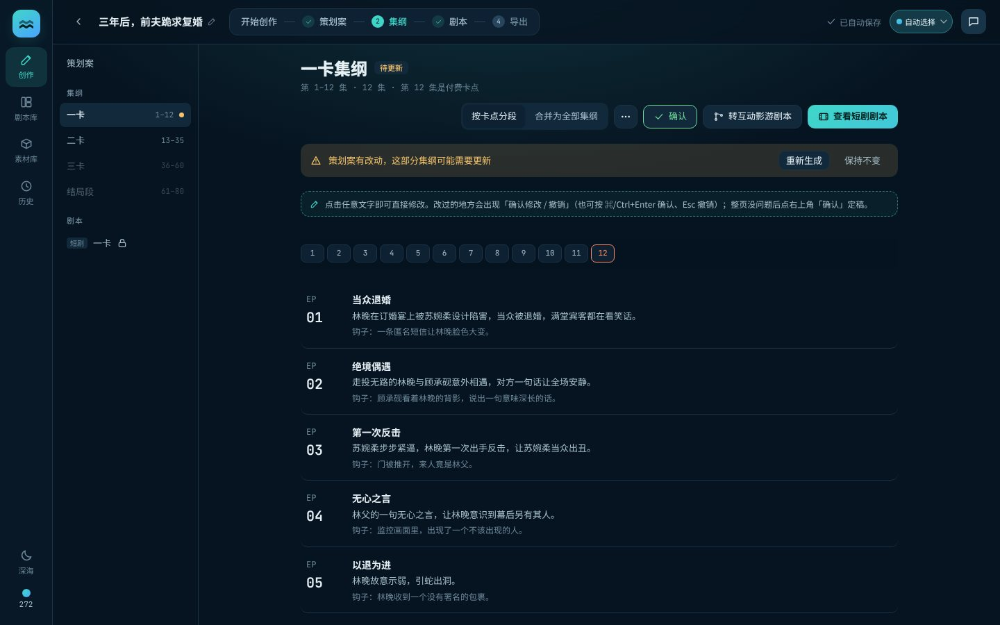

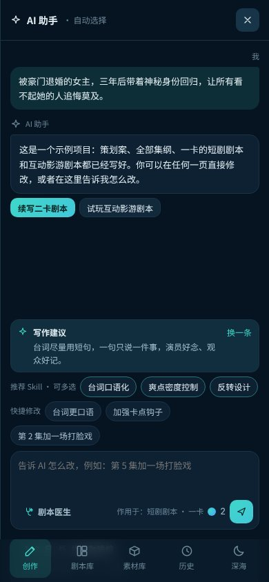{width=40%}

### 7.2 侧边栏结构

自上而下：

| 区块 | 内容 |
|---|---|
| 头部 | ✦ AI 助手 · 当前模型名；× 收起 |
| 消息流 | 「我」的消息靠右（青色底），AI 消息靠左（卡片）。系统在每一步完成、失败、需要用户选择时都会发消息。**只有最新一条 AI 文字消息显示操作按钮**，第一个按钮为主按钮。策划案、集纲生成后还会出现内容卡片（见 7.4）。新消息到达时自动滚到底；展开 / 收起卡片时保持当前位置 |
| 技能引导（偶尔出现） | 输入框上方的小卡片，见 7.7。平时不显示 |
| 输入框 | 已调用的技能以「@技能名」标签显示在输入框上方（可 × 移除）；占位「告诉 AI 怎么改，输入 @ 调用技能。例如：第 5 集加一场打脸戏」；底部：@ 按钮 · 剧本医生按钮 ·「作用于：当前页名」· 单次积分（2）· 发送 |
| 不再有的内容（v1.2 去掉） | 快捷修改、推荐 Skill、写作建议、编辑文字时弹出的「正在编辑…」提醒 |

### 7.3 对话改稿规则

| 情况 | AI 助手回复 |
|---|---|
| 当前页还没内容 | 先等内容生成出来，我再帮你改。 |
| 当前页已定稿 | 这一页已经确认定稿了。要改的话，先点右上角「继续编辑」。 |
| 当前页生成中 | 还在生成中，等写完我再改。 |
| 指令里的「第 N 集」不在当前页 | 第 30 集不在这一页（这里是第 1–12 集）。它在「二卡集纲」，去那里我再帮你改。+「打开二卡集纲」按钮；那一段还没写时提示先写出来 |
| 互动影游剧本没选节点 | 在剧本树里先点选一个节点，我再改它。 |
| 正常修改 | 改好了，改的是第 3 集。修改版已经放在正文对应的集上（标「修改版」），并打开了和第一版的对比。+「查看第 3 集对比」「撤销这次修改」；改到的集闪烁高亮；指令识别不出意图时追加「我按字面意思做了调整，不满意可以撤销后换个说法。」改策划案时回复后附「策划案 · 修改后」卡片，改集纲时附「集纲修改版 · 第 N 集」卡片（见 7.4、7.5） |

- 作用范围：只改当前打开的这一页（底部「作用于」写明）。指定了「第 N 集」就改那几集；没指定时，「钩子 / 卡点 / 悬念」类改卡点集，其他改中间一集（集纲）或第一集（剧本）。
- 每次 2 积分（× 模型倍率），存一版，按 6.3 传播。
- 意图识别（Demo 关键词，正式版由模型理解）：打脸 / 反击 / 爽、反派 / 狠、快 / 节奏 / 删、钩子 / 卡点 / 悬念、甜 / 感情 / 心动、口语 / 台词。


### 7.4 对话里的策划案 / 集纲卡片【本版新增】

AI 助手生成的策划案和集纲，除了写进正文，也在对话里以卡片形式输出一份，方便边聊边看。**短剧剧本、互动影游剧本的正文不进对话框**，只在对话里给文字说明和跳转按钮。

| 项 | 规则 |
|---|---|
| 什么时候出卡片 | 策划案生成 / 重新生成完成；每段集纲（或全部集纲）生成完成，包括补写集纲、加更集纲、剧本医生重写；AI 修改策划案或集纲之后（只含改过的部分） |
| 位置 | 紧跟在这一步的文字消息之前（文字消息带下一步按钮，保持在最下面） |
| 标题 | 策划案：「策划案 ·《剧名》」；集纲：「集纲 · 第 1–12 集」（范围取这次生成的首末集）；AI 修改后：「策划案 · 修改后」「集纲修改版 · 第 60 集」。右侧显示「7 部分」或「12 集」 |
| 折叠（默认） | 集纲超过 3 集时只显示前 3 集（每集一行：EP 编号、标题、卡点标签、梗概一行截断）+「还有 9 集…」；策划案显示一句话梗概、故事梗概前两行、人物标签 |
| 展开 | 点卡片标题栏或「展开全部 12 集 ▾」：集纲展开为全部集（标题、完整梗概、钩子）；策划案展开为全部 7 部分（一句话梗概、故事梗概、世界观、人物小传、核心冲突与爽点、节奏与付费卡点、结局方向）。展开后卡片内容区最高 60% 屏高，超出部分在卡片内滚动；「收起 ▴」恢复 |
| 不足 3 集 | 直接全部显示，没有展开按钮 |
| 在正文中打开 | 卡片底部按钮，跳到对应的策划案 / 集纲页 |
| 内容 | 卡片是生成那一刻的快照，之后正文再改不会改动旧卡片（对话记录保持原样）；正文以文档区为准 |


### 7.5 修改版与第一版对比【本版新增】

用户让 AI 改了某一集（对话改稿，或剧本页的「让 AI 改这一集」「重写本集」），正文里这一集显示为**修改版**，并支持查看第一版做对比。

| 项 | 规则 |
|---|---|
| 适用 | 集纲（各段 / 全部集纲）和短剧剧本的单集。策划案、互动影游剧本不按集记录 |
| 第一版 | 这一集**第一次被 AI 改之前**的内容。之后再改多少次，第一版都不变；记录改了几次 |
| 正文标记 | 集标题旁紫色标签「修改版」（悬停显示「AI 修改：第 60 集加强卡点钩子」）+「对比第一版 / 收起对比」+「恢复第一版」（已定稿时不显示恢复）；顶部集数跳转条里这一集紫框带点 |
| 自动打开对比 | AI 改完后自动打开改到的集的对比；AI 回复里「查看第 N 集对比」跳到这一集并打开对比 |
| 集纲对比 | 这一集下方左右两栏：左「第一版」，右「修改版 · 改了 N 次」；标题、梗概、钩子中有变化的字段高亮 |
| 剧本对比 | 这一集的分场换成左右两栏：左「第一版」，右「修改版」；按行对比，修改版新增的行紫色高亮，第一版里被删掉的行红色删除线；对比时正文只读，提示「点「收起对比」后可以继续直接修改」 |
| 恢复第一版 | 这一集换回第一版，去掉「修改版」标记，存一版（「第 60 集恢复第一版」），写历史；AI 助手提示「第 60 集已恢复成第一版。」+ 撤销 |
| 撤销 | AI 回复里的「撤销这次修改」：内容和修改版标记一起回到修改前 |
| 什么时候清掉修改版标记 | 整页重新生成、剧本医生重写整页、从版本记录恢复：视为新的一版，修改版标记全部清空；加更（在结尾续写）不清 |
| 用户手动直接编辑 | 不算 AI 修改，不产生修改版标记 |
| 手机端 | 对比改为上下两栏 |

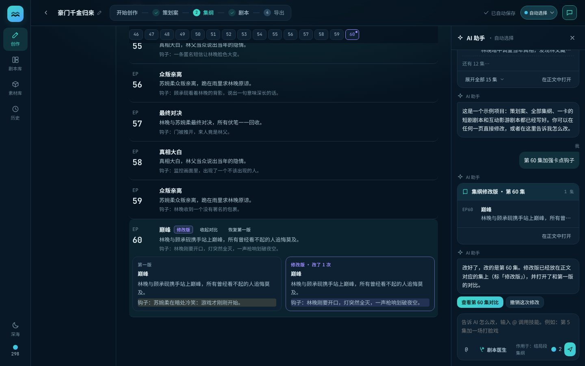

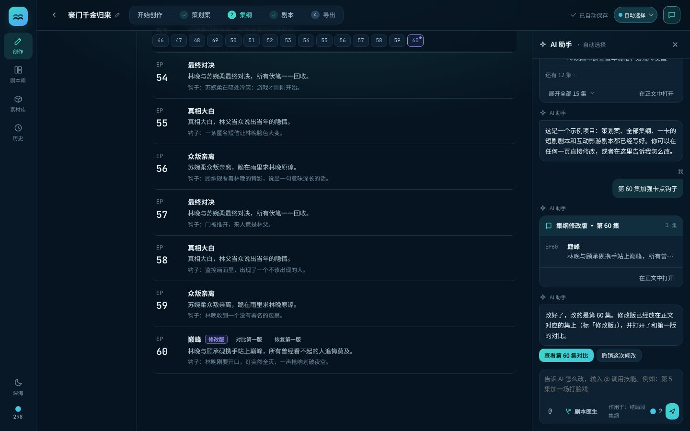

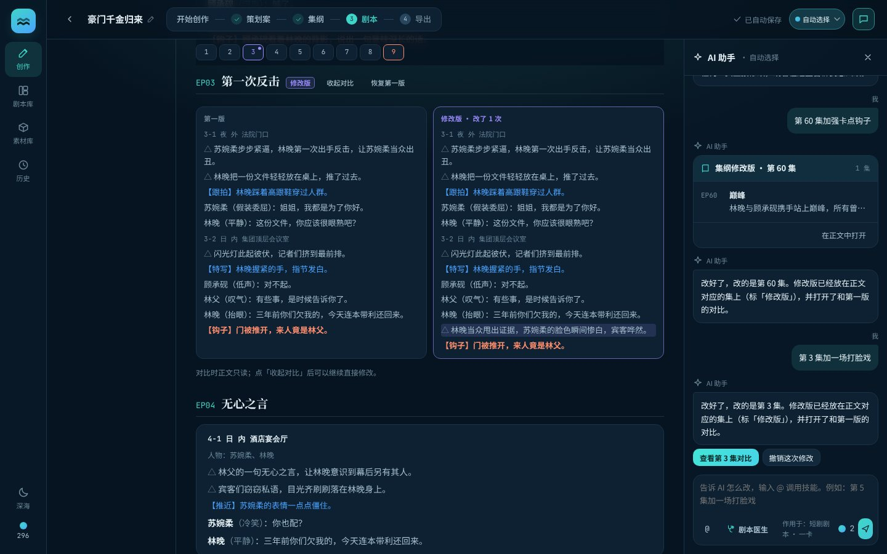

### 7.6 @ 调用技能【本版新增】

| 项 | 规则 |
|---|---|
| 打开技能列表 | 在输入框里输入 @（行首或空格后），或点输入框左下角「@」按钮 |
| 列表内容 | 全部内置技能（9 个，含新增「脑洞创意」）+ 用户上传且可用的技能。每行：@技能名 + 一句说明；已选的标「已选」 |
| 搜索 | @ 后面继续打字即按名称和说明过滤，例如「@钩」只剩「付费卡点钩子」；没有匹配时提示「没有匹配的技能，可以在素材库上传自己的 Skill」 |
| 选择 | 鼠标点击，或 ↑↓ 选择、Enter / Tab 确认；Esc 或点别处关闭。选中后输入框里的「@xx」文字被移除，技能变成输入框上方的「@技能名 ×」标签，光标回到原位 |
| 数量 | 一次最多 5 个，超出 Toast「一次最多调用 5 个技能」 |
| 发送 | 对话里显示为「@脑洞创意 这几集有点俗套」；只选了技能没写字时，按技能的默认指令发送（如「用「付费卡点钩子」加强卡点悬念」）。发送后技能挂到项目上（每个项目最多 5 个），标签清空 |
| 切换页面 | 未发送的输入和技能标签清空 |


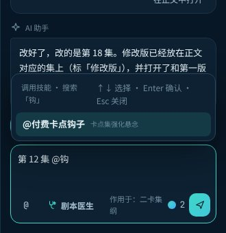


### 7.7 技能引导小卡片【本版新增】

目的：不常驻推荐，而是在用户可能需要的时刻，偶尔弹一张小卡片引导用户试一个技能。

**样式**：AI 助手输入框上方的小卡片（带轻微上浮动效）：「✦ 检测到你在看「二卡集纲」 ×」+ 一句说明 + 按钮「试试「脑洞创意」」「不用了」+ 勾选框「不再提示」。

**两种触发**：

| 触发 | 条件 | 检测与推荐 |
|---|---|---|
| 看内容时 | 在同一页停留 8 秒（包括刚生成完停在这一页）；期间（以及之前 10 秒）没有在给 AI 助手打字；这一页已生成、不在生成中、未定稿 | 策划案 →「脑洞创意」（主线想 3 个反转方向）；集纲 →「脑洞创意」（给第 a–b 集想 3 个反转）；短剧剧本 → 有超过 16 字的台词时「台词口语化」（「第 1、2、3 集有 9 句台词偏长」），否则「脑洞创意」；互动影游剧本 →「互动分支设计」 |
| 打字时 | 在 AI 助手输入框停止输入 0.8 秒后，按关键词判断；已经 @ 了对应技能就不提示 | 没灵感 / 卡住 / 想不出 / 新意 / 脑洞 / 俗套 / 套路 →「脑洞创意」；拖 / 节奏 / 太慢 / 无聊 →「爽点密度控制」；台词 / 对白 / 口语 →「台词口语化」；钩子 / 卡点 / 悬念 / 付费 →「付费卡点钩子」；人物 / 人设 / 动机 →「人物弧光」；开头 / 开篇 / 第 1 集 →「黄金三秒开篇」；海外 / 本土 →「海外本土化」；选项 / 分支 / 结局 →「互动分支设计」 |

**频率限制**（防打扰）：

| 规则 | 值 |
|---|---|
| 两次引导的最小间隔 | 2 分钟 |
| 每个项目每次打开最多 | 3 次 |
| 看内容触发 | 同一页只触发一次 |
| 用户点「不用了」或 × | 这个技能在本次使用中不再推荐 |
| 勾「不再提示」 | 以后都不弹（记住设置）；Toast「之后不再弹技能引导，需要时输入 @ 调用技能」 |
| 不弹的情况 | 页面在生成中、页面已定稿、已经有一张引导卡片在显示 |
| AI 助手收起时 | 照样检测，但不弹卡片：顶栏 AI 助手图标右上角出现跳动的小红点（悬停提示「AI 助手有一条技能建议」），打开侧边栏即看到卡片；切换页面后红点消失 |
| 卡片消失 | 点任一按钮、切换页面、发送消息 |

**点「试试」**：把技能加成输入框上方的 @ 标签；输入框为空时预填一句指令（如「给第 46–60 集想 3 个反转方向」），已经写了字则保留用户的话；光标进入输入框，用户确认后再发送（不自动发送）。


内部调试面板有「技能引导：忽略频率限制（演示用）」，打开后停留 2 秒即可触发，方便演示。正常频率下，第一次引导通常在打开项目、停在某一页约 8 秒后出现。

### 7.8 脑洞创意【本版新增】

内置技能，说明「给出 3 个意想不到的展开方向」。和其他技能直接改稿不同，它分两步：

1. 用户 @脑洞创意 发送（或从引导卡片进入）→ 2 积分 → AI 助手回复「「脑洞创意」给你 3 个方向：① … ② … ③ … 挑一个，我按它来改「二卡集纲」。」按钮：「用方向 ①」「用方向 ②」「用方向 ③」「再来 3 个」。
2. 点「用方向 N」→ 按这个方向改当前页（规则同 7.3 对话改稿，2 积分），改到的集显示为修改版并打开对比（见 7.5）。指令里写了「第 N 集」时只改那一集。
3. 「再来 3 个」换一批方向（2 积分）。

方向围绕人物关系和真相反转生成（如「真正的幕后黑手是林晚身边最不起眼的助理，苏婉柔只是被推到台前的替罪羊」）。正式版由模型结合当前页内容生成。


---

## 8. 剧本医生【本版改动】

### 8.1 定位

给当前页做「体检」：打分、指出问题、给修改意见。**分数只做参考，不会因为分低就弹窗或提示重写**；改不改、按哪几条改、自己改还是让 AI 重写，都由用户决定。

### 8.2 入口

| 入口 | 说明 |
|---|---|
| AI 助手输入框左下角「剧本医生」 | 主入口 |
| 每页标题行 ⋯ 更多 →「剧本医生体检」 | 侧边栏收起时也能用 |
| 重写完成后的 AI 消息 →「查看新的体检报告」 | 看重写后的分数 |

支持的页：策划案、集纲（各段 / 全部）、短剧剧本、互动影游剧本。不能体检的情况：页面没内容（Toast「这一页还没有内容，先生成再来体检」）、生成中（「还在生成中，等写完再体检」）、解析页（「这一页还不支持剧本医生」）。体检免费。

### 8.3 体检报告

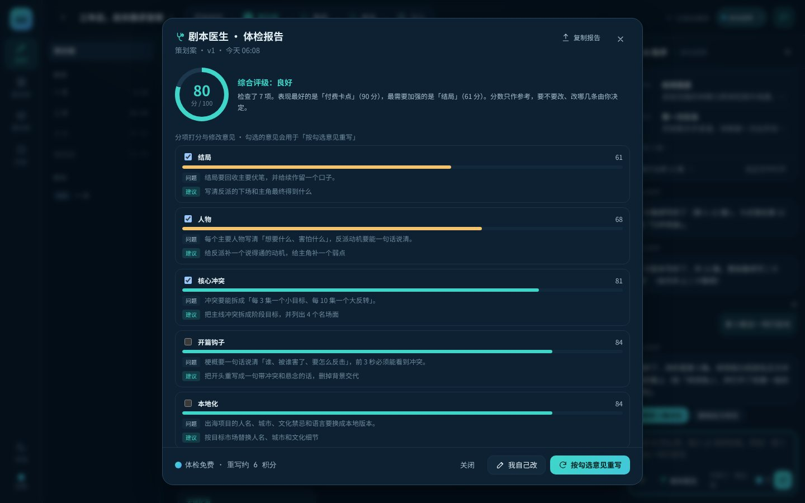

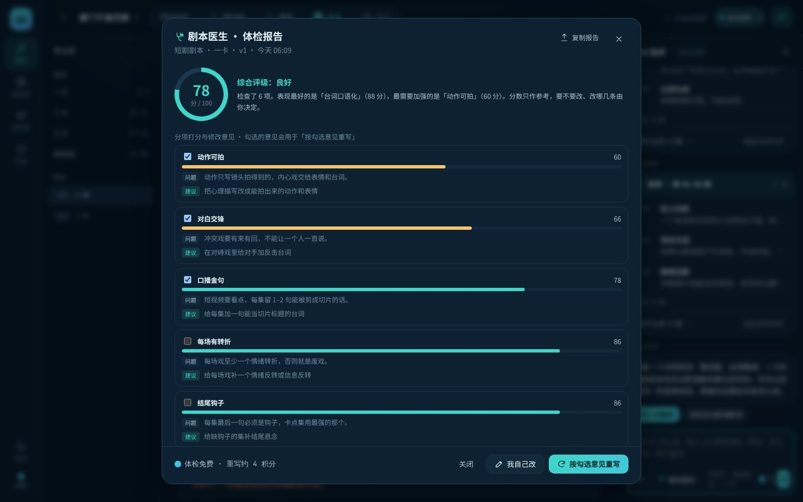

| 区块 | 内容 |
|---|---|
| 标题 | 🩺 剧本医生 · 体检报告；副标题「策划案 · v1 · 今天 01:12」；右上「复制报告」、× |
| 总分 | 环形分数（0–100）+ 「综合评级：良好」+ 说明「检查了 7 项。表现最好的是「付费卡点」（90 分），最需要加强的是「结局」（61 分）。分数只作参考，要不要改、改哪几条由你决定。」 |
| 和上一版对比 | 这一页之前在别的版本体检过时显示：「上次体检（v1）78 分 → 这次（v2）90 分 +12」，涨分绿色、降分红色 |
| 分项打分与修改意见 | 按分数从低到高排列。每项一张卡：勾选框 + 维度名 + 分数 + 进度条；「问题」一行说明标准；「建议」一行给具体改法。**默认勾选得分最低的 3 项**，用户可改 |
| 建议挂载的 Skill | 按最弱维度推荐最多 3 个，点一下加进 AI 助手输入框（侧边栏收起时自动打开） |
| 已定稿提示 | 页面已定稿时：「这一页已确认定稿，可以看报告；要重写或修改，先点右上角「继续编辑」。」勾选框和两个操作按钮置灰 |
| 底部 | 「体检免费 · 重写约 6 积分」（互动影游剧本为「重写按重新生成计费」）；关闭 / 我自己改 / 按勾选意见重写 |

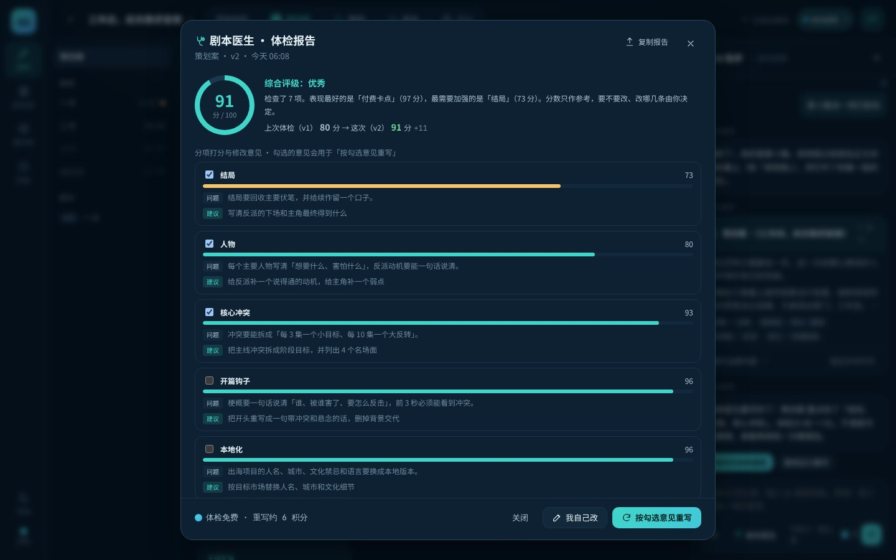

评级（只用于展示，不触发任何提示或弹窗）：

| 分数 | 评级 | 颜色 |
|---|---|---|
| ≥ 85 | 优秀 | 青 |
| 70–84 | 良好 | 青 |
| 60–69 | 及格 | 琥珀 |
| < 60 | 待加强 | 红 |

分项颜色：≥ 75 青、60–74 琥珀、< 60 红。

**检查维度与权重**（总分 = 各维度分数按权重加权平均；单项分数范围 35–97）：

| 页类型 | 维度（权重） |
|---|---|
| 策划案 | 开篇钩子（1.2）、故事主线（1.1）、人物（1.0）、核心冲突（1.0）、付费卡点（1.2）、结局（0.8）、本地化（0.6） |
| 集纲 | 开篇钩子（1.2）、每集钩子（1.2）、爽点密度（1.0）、卡点（1.1）、梗概写法（0.9） |
| 短剧剧本 | 台词口语化（1.2）、每场有转折（1.0）、结尾钩子（1.1）、动作可拍（0.9）、对白交锋（1.0）、口播金句（0.8） |
| 互动影游剧本 | 选择难度（1.2）、分支收束（1.1）、即时反馈（1.0） |

各维度的「问题」和「建议」示例：

| 维度 | 问题（标准） | 建议（改法） |
|---|---|---|
| 开篇钩子（策划案） | 梗概要一句话说清「谁、被谁害了、要怎么反击」，前 3 秒必须能看到冲突。 | 把开头重写成一句带冲突和悬念的话，删掉背景交代 |
| 付费卡点 | 卡点前一集先埋悬念，卡点集停在最想看下一集的瞬间。 | 明确三个卡点各停在哪一集、停在什么悬念上 |
| 每集钩子 | 每集结尾都留一个钩子，卡点集的钩子要最强。 | 给没留钩子的几集各补一句结尾悬念 |
| 台词口语化 | 台词用短句，一句只说一件事，超过 30 字就该拆。 | 把长台词拆成短句，删掉书面语 |
| 动作可拍 | 动作只写镜头拍得到的，内心戏交给表情和台词。 | 把心理描写改成能拍出来的动作和表情 |
| 选择难度 | 好的选择是两难：两个选项都要有代价。 | 把「一边倒」的选项改成各付代价 |

（完整文案见 Demo 代码 `docCheck`。正式版打分由模型按同一套维度和标准评分，Demo 用规则模拟。）

### 8.4 操作

| 按钮 | 行为 |
|---|---|
| 关闭 | 关闭报告，什么都不改 |
| 我自己改 | 关闭报告；把勾选的意见作为「剧本医生的修改清单（策划案）：1. 结局：写清反派的下场和主角最终得到什么 …」发到 AI 助手（侧边栏收起时自动打开），方便对照着改；Toast「在页面上点任意文字就能改，改完点「确认修改」」 |
| 按勾选意见重写 | 至少勾一条（否则 Toast「至少勾选一条修改意见」）。策划案 6 积分，集纲 / 剧本 4 积分（× 模型倍率）。按生成任务执行（进度：重新读一遍这一页 → 定位问题：结局、人物、核心冲突 → 按勾选的意见重写 → 调整节奏和钩子 → 收尾检查），完成后页面变「已编辑」、存新版本、按 6.3 传播；AI 助手提示「剧本医生重写好了：策划案 重点改了「结局、人物、核心冲突」，体检分 80 → 91。不满意可以撤销，或者再体检一次看报告。」+「查看新的体检报告」「撤销这次重写」。互动影游剧本按原配置重新生成，提示旧版本可在版本记录恢复 |
| 复制报告 | 复制纯文本报告：标题、版本、综合得分和评级、每个维度的分数 / 问题 / 建议 |


### 8.5 去掉的逻辑（相对 V21）

- 去掉：低于 60 分时报告顶部的红色警告「低于 60 分，问题集中在…」和「这一版不建议直接开拍，建议让剧本医生……重写一版」。
- 去掉：低于 60 分 / 高于 60 分两套不同的按钮文案和推荐（低分不推荐 Skill、低分默认勾 4 条等）。
- 去掉：内部调试面板的「模拟下一次剧本医生低于 60 分」。
- 统一为：任何分数都是同一份报告、同一组按钮、默认勾最低 3 项。

---

## 9. 剧本库、素材库、历史记录

### 9.1 剧本库

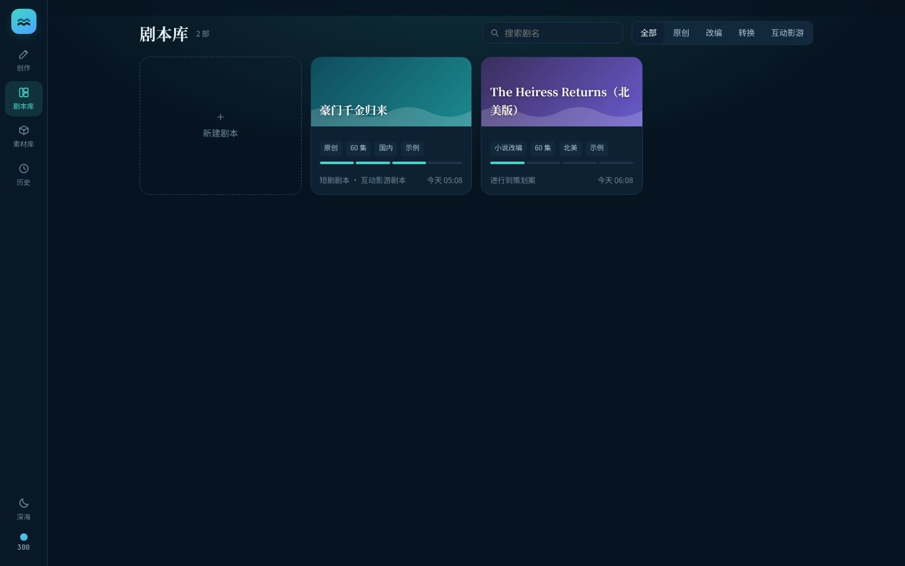

| 元素 | 规则 |
|---|---|
| 标题 | 剧本库 · N 部 |
| 搜索 | 按剧名搜索，输入后 250ms 刷新；无结果「没有找到「xx」」 |
| 筛选 | 全部 / 原创 / 改编 / 转换 / 互动影游 |
| 新建剧本 | 第一张卡，回到创作首页 |
| 项目卡 | 封面（渐变 + 海浪 + 剧名）；标签：类型、集数、市场、「示例」；进度点 4 格（策划案 / 集纲 / 剧本 / 导出）；底部：已有的剧本类型（短剧剧本 · 互动影游剧本）或「进行到 xx」+ 更新时间 |
| 打开项目 | 优先打开第一份短剧剧本，没有就打开第一段集纲，再没有就打开策划案 |

首次打开时放入 2 个示例项目（标「示例」）：《豪门千金归来》（策划案、全部集纲、一卡短剧剧本和互动影游剧本都已写好）、《The Heiress Returns（北美版）》（小说改编，只有策划案）。

### 9.2 素材库

**小说原文**：


| 元素 | 规则 |
|---|---|
| 卡片 | 书名、字数 · 章数、前 70 字预览、「用于《剧名》」或「还没用过」· 时间 |
| 来源 | 素材库里上传的 + 小说改编项目里用过的（同名合并，记录用在哪些项目） |
| 用它改编 | 回到首页，载入原文，切到小说改编模式；Toast「已载入《书名》，选好参数就能开始改编」 |
| 查看原文 | 弹窗显示全文 |
| 删除 | 点两次（第一次变成「确认删除」）。项目里带出来的小说不能删 |
| 上传 | 最后一张卡「上传小说原文（.txt / .md）」 |

**Skill**：


| 元素 | 规则 |
|---|---|
| 内置 9 个 | 黄金三秒开篇、爽点密度控制、付费卡点钩子、反转设计、人物弧光、海外本土化、互动分支设计、台词口语化、脑洞创意（v1.2 新增）。只能挂载 / 取消、查看说明 |
| 用户上传 | .md / .txt；状态：上传中 → 校验中 → 可用 / 校验失败（内容少于 10 字或超过 5 万字）；可用 ↔ 已停用；可删除（点两次确认） |
| 挂载 | 「挂载」=加到下次创作（首页 Skill chip），最多 5 个，已挂载显示「已挂载到下次创作」 |

### 9.3 历史记录


- 按天分组（今天 / 昨天 / 某月某日），最多保留 200 条。
- 每条：图标（生成 ✦ / AI 修改 💬）、做了什么（「生成了一卡集纲」「AI 修改短剧剧本 · 一卡：第 3 集加一场打脸戏」「导出了…」「把…恢复到第 2 版」「从《X》发起爆款转换」）、《剧名》· 模型 · 消耗积分 · 时间。
- 按钮：打开（进入项目对应页）、恢复此版本（见 5.11）。

---

## 10. 主题与视觉

| 主题 | 说明 |
|---|---|
| 深海（默认） | 深蓝底，青色强调色 |
| 晴空 | 白天浅色 |
| 护眼 | 低蓝光暖色 |

入口：左侧导航底部主题按钮 → 弹出三选一。选择会记住。


海洋元素：首页底部三层海浪缓慢漂移 + 14 个上浮气泡；生成进度条做成「水箱」注水样式。系统开启「减少动态效果」时关闭所有动画。

手机端（≤ 760px）：左侧导航变成底部标签栏；目录变成横向滚动条；顶栏隐藏剧名和保存状态。

{width=40%}

{width=40%}

---

## 11. 状态机定义

状态机是内部实现，**不直接展示给用户**。用户只看到简洁的状态标签和提示（见 11.7）。内部调试面板（⌘/Ctrl+Shift+D）可以看到每个产物的内部状态。


### 11.1 项目阶段（Project）


| 状态 | 中文 | 含义 |
|---|---|---|
| draft | 草稿 | 刚创建 |
| parsing | 解析中 | 小说 / 爆款 / 剧本解析中 |
| parse_failed | 解析失败 | 解析不成功 |
| planning | 策划案 | 进入策划案阶段 |
| outlining | 集纲 | 进入集纲阶段 |
| scripting | 剧本 | 进入剧本阶段（短剧或互动） |
| completed | 已导出 | 至少导出过一次 |

| 从 | 可以到 | 触发 |
|---|---|---|
| draft | parsing | 改编 / 转换 / 上传剧本项目创建 |
| draft | planning | 原创 / 互动一句话项目开始写策划案 |
| parsing | planning / parse_failed | 解析成功 / 失败 |
| parse_failed | parsing | 重新解析 |
| planning | outlining | 开始写集纲 |
| outlining | scripting | 开始写剧本或转互动 |
| scripting | completed | 复制导出内容 |

规则：阶段只前进不后退（例如已经在剧本阶段，再改策划案不会回到策划案阶段）。

### 11.2 产物（Artifact）

产物 = 一页内容：策划案、每段集纲 / 全部集纲、每份短剧剧本、每份互动影游剧本。


| 状态 | 中文（用户可见） | 含义 |
|---|---|---|
| empty | 未生成 | 还没写 |
| blocked | 等待前置 | 前一段集纲还没写完（只出现在按卡点分段的二卡及之后） |
| generating | 生成中 | 有任务在跑 |
| ready | 已生成 | AI 写完，没人改过 |
| edited | 已编辑 | 用户或 AI 修改过 |
| outdated | 待更新 | 上游改了，可能需要更新 |
| locked | 已确认 | 定稿 |
| error | 生成失败 | 第一次生成就失败（之前没有内容） |

| 从 | 可以到 |
|---|---|
| empty | generating、blocked |
| blocked | empty |
| generating | ready、error、empty（取消且之前没有内容） |
| ready | edited、outdated、locked、generating |
| edited | edited、outdated、locked、generating |
| outdated | generating、edited、locked |
| locked | ready、edited、outdated（继续编辑时按定稿前状态和期间的上游改动决定） |
| error | generating |

关键规则：

1. 重新生成失败或取消时，如果之前有内容，**回到生成前的状态，内容不变**（「生成失败，已保留上一版本，积分未扣除」）。
2. 前一段集纲生成成功 → 下一段从 blocked 变 empty。
3. 「保持不变」：outdated → edited。
4. 页面刷新时正在生成的产物：有内容回到生成前状态，没内容变 error（「页面刷新，生成中断」）。

### 11.3 生成任务（Task）


| 状态 | 中文 | 含义 |
|---|---|---|
| queued | 排队中 | 已提交（Demo 约 0.4 秒） |
| running | 生成中 | 有进度百分比和当前步骤文字 |
| succeeded | 成功 | 写入内容、扣积分、存版本、写历史 |
| partial | 部分成功 | 预留：长任务部分完成 |
| failed | 失败 | 不扣积分，记录原因（生成超时 / 页面刷新） |
| cancelled | 已取消 | 用户点取消，不扣积分 |

| 从 | 可以到 |
|---|---|
| queued | running、cancelled |
| running | succeeded、failed、cancelled、partial |
| partial | queued（继续） |
| failed | queued（重试） |

同一产物同时只能有一个任务；重复提交 Toast「正在生成中」。

### 11.4 结构校验（Validate，互动影游剧本）

| 状态 | 中文 | 用户可见 |
|---|---|---|
| unchecked | 未校验 | — |
| checking | 校验中 | — |
| valid | 通过 | ✓ 结构完整 |
| warning | 有警告 | ⚠ N 条提醒（可导出） |
| invalid | 有错误 | ⚠ N 处需修复（不可导出） |

流转：unchecked → checking → valid / warning / invalid；任何编辑后回到 unchecked 并立即重新校验。

### 11.5 Skill

| 状态 | 中文 | 说明 |
|---|---|---|
| uploading | 上传中 | 约 0.5 秒 |
| validating | 校验中 | 约 0.8 秒 |
| active | 可用 | 可挂载；上传成功时自动挂到当前创作（未满 5 个） |
| invalid | 校验失败 | 不可挂载、不可启用 |
| disabled | 已停用 | 停用时从当前创作的挂载里移除 |

流转：uploading → validating → active / invalid；active ↔ disabled。

### 11.6 解析（Parse）

| 状态 | 页面表现 |
|---|---|
| parsing | 解析进度卡 |
| done | 解析结果页 |
| parse_failed | 红色提示 + 重新解析 / 返回修改 |

### 11.7 页面状态的用户表现

| 内部状态 | 标题旁标签 | 目录图标 | 页面提示 | 可用操作 |
|---|---|---|---|---|
| empty | — | — | 「这一段还没有生成」 | 生成 |
| blocked | — | 整行置灰 | 「「一卡」写完后，这一段会接着往下写」 | 去前一段 |
| generating | — | 转圈 | 进度卡 | 取消 |
| ready | 已生成（绿） | — | 编辑提示条 | 全部 |
| edited | 已编辑 · v3（青） | — | 编辑提示条 | 全部 |
| outdated | 待更新（琥珀） | 琥珀点 | 琥珀提示条 | 重新生成 / 保持不变 / 全部 |
| locked | 🔒 已确认（白） | 锁 | 「已确认定稿……」 | 继续编辑、导出、查看、剧本医生只读 |
| error | 生成失败（红） | 红点 | 红色提示条 | 重新生成 |


### 11.8 字段编辑状态

| 状态 | 表现 | 退出方式 |
|---|---|---|
| clean | 正常 | 输入文字 → dirty |
| dirty（已修改未确认） | 琥珀底色 + 浮条 | 确认修改 / ⌘Ctrl+Enter → 保存；撤销 / Esc → 恢复；点页面「确认」→ 全部保存；改回原文 → 自动回到 clean |

### 11.8b 单集修改状态（集纲 / 短剧剧本）

| 状态 | 表现 | 进入 | 退出 |
|---|---|---|---|
| 原版 | 无标记 | 生成 / 重新生成 / 恢复版本 | AI 改了这一集 → 修改版 |
| 修改版 | 「修改版」标签；可对比、可恢复 | AI 修改、重写本集 | 恢复第一版 / 撤销 → 原版；整页重新生成 → 原版（新内容） |
| 对比展开 | 左右两栏（剧本对比时只读） | 点「对比第一版」或 AI 改完自动打开 | 点「收起对比」 |

### 11.9 流程控制状态

| 状态 | 含义 | 结束 |
|---|---|---|
| 一站直出中（autoRun） | 一句话生成在自动推进 | 全部完成 / 任一步失败 / 用户点「改为逐步确认」 |
| 自定义节点队列（nodeQueue） | 按勾选步骤自动推进 | 队列执行完 |
| 自动连续写（auto，全局） | 分段集纲 / 剧本写完自动写下一段 | 用户取消勾选 |

---

## 12. 积分与模型

### 12.1 模型

| 模型 | 说明 | 积分倍率 |
|---|---|---|
| 自动选择（默认） | 按任务匹配合适的模型 | × 1 |
| Gemini 3.1 Pro | 长上下文，适合整本小说改编 | × 1.5 |
| GLM-5.2 | 中文网文语感好 | × 1 |
| Claude Opus 5.5 | 人物与结构更细腻 | × 2 |
| DeepSeek | 速度快，成本低 | × 0.8 |
| 豆包 Seed | 短剧语料多，爽点密集 | × 1 |

模型面板底部注明「演示数据，实际可用模型以接入为准」。每次生成的版本记录和历史都记下用的模型。

### 12.2 积分消耗（基础值，再乘模型倍率，最少 1）

| 操作 | 积分 |
|---|---|
| 策划案（含全部重新生成） | 10 |
| 策划案局部重新生成 | 2 |
| 自动基础设定（自定义节点没勾策划案） | 0 |
| 一段集纲（n 集） | max(4, ⌈n/4⌉) |
| 短剧剧本（n 集） | max(6, ⌈n/2⌉) |
| 重写本集 | 1 |
| 互动影游剧本（任意范围） | 20 |
| AI 助手修改一次 | 2 |
| 剧本医生体检 | 0 |
| 剧本医生重写 | 策划案 6；集纲 / 剧本 4；互动影游按重新生成计 |
| 加更 n 集 | 集纲 max(4, 2n) + 剧本 2n |

规则：成功后才扣；失败、取消不扣；积分不够时不开始，Toast「积分不足：需要 N，剩余 M」。配置面板和弹窗底部显示预估积分。左侧导航底部显示剩余积分。

---

## 13. 异常与边界

| 场景 | 处理 |
|---|---|
| 生成失败（超时等） | 不扣积分；有旧内容则保留旧内容；没内容则页面显示失败提示 + 重新生成；AI 助手消息 + 重试；一站直出中止 |
| 用户取消生成 | 同上，Toast「已取消，积分未扣除」 |
| 生成中刷新页面 | 任务标记失败「页面刷新，生成中断」；解析中刷新 → 解析失败 |
| 生成中再次点生成 | Toast「正在生成中」 |
| 集纲还在生成时写那个范围的剧本 | Toast「集纲还在生成中，稍等一下」 |
| 范围内没有集纲 | 先按段补写缺的集纲（AI 助手提示「二卡还没有集纲，先补写集纲（第 13–35 集）」），再写剧本 |
| 范围起始 > 结束 | Toast「起始集不能大于结束集」 |
| 题材超过 3 个 / Skill 超过 5 个 | Toast「题材最多选 3 个」/「每次最多挂载 5 个 Skill」 |
| 选了不在 PE 范围的题材 | 不可点；Toast「当前的 PE 类型里没有这一项」 |
| 自定义节点全部取消 | Toast「至少保留一个节点」 |
| 直接编辑清空 | 不能确认 |
| 已定稿页面：AI 修改 / 剧本医生重写 / 恢复版本 / 调整卡点 | 拦截并提示先「继续编辑」 |
| 互动影游剧本已经续写到最后一段 | Toast「已经写到最后一段了」 |
| 互动剧本有结构错误时导出 | 拦截，引导去修复 |
| 历史里的项目已删除 | 不显示「打开」「恢复」 |
| 版本已不存在 | Toast「这个版本已经找不到了」 |
| 复制失败 | 选中文本，Toast「已选中，按 Ctrl/⌘ + C 复制」 |
| 文件读取 | 只读 .txt / .md 文本 |

---

## 14. 数据模型（供研发参考）

```
Project {
  id, mode: original | novel | benchmark | game, gen: quick | fine,
  params: { idea, novelName, novelText, benchText, gameText, conv, market, audience,
            genres[], styles[], episodes, skills[], nodes[], game: { src, cfg } },
  stage, title, cover, sample,
  cards: { c1, c2, c3 }, outlineMode: all | cards, baseEps,
  parseState, parseErr, parsed: { chapters | beats | scm ... },
  arts: { plan, all | c1, c2, c3, end },     // 策划案与集纲
  sc: { [rangeKey]: Artifact },              // 短剧剧本，rangeKey = full | c1… | r{a}_{b}
  ia: { [rangeKey]: Artifact },              // 互动影游剧本（extra: 续写并入的段）
  chat: [{ r: me | ai, t, acts[], at } | { r: ai, card: { t: plan | outline, key, title, d | eps[] }, at }],
  versions: { [artKey]: [{ v, at, label, model, data }] },
  undo: { key, data }, created, updated
}
Artifact { key, label, kind: plan | outline | segment | script | interactive,
           revs: { [epNo]: { orig: 第一版内容, n: 改了几次, by, note, at } },   // 修改版记录
           status, data, versions, task: { id, status, progress, line, err },
           prev, prevLock, notice, src, cfg, validate: { status }, issues[] }
History  { at, pid, title, what, key, v, cost, model, kind: gen | ai }
Skill    { id, name, desc, status, content, at }
Novel    { id, name, text, at }
```

正式版需要的后端能力：账号与项目存储（Demo 存在浏览器本地）、模型网关（按模型路由、计费）、长任务队列（支持取消、失败重试、断线恢复）、文件解析（txt / md / docx）、导出文件生成、剧本医生评分服务、结构校验（前后端共用）。

---

## 15. 非功能需求

| 项 | 要求 |
|---|---|
| 自动保存 | 每次改动 200ms 内保存；刷新后恢复到原来的项目和页面数据 |
| 长任务 | 进度可见（百分比 + 当前在写第几集）；可取消；失败不扣积分、不丢旧内容 |
| 性能 | 80 集集纲、80 集剧本页面滚动流畅；剧本树 200 个节点内拖拽缩放流畅 |
| 响应式 | 桌面 ≥ 1000px 三栏；761–1000px 三栏压缩；≤ 760px 手机布局，无横向滚动 |
| 可访问性 | 所有图标按钮有 aria-label；弹窗 aria-modal；滑杆支持键盘；尊重「减少动态效果」 |
| 文案 | 直白、短句、不出现内部术语（状态机、任务、产物等） |
| 版权 | 上传小说即声明拥有改编权；爆款转换显示相似度，海外本土化提示需要授权 |

---

## 附录 A：Demo 与正式版的差异

| 项 | Demo | 正式版 |
|---|---|---|
| AI 生成 | 模板模拟（女频 / 男频两套模板），速度加快 | 接入真实模型 |
| 剧本医生 | 规则打分 + 模拟重写 | 模型按同一套维度评分和重写 |
| 数据 | 浏览器本地存储（`lanmu-v3`） | 服务端存储 |
| 导出 | 只能复制 | 下载文件 |
| 积分 | 初始 300，调试面板可 +100 | 计费系统 |
| 调试面板 | ⌘/Ctrl+Shift+D：查看内部状态、模拟下一次生成失败、积分 +100、清空数据 | 仅内部环境 |
| 影游剧本（章节制） | 代码里保留了旧的「影游剧本」（关卡剧本 / 系统设计 / 拍摄清单），界面上没有入口 | 已与互动影游剧本合并，暂不区分 |

## 附录 B：截图索引

截图在 `docs/prd-img/`，按文中出现顺序编号。用 `demo/index.html` 可复现所有画面。
